# Machine Learning From Scratch: A Complete 134-Topic Study Guide

**Concepts • intuition • worked mathematics • Python • real-life examples • diagrams**

This is an original study guide organized around the 134 topic headings supplied by the reader. It is not a transcript or a claim to reproduce the corresponding CampusX videos. The chapter numbers preserve the supplied order. Related chapters deliberately build on one another.

The intended reader knows basic Python but may be new to statistics, calculus, and linear algebra. Read the explanations before running the code. Learning an algorithm means being able to explain what it learns, how training changes it, and how it predicts one unseen row.

## How to use this book

1. Read chapters 1–14 to understand the workflow and vocabulary.
2. Work through chapters 15–45 with a small DataFrame beside you.
3. Draw the geometry while studying chapters 46–81.
4. Compute the probability and SVM examples by hand in chapters 82–96.
5. Compare algorithms using the same split in chapters 97–134.
6. Finish the capstone in Appendix C. Return to the check questions in Appendix D.

A chapter's code block runs after the **shared setup** below unless it explicitly references an earlier chapter or is marked **optional**. Individual examples often redefine `X` and `y`; use a fresh notebook section rather than assuming they always refer to the same dataset. Toy data illustrate mechanisms; their scores are not evidence of real-world performance.

Mermaid diagrams render in compatible Markdown viewers. Equations use LaTeX math. On viewers without these features the underlying text remains available. No external image files are needed.

## Contents

- [1. What is Machine Learning?](#topic-1)
- [2. AI vs ML vs DL](#topic-2)
- [3. Types of Machine Learning](#topic-3)
- [4. Batch / offline learning](#topic-4)
- [5. Online learning](#topic-5)
- [6. Instance-based vs model-based learning](#topic-6)
- [7. Challenges in Machine Learning](#topic-7)
- [8. Real-life applications](#topic-8)
- [9. Machine Learning Development Life Cycle](#topic-9)
- [10. Data roles](#topic-10)
- [11. Tensors from scratch](#topic-11)
- [12. Anaconda, Jupyter, and Colab](#topic-12)
- [13. An end-to-end toy project](#topic-13)
- [14. Framing an ML problem](#topic-14)
- [15. Working with CSV files](#topic-15)
- [16. JSON and SQL](#topic-16)
- [17. Fetching data from an API](#topic-17)
- [18. Web scraping](#topic-18)
- [19. Understanding your data](#topic-19)
- [20. Univariate EDA](#topic-20)
- [21. Bivariate and multivariate EDA](#topic-21)
- [22. Automated profiling: pandas-profiling / YData Profiling](#topic-22)
- [23. What is feature engineering?](#topic-23)
- [24. Standardization](#topic-24)
- [25. Min-max, max-absolute, robust scaling, and row normalization](#topic-25)
- [26. Ordinal encoding and label encoding](#topic-26)
- [27. One-hot encoding](#topic-27)
- [28. ColumnTransformer](#topic-28)
- [29. Pipelines A–Z](#topic-29)
- [30. FunctionTransformer and simple transformations](#topic-30)
- [31. PowerTransformer: Box–Cox and Yeo–Johnson](#topic-31)
- [32. Binning and binarization](#topic-32)
- [33. Mixed variables](#topic-33)
- [34. Date and time variables](#topic-34)
- [35. Missing data and complete-case analysis](#topic-35)
- [36. Numerical imputation](#topic-36)
- [37. Missing categorical data](#topic-37)
- [38. Missing indicators and random-sample imputation](#topic-38)
- [39. KNN imputation](#topic-39)
- [40. MICE and IterativeImputer](#topic-40)
- [41. What are outliers?](#topic-41)
- [42. Z-score outlier detection](#topic-42)
- [43. IQR-based outlier detection](#topic-43)
- [44. Percentiles and winsorization](#topic-44)
- [45. Feature construction and splitting](#topic-45)
- [46. The curse of dimensionality](#topic-46)
- [47. PCA: geometric intuition](#topic-47)
- [48. PCA: formulation and a complete calculation](#topic-48)
- [49. PCA: code and visualization](#topic-49)
- [50. Simple linear regression: intuition and code](#topic-50)
- [51. Simple linear regression: mathematics and scratch implementation](#topic-51)
- [52. Regression metrics](#topic-52)
- [53. Multiple linear regression: geometry](#topic-53)
- [54. Multiple regression: matrix derivation](#topic-54)
- [55. Multiple regression from scratch](#topic-55)
- [56. Linear regression assumptions](#topic-56)
- [57. Gradient descent from scratch](#topic-57)
- [58. Batch gradient descent](#topic-58)
- [59. Stochastic gradient descent](#topic-59)
- [60. Mini-batch gradient descent](#topic-60)
- [61. Polynomial regression](#topic-61)
- [62. Bias–variance trade-off](#topic-62)
- [63. Ridge regression: intuition](#topic-63)
- [64. Ridge: closed form and scratch code](#topic-64)
- [65. Ridge with gradient descent](#topic-65)
- [66. Five key ridge points](#topic-66)
- [67. Lasso regression](#topic-67)
- [68. Why Lasso creates sparsity](#topic-68)
- [69. Elastic Net](#topic-69)
- [70. The perceptron trick](#topic-70)
- [71. Perceptron code from scratch](#topic-71)
- [72. Sigmoid: turning a score into a probability](#topic-72)
- [73. Maximum likelihood and binary cross-entropy](#topic-73)
- [74. Derivative of sigmoid](#topic-74)
- [75. Logistic gradient descent from scratch](#topic-75)
- [76. Accuracy, confusion matrix, Type I and Type II errors](#topic-76)
- [77. Precision, recall, and F1](#topic-77)
- [78. ROC curve and ROC-AUC](#topic-78)
- [79. Softmax / multinomial logistic regression](#topic-79)
- [80. Polynomial logistic regression](#topic-80)
- [81. Logistic regression hyperparameters](#topic-81)
- [82. Conditional probability](#topic-82)
- [83. Independent events](#topic-83)
- [84. Mutually exclusive events](#topic-84)
- [85. Bayes' theorem: counting intuition](#topic-85)
- [86. Another worked Bayes problem](#topic-86)
- [87. Naive Bayes intuition](#topic-87)
- [88. Naive Bayes mathematics and smoothing](#topic-88)
- [89. Naive Bayes code example](#topic-89)
- [90. Numerical features: Gaussian Naive Bayes](#topic-90)
- [91. K nearest neighbors](#topic-91)
- [92. SVM geometric intuition](#topic-92)
- [93. Hard-margin SVM and the route to alpha](#topic-93)
- [94. Soft-margin SVM, slack, and hinge loss](#topic-94)
- [95. Kernel trick: complete training-to-prediction connection](#topic-95)
- [96. Kernel SVM code, Gram matrix, and manual prediction](#topic-96)
- [97. Decision trees: geometry, entropy, Gini, and information gain](#topic-97)
- [98. Tree hyperparameters and overfitting](#topic-98)
- [99. Regression trees](#topic-99)
- [100. Tree visualization and dtreeviz](#topic-100)
- [101. Introduction to ensemble learning](#topic-101)
- [102. Voting: the core idea](#topic-102)
- [103. VotingClassifier: hard vs soft](#topic-103)
- [104. VotingRegressor](#topic-104)
- [105. Bagging intuition](#topic-105)
- [106. Bagging classifiers](#topic-106)
- [107. Bagging regressors](#topic-107)
- [108. Random forest intuition](#topic-108)
- [109. Why random forests often work well](#topic-109)
- [110. Bagging vs random forest](#topic-110)
- [111. Random forest hyperparameters](#topic-111)
- [112. GridSearchCV and RandomizedSearchCV](#topic-112)
- [113. OOB score](#topic-113)
- [114. Tree and forest feature importance](#topic-114)
- [115. AdaBoost geometric intuition](#topic-115)
- [116. AdaBoost step by step](#topic-116)
- [117. AdaBoost from scratch](#topic-117)
- [118. AdaBoost hyperparameters and search](#topic-118)
- [119. Bagging vs boosting](#topic-119)
- [120. Gradient boosting intuition](#topic-120)
- [121. Gradient boosting regression mathematics](#topic-121)
- [122. Gradient boosting classification](#topic-122)
- [123. Introduction to XGBoost](#topic-123)
- [124. XGBoost for regression](#topic-124)
- [125. XGBoost for classification](#topic-125)
- [126. The mathematics behind XGBoost](#topic-126)
- [127. Stacking and blending](#topic-127)
- [128. K-means clustering: geometric intuition](#topic-128)
- [129. K-means practical student example](#topic-129)
- [130. K-means from scratch](#topic-130)
- [131. Agglomerative hierarchical clustering](#topic-131)
- [132. DBSCAN](#topic-132)
- [133. Imbalanced data: undersampling, oversampling, and SMOTE](#topic-133)
- [134. Optuna and Bayesian optimization](#topic-134)

## Validation and compatibility note

This file contains **134 numbered chapters, 105 Python code blocks, and 12 self-contained Mermaid diagrams**. All Python blocks were syntax-checked. The 96 core blocks were executed successfully in the available environment; chapter examples were also checked in isolated chapter contexts using the shared setup and the explicitly stated chapter dependencies. The capstone executed successfully.

Nine integration blocks were not executed here because their optional packages or live services were unavailable: API requests, BeautifulSoup, YData Profiling, dtreeviz, three XGBoost examples, imbalanced-learn/SMOTE, and Optuna. They are explicitly identified with installation/setup guidance. Mermaid diagrams require a compatible Markdown renderer; plotting examples generate their figures when run.

## Shared setup and notation

### Environment

Use a supported Python version, preferably Python 3.11 or 3.12 for broad package compatibility. In a terminal:

```bash
python -m venv .venv
# macOS / Linux:
source .venv/bin/activate
# Windows PowerShell instead:
# .venv\Scripts\Activate.ps1
python -m pip install --upgrade pip
python -m pip install numpy pandas scipy matplotlib scikit-learn jupyterlab
jupyter lab
```

The numerical examples were checked with Python and the available environment: NumPy 2.3.5, pandas 2.2.3, scikit-learn 1.8.0. Optional integrations have separate dependencies and are identified where used. API references were consulted on 7 November 2026; a documentation site's moving `stable` URL can describe a different release than your installation. Check `sklearn.__version__` when diagnosing differences.

```python
import numpy as np
import pandas as pd
import matplotlib.pyplot as plt
from sklearn.model_selection import train_test_split, cross_val_score
from sklearn.pipeline import Pipeline, make_pipeline
from sklearn.preprocessing import StandardScaler
from sklearn.metrics import accuracy_score, mean_squared_error
from sklearn.linear_model import LinearRegression
from sklearn.impute import SimpleImputer

RANDOM_STATE = 42
rng = np.random.default_rng(RANDOM_STATE)
```

### The symbols, from scratch

| Symbol | Meaning | Example |
|---|---|---|
| $n$ | Number of rows / observations | 100 students |
| $d$ | Number of input features | Hours, attendance, previous score: 3 |
| $X\in\mathbb R^{n\times d}$ | Feature matrix | One row per student |
| $x_i\in\mathbb R^d$ | Features of row $i$ | $[4,85,70]$ |
| $x_{ij}$ | Feature $j$ of row $i$ | Attendance of student $i$ |
| $y_i$ | True target for row $i$ | Actual exam score |
| $\hat y_i$ | Model prediction | Predicted exam score |
| $w,b$ | Learned weights and intercept | $\hat y=w^Tx+b$ |
| $\theta$ | All learned parameters together | Weights plus intercept |
| $\eta$ | Learning rate | Size of an optimization step |
| $\lambda$ | Regularization strength in our formulas | Penalty against large weights |
| $L$ / $J$ | Per-example loss / aggregate objective | Squared prediction error |
| $\sum_i$ | Add over observations | Sum all row errors |
| $\|w\|_2^2$ | Sum of squared weights | $w_1^2+\cdots+w_d^2$ |

A **parameter** is learned during training, such as a slope. A **hyperparameter** is selected outside that fitting procedure, such as tree depth. A **feature** is information available when predicting. A **target** is what we want to predict. A **sample** is one observation.

The dot product $w^Tx=\sum_jw_jx_j$ is a weighted sum. With $w=[2,3]$ and $x=[4,5]$, it is $2(4)+3(5)=23$. Geometrically it measures alignment multiplied by vector lengths; it is not automatically a normalized similarity.

**The rule used throughout:** split first; learn preprocessing only from training data. Test rows are transformed using the training-fitted objects. Cross-validation must refit the entire preprocessing-and-model pipeline inside each fold. See [scikit-learn's pitfalls guide](https://scikit-learn.org/stable/common_pitfalls.html).

---

# Part I — Foundations and project thinking

<a id="topic-1"></a>

## 1. What is Machine Learning?

Machine learning builds a rule from examples instead of requiring a programmer to specify every case. Imagine estimating delivery time in Pune. A hand-written rule might say “distance × three minutes.” Real deliveries also depend on traffic, rain, restaurant preparation, and time of day. A learning algorithm searches for a function that relates recorded inputs to recorded delivery times.

The ingredients are **data**, a **model family**, an **objective**, and a **learning procedure**. For example, a straight-line model assumes $\hat y=wx+b$. Squared error says large mistakes are undesirable. Fitting chooses $w,b$ to reduce errors on the training examples. Prediction substitutes a new distance into the fitted formula.

| Distance (km) | Observed time (minutes) |
|---:|---:|
| 1 | 8 |
| 2 | 11 |
| 3 | 14 |

Here the exact rule is $\hat y=3x+5$. At 4 km, prediction is 17 minutes. Real data rarely lie perfectly on a line.

```python
from sklearn.linear_model import LinearRegression
X = np.array([[1.], [2.], [3.]])
y = np.array([8., 11., 14.])
m = LinearRegression().fit(X, y)
print(m.coef_, m.intercept_, m.predict([[4.]]))
# Approximately [3.], 5., [17.]
```

The central goal is **generalization**: doing well on new examples from the intended use case. Memorizing training rows is not sufficient. ML also does not establish causation: traffic and delay may correlate, but a prediction model alone does not prove the effect of changing one variable.

<a id="topic-2"></a>

## 2. AI vs ML vs DL

**Artificial intelligence** is the broad field of building systems that perform tasks associated with intelligent behavior. **Machine learning** is a major approach within AI that learns from data. **Deep learning** is ML using neural networks with multiple learned layers.

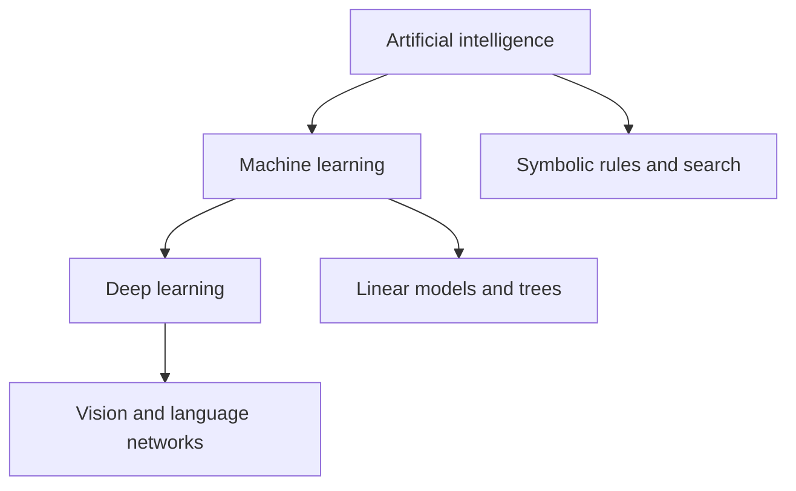

Think of an email assistant. A rule “reject attachments ending in `.exe`” is a programmed rule. A Naive Bayes spam detector learns word statistics and is ML. A multilayer language model learns representations from large text corpora and is DL. A complete product can combine all three.

Deep networks transform representations: pixels become edges, shapes, and task-relevant patterns. The word “deep” describes layers of computation, not guaranteed understanding or guaranteed superiority. For a modest table of sales records, a linear model or boosted trees may be a better starting point. Conversely, unstructured speech and images often benefit from learned representations.

A calculator is not ML simply because its output is complicated. The distinguishing question is whether its behavior was fitted from data.

<a id="topic-3"></a>

## 3. Types of Machine Learning

The main distinction is the **feedback available to the learner**.

| Type | Training information | Example | Typical output |
|---|---|---|---|
| Supervised | Inputs and desired answers | Past applications with repayment outcomes | Predicted amount/class |
| Unsupervised | Inputs without task labels | Customer purchase vectors | Clusters or components |
| Semi-supervised | A few labeled rows plus many unlabeled rows | A small labeled image set | Class predictions |
| Self-supervised | Targets constructed from the data itself | Predict masked words | Learned representations |
| Reinforcement | Rewards from interacting with an environment | Robot receives reward for reaching a goal | Policy for selecting actions |

Supervised **regression** predicts quantities, such as temperature. Supervised **classification** predicts categories, such as spam/not spam. Unsupervised clustering groups similar rows, but a cluster number is not a discovered ground-truth class name.

Reinforcement learning differs from ordinary labeled examples because actions influence future observations and rewards may be delayed. A navigation action can look unhelpful immediately but lead to a shorter route later. Exploration gathers information; exploitation uses current knowledge.

These categories overlap with other axes. A supervised model can be trained online or offline. A clustering system can use a model-based algorithm. “Online,” “supervised,” and “instance-based” answer different questions.

<a id="topic-4"></a>

## 4. Batch / offline learning

In batch learning, collect a dataset, fit a model, and deploy that fixed model. Later, retrain a new version using a new dataset. The deployed predictor does not normally update its weights each time it predicts.

A retailer could retrain a demand model every Sunday with the latest six months of sales. During the week it predicts without changing. This simplifies reproducibility: a model version corresponds to a particular dataset, code version, and configuration.

**Offline learning is not the same as batch gradient descent.** Offline describes the update schedule of the system; batch gradient descent describes how many training rows contribute to an optimization step. An offline neural network may use mini-batch gradient descent.

Advantages include repeatable evaluation and centralized quality control. Disadvantages include expensive retraining and delayed adaptation. A frozen model can deteriorate if customer behavior changes. Retraining should respond to measured performance and operational needs, not merely a calendar ritual.

```python
from sklearn.linear_model import LinearRegression
weekly_model = LinearRegression().fit([[1], [2], [3]], [8, 11, 14])
# Prediction does not refit:
print(weekly_model.predict([[5]]))
```

<a id="topic-5"></a>

## 5. Online learning

Online learning updates a model incrementally as new observations or small batches arrive. Imagine a spam filter adapting to a newly popular scam phrase without rebuilding from the complete historical mailbox.

```python
from sklearn.linear_model import SGDClassifier
online = SGDClassifier(loss="log_loss", random_state=42)
X1 = np.array([[0., 0.], [1., 1.], [0., 1.], [1., 0.]])
y1 = np.array([0, 1, 0, 1])
online.partial_fit(X1, y1, classes=np.array([0, 1]))
X2 = np.array([[0.2, 0.1], [0.9, 0.8]])
y2 = np.array([0, 1])
pred_before_update = online.predict(X2)
online.partial_fit(X2, y2)
```

`classes` on the first call establishes the label universe. Here the features are already on comparable scales. In a real stream, maintain training-only scaling carefully; changing the coordinate system after fitting weights requires care.

**Prequential evaluation** predicts each arriving batch before revealing its labels and updating. This respects time order. Labels may arrive late: credit outcomes can take months, so instantaneous updating may be impossible.

**Concept drift** means the relationship being predicted changes; **covariate drift** means the input distribution changes. Neither guarantees the same remedy. Updating on erroneous labels can rapidly damage an online model, so monitor data quality and keep recovery versions. “Online” does not mean “connected to the internet.”

<a id="topic-6"></a>

## 6. Instance-based vs model-based learning

Instance-based methods retain examples and use their relationship to a query. In KNN, a new house is compared with nearby houses; their prices supply the estimate. Model-based learning compresses the relationship into a fitted structure or parameters, such as a regression equation or decision tree.

For training points $(1,2),(2,4),(8,16)$, a one-neighbor predictor at $x=3$ returns 4 because $x=2$ is closest. A fitted line $y=2x$ returns 6. The former asks “what happened to a similar case?”; the latter asks “what does the learned rule predict?”

```python
from sklearn.neighbors import KNeighborsRegressor
X = np.array([[1.], [2.], [8.]])
y = np.array([2., 4., 16.])
print(KNeighborsRegressor(n_neighbors=1).fit(X, y).predict([[3.]]))
```

Instance-based does not mean “no assumptions”: distance, scaling, and neighborhood size strongly determine behavior. It often has cheap fitting but expensive prediction and storage. Model-based methods vary: a huge ensemble is not necessarily more compact than the original data. This is a useful conceptual contrast, not a strict memory guarantee.

<a id="topic-7"></a>

## 7. Challenges in Machine Learning

A model can be mathematically correct and operationally useless. Common failure sources are:

| Challenge | Concrete failure | Useful response |
|---|---|---|
| Unrepresentative data | Train only on urban deliveries, deploy in villages | Collect target-population coverage |
| Label noise | Different annotators use different definitions | Define and audit labels |
| Leakage | Use eventual refund status to predict purchase-time fraud | Restrict features to prediction time |
| Overfitting | Memorize unusual training rows | Validate and regularize |
| Underfitting | Fit a line to a curved pattern | Improve features/model capacity |
| Drift | New pricing changes customer behavior | Monitor and reassess |
| Wrong metric | High accuracy while missing every fraud | Match metric to costs |
| Deployment mismatch | Different units or category encoding | Package preprocessing with model |

A useful investigation sequence is: verify labels, verify the split, establish a baseline, inspect errors, then consider a more complex algorithm. Increasing model sophistication cannot repair a target that was defined inconsistently.

**Intuition:** preparing for an exam using leaked answer sheets produces an impressive practice score but says little about learning. Leakage creates that same illusion in ML.

<a id="topic-8"></a>

## 8. Real-life applications

ML is useful where examples contain learnable patterns and imperfect predictions still improve a decision.

| Application | Features | Target / objective | Practical concern |
|---|---|---|---|
| Retail demand | Past sales, price, holidays | Next-week units | Stockouts hide true demand |
| Fraud screening | Amount, device history | Fraud probability | Delayed labels and rare positives |
| Recommendations | User/item interactions | Ranking relevant items | Feedback and popularity bias |
| Predictive maintenance | Vibration, heat, usage | Failure risk | Rare failures and sensor drift |
| Document classification | Text features | Topic/category | Language and vocabulary change |
| Customer segmentation | Purchase behavior | Useful customer groups | Clusters need interpretation |

A prediction is usually one component of a decision. A demand forecast must feed an inventory policy that accounts for storage costs and uncertainty. A recommendation system changes what users see, which changes the future data collected. That feedback can amplify early mistakes.

Always ask what action changes because of the output. If no decision changes, a more accurate prediction may provide little value.

<a id="topic-9"></a>

## 9. Machine Learning Development Life Cycle

The lifecycle connects the business objective to continued measurement after deployment.

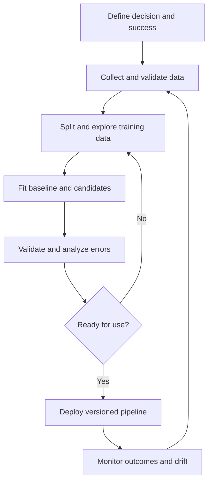

Suppose the goal is reducing late deliveries. Define “late” relative to a promised time and specify when a prediction is made. Collect only information available then. Split by time to imitate future operation. Compare against a baseline such as route-specific historical median. Measure both overall error and error on rainy evenings.

Validation guides model selection; the final test estimates performance of the selected process. After launch, track missing features, latency, prediction distributions, and eventual outcomes. Save preprocessing, model, feature schema, package versions, and training-data identifiers together.

Deployment does not finish the scientific question. The data-generation process can change when people start acting on predictions.

<a id="topic-10"></a>

## 10. Data roles

| Role | Primary responsibility | Example deliverable |
|---|---|---|
| Data engineer | Reliable data collection, movement, and storage | Tested daily transaction pipeline |
| Data analyst | Answer operational/business questions | Sales dashboard and explanation |
| Data scientist | Statistical analysis and predictive experimentation | Validated churn model and experiment |
| ML engineer | Reliable training/serving systems | Versioned model service and monitoring |

At a small company one person can do all four. At a large company the boundary may depend on team ownership. A data scientist still needs clean SQL; an ML engineer still needs to understand evaluation.

Consider churn prevention: the engineer ensures subscriptions and cancellations are joined correctly; the analyst identifies trends; the scientist defines the target and compares models; the ML engineer serves predictions consistently. Product owners decide whether an intervention is worthwhile, often using a controlled experiment. A job title alone does not determine the actual responsibilities.

<a id="topic-11"></a>

## 11. Tensors from scratch

In numerical ML, a tensor is a multidimensional array. Its **order**, often called tensor rank in this context, is the number of axes. This differs from matrix rank, which measures independent rows/columns.

| Object | Example shape | Meaning |
|---|---|---|
| Scalar | `()` | One temperature |
| Vector | `(3,)` | Three features |
| Matrix | `(100, 3)` | 100 rows × three features |
| Order-3 array | `(10, 24, 4)` | Ten stations × 24 hours × four readings |
| Order-4 array | `(32, 64, 64, 3)` | Batch of 32 RGB images |

```python
a = np.array(5.)
v = np.array([1., 2., 3.])
X = np.array([[1., 2., 3.], [4., 5., 6.]])
w = np.array([0.1, 0.2, 0.3])
print(a.ndim, v.shape, X.shape)
print(X @ w)  # shape (2,): [1.4, 3.2]
```

Matrix multiplication combines compatible inner dimensions: $(n,d)(d,)\to(n,)$. Elementwise multiplication `X * w` instead scales each column by its corresponding weight through broadcasting. `reshape` changes the arrangement of axes without inventing observations; it is not a statistical transformation. Check shapes before debugging formulas: many apparent mathematical errors are broadcasting errors.

<a id="topic-12"></a>

## 12. Anaconda, Jupyter, and Colab

A Python distribution supplies an interpreter and packages. Anaconda is one option; a standard Python virtual environment is another. Jupyter notebooks mix executable code cells with explanations and outputs. Google Colab runs hosted notebooks, which is convenient when local setup is inconvenient.

**With conda, in a terminal:**

```bash
conda create -n mlguide python=3.12 numpy pandas scipy matplotlib scikit-learn jupyterlab
conda activate mlguide
jupyter lab
```

Do not blindly mix several environment managers in the same environment. In a notebook, inspect which interpreter is actually running:

```python
import sys
import sklearn
print(sys.executable)
print(sklearn.__version__)
```

A notebook's visible cell order need not equal execution order. Running a cell that defines `X` twice can silently change later results. Use **Restart Kernel and Run All** to test reproducibility. In Colab, sessions can reset, so keep data and installation steps reproducible and save work deliberately. Avoid embedding passwords or API keys in notebook cells.

<a id="topic-13"></a>

## 13. An end-to-end toy project

We predict a numerical score from study hours. This synthetic example teaches procedure, not a credible theory of academic performance.

```python
from sklearn.linear_model import LinearRegression
from sklearn.dummy import DummyRegressor
from sklearn.metrics import mean_absolute_error

rng = np.random.default_rng(42)
hours = rng.uniform(0, 8, 120)
scores = 35 + 6 * hours + rng.normal(0, 5, 120)
X = pd.DataFrame({"hours": hours})
y = pd.Series(scores, name="score")
Xtr, Xte, ytr, yte = train_test_split(X, y, test_size=0.25, random_state=42)
base = DummyRegressor(strategy="mean").fit(Xtr, ytr)
model = LinearRegression().fit(Xtr, ytr)
for name, fitted in [("baseline", base), ("linear", model)]:
    print(name, mean_absolute_error(yte, fitted.predict(Xte)))
print(model.predict(pd.DataFrame({"hours": [4.]})))
```

The baseline predicts the training mean for everyone. The fitted model must improve on this useful point of comparison. MAE is measured in score points. We split before fitting, so the test targets do not influence the slope.

**Training:** `fit(Xtr, ytr)` estimates parameters. **Inference:** `predict(Xte)` uses frozen parameters. The algorithm does not read `yte` during prediction. A new row must have the same feature meaning and columns. Extrapolating to 25 study hours per day is nonsensical even though a line returns a number.

<a id="topic-14"></a>

## 14. Framing an ML problem

Begin with a decision statement: “At subscription renewal minus seven days, identify customers who may cancel so the team can offer relevant support.” This fixes the prediction time, observation unit, target window, and usable features.

Write down:

1. **Unit:** one customer-renewal event.
2. **Inputs:** activity in the preceding 30 days.
3. **Target:** cancellation within the following seven days.
4. **Decision:** whether to contact the customer.
5. **Baseline:** existing contact rule or constant prediction.
6. **Metric:** for example, recall within a fixed contact budget.
7. **Validation:** train on earlier renewals and evaluate on later ones.

A common mistake is using “days until cancellation,” which is unknown at prediction time. Another is splitting repeated rows from the same customer randomly across train and test when the intended evaluation is on entirely new customers. Choose group or temporal splits to match deployment.

Also separate prediction from intervention. A customer at high cancellation risk is not necessarily one whose behavior changes after a call. Measuring the causal benefit of outreach requires a suitable experiment or causal design.

---

# Part II — Collecting and understanding data

<a id="topic-15"></a>

## 15. Working with CSV files

CSV is a text table, not a complete type system. The separator, decimal notation, encoding, missing-value markers, and date formats affect interpretation. A customer ID `00123` should often remain a string.

```python
from io import StringIO
text = "customer_id,age,revenue\n001,24,1200\n002,,850\n003,31,NA\n"
df = pd.read_csv(StringIO(text), dtype={"customer_id": "string"}, na_values=["NA"])
print(df.dtypes)
print(df.isna().sum())
# A real file: pd.read_csv("sales.csv", usecols=["customer_id", "revenue"])
# For large data: iterate pd.read_csv("sales.csv", chunksize=100_000)
```

Inspect parsed results before modeling. If `revenue` contains currency symbols or commas, it may become text. Use explicit cleaning rather than assuming the parser inferred everything correctly. With `chunksize`, process every chunk or combine appropriately; one chunk is not the whole dataset. Do not silently skip malformed lines without understanding what population you removed.

When writing, `df.to_csv("clean.csv", index=False)` avoids exporting an unintended index column. Keep raw input immutable and record cleaning steps in code.

<a id="topic-16"></a>

## 16. JSON and SQL

JSON represents nested objects and lists; SQL queries structured tables. Flatten JSON only after understanding what constitutes one observation.

```python
import json
import sqlite3
raw = '[{"id":1,"profile":{"city":"Pune"},"sales":200},' \
      '{"id":2,"profile":{"city":"Mumbai"},"sales":300}]'
flat = pd.json_normalize(json.loads(raw))
print(flat)  # column profile.city

with sqlite3.connect(":memory:") as con:
    flat.rename(columns={"profile.city": "city"}).to_sql("sales", con, index=False)
    result = pd.read_sql_query(
        "SELECT city, sales FROM sales WHERE sales > ?", con, params=(220,)
    )
print(result)
```

An order with five items can become five rows after flattening. If you then count rows as customers, your analysis is wrong. Establish the table's **grain**: customer, order, or order item.

For SQL joins, check key uniqueness. Joining a customer table to two one-to-many tables can multiply rows and inflate totals. Parameterized queries avoid constructing SQL by string concatenation. Keep credentials outside notebooks and use read-only access when extracting data for analysis.

<a id="topic-17"></a>

## 17. Fetching data from an API

An API exposes structured data through requests and responses. The response may be JSON, but field definitions and pagination still matter.

**Optional dependency:** `python -m pip install requests`.

```python
import requests
response = requests.get(
    "https://api.github.com/repos/scikit-learn/scikit-learn",
    headers={"Accept": "application/vnd.github+json"},
    timeout=20,
)
response.raise_for_status()
record = response.json()
repo = pd.json_normalize(record)[["full_name", "stargazers_count"]]
print(repo)
```

This is a live request: counts change and internet access is required. In a real extraction, read the API documentation, follow pagination, respect rate limits, retry transient failures with bounded backoff, and cache raw responses with retrieval times. A successful HTTP status does not guarantee the returned schema matches expectations.

**Intuition:** an API is like asking a librarian for a structured catalogue record. Pagination means the librarian hands you one page, not the complete library. Tokens are credentials; read them from environment variables rather than committing them into code.

<a id="topic-18"></a>

## 18. Web scraping

Scraping extracts information from page content when structured access is unavailable. HTML tags organize the page; selectors identify elements. Prefer a documented API when one exists.

**Optional dependency:** `python -m pip install beautifulsoup4`.

```python
from bs4 import BeautifulSoup
html = '''<table id="products"><tr><th>Item</th><th>Price</th></tr>
<tr><td>Pen</td><td>10</td></tr><tr><td>Book</td><td>80</td></tr></table>'''
soup = BeautifulSoup(html, "html.parser")
rows = []
for tr in soup.select("#products tr")[1:]:
    item, price = [td.get_text(strip=True) for td in tr.select("td")]
    rows.append({"item": item, "price": float(price)})
print(pd.DataFrame(rows))
```

This local HTML example needs no live website. For actual sites, respect access rules, privacy, and request limits. Client-rendered content may not appear in the initial HTML; blindly changing selectors will not solve that. Selectors can break when a site redesigns, so validate expected row counts and fields. Save provenance and extraction dates. A scraped number without its unit, date, and definition is often unusable data.

<a id="topic-19"></a>

## 19. Understanding your data

Before plotting or fitting, inspect structure and meaning. `shape` answers how many rows and columns, not whether they are valid. `info()` reveals types and non-null counts. `describe()` summarizes distributions.

```python
df = pd.DataFrame({"age": [20, 22, 22, 400, np.nan],
                   "city": ["Pune", "Pune", "Mumbai", "Pune", None],
                   "amount": [100, 150, 150, 5000, 90]})
print(df.shape)
df.info()
print(df.describe(include="all"))
print(df.isna().mean())
print(df.duplicated().sum())
print(df["city"].value_counts(dropna=False))
```

Age 400 is suspicious, but a duplicate row may be legitimate if two customers have identical attributes. Define duplicate keys using business meaning rather than deleting all repeated values reflexively.

Ask: What does each row represent? What are the units? When were fields measured? How were labels obtained? Does a zero mean “none” or “not recorded”? Does “unknown” differ from missing? These questions prevent errors no visualization can repair. For predictive work, reserve the test set before extensive model-informing exploration.

<a id="topic-20"></a>

## 20. Univariate EDA

Univariate analysis studies one variable at a time. For numerical data inspect center, spread, shape, tails, and missingness. For categorical data inspect counts and rare levels.

```python
s = pd.Series([10, 11, 12, 12, 13, 14, 15, 60], name="delivery_minutes")
fig, ax = plt.subplots(1, 2, figsize=(8, 3))
ax[0].hist(s, bins=6, edgecolor="black")
ax[0].set_xlabel("Minutes")
ax[1].boxplot(s)
ax[1].set_ylabel("Minutes")
plt.tight_layout()
plt.show()
print("mean", s.mean(), "median", s.median())
```

The large value pulls the mean more strongly than the median. A histogram groups observations into intervals; changing bin width can reveal or hide structure. A KDE is a smoothed density estimate, not the true population distribution; its bandwidth controls smoothing. Density heights are not probabilities by themselves—areas over intervals are.

A boxplot's marked outliers are rule-based flags, not confirmed mistakes. Check whether a long delay is a genuine operational event. For a category, a bar plot is usually clearer than a histogram because categories are distinct groups.

<a id="topic-21"></a>

## 21. Bivariate and multivariate EDA

Bivariate analysis examines relationships between two variables; multivariate analysis considers additional context.

| Variable combination | Useful starting plot/statistic |
|---|---|
| Numeric + numeric | Scatter plot; Pearson or Spearman correlation |
| Category + numeric | Group summaries; boxplots |
| Category + category | Contingency table; conditional proportions |
| Several numeric variables | Pair plots; correlation matrix; grouped plots |

```python
df = pd.DataFrame({"hours": [1, 2, 3, 4, 5, 6],
                   "score": [42, 48, 53, 66, 67, 76],
                   "group": ["A", "A", "B", "A", "B", "B"]})
print(df.groupby("group")["score"].agg(["count", "mean", "median"]))
print(df[["hours", "score"]].corr())
plt.scatter(df["hours"], df["score"])
plt.xlabel("Study hours"); plt.ylabel("Score"); plt.show()
```

Correlation is not causation, and Pearson correlation can miss nonlinear relationships: $Y=X^2$ with symmetric $X$ has strong dependence but can have near-zero correlation. Group composition can reverse an apparent relationship, a phenomenon associated with Simpson's paradox. Inspect denominators: 80 successes out of 100 is different evidence from 4 out of 5, despite equal proportions.

<a id="topic-22"></a>

## 22. Automated profiling: pandas-profiling / YData Profiling

Automated profiling generates descriptive summaries, missingness patterns, and relationship warnings. The older `pandas-profiling` package name was succeeded by `ydata-profiling`; old import paths and dependency assumptions may fail in a modern environment. See the [official quickstart](https://docs.profiling.ydata.ai/).

**Optional; install in a compatible separate environment if dependencies conflict:**

```bash
python -m pip install ydata-profiling
```

```python
# Optional integration; df must be your training DataFrame.
from ydata_profiling import ProfileReport
profile = ProfileReport(df, title="Training data profile", minimal=True)
profile.to_file("training_profile.html")
```

A report is an assistant to investigation. A high correlation warning does not tell you whether a feature leaks future information. A missingness chart does not establish why values are missing. Profiling a huge wide table can be costly; start with a representative training sample and a minimal report.

Review generated HTML before sharing because it can contain actual values and identifiers. Keep the test set out of repeated model-development decisions. If an older tutorial produces a Pydantic dependency error, creating a clean compatible environment is preferable to repeatedly downgrading unrelated packages in your main environment.

---
# Part III — Feature engineering and data preparation

<a id="topic-23"></a>

## 23. What is feature engineering?

Feature engineering converts available raw information into a representation that makes useful relationships easier to learn. It includes selecting, cleaning, transforming, combining, and encoding inputs.

For delivery prediction, a timestamp can become hour-of-day, weekday, and holiday indicator. Total price and item count can become average item value. These features express hypotheses about the process. A linear model can use a constructed interaction `rain × distance` to represent the idea that distance matters more in rain.

```python
df = pd.DataFrame({"distance": [2., 5., 8.], "rain": [0, 1, 1],
                   "total": [200., 500., 150.], "items": [2, 5, 0]})
df["rain_distance"] = df["rain"] * df["distance"]
df["price_per_item"] = df["total"] / df["items"].replace(0, np.nan)
```

A feature must be computable at prediction time. “Average customer spending” must use only history available then, not their later purchases. Target-based encodings and aggregate features need particularly careful fold and time boundaries.

**Intuition:** choosing a useful representation is like giving directions using landmarks instead of raw GPS bytes. The destination is unchanged, but the task becomes easier. More features are not automatically better: noisy, redundant, and leaking features can make validation misleading or increase variance.

<a id="topic-24"></a>

## 24. Standardization

Standardization expresses a value in units of training-set standard deviation:

$$z=\frac{x-\mu_{train}}{\sigma_{train}}.$$

For training values $[10,20,30]$, the mean is 20 and the population standard deviation is approximately 8.165. The transformed values are $[-1.225,0,1.225]$. A future value 40 becomes 2.449 using **the same** mean and scale.

```python
from sklearn.preprocessing import StandardScaler
sc = StandardScaler()
print(sc.fit_transform([[10.], [20.], [30.]]).ravel())
print(sc.transform([[40.]]).ravel())
```

`StandardScaler` uses a population-variance convention (`ddof=0`). It does not make a skewed distribution Gaussian; it only shifts and rescales it. Values are not constrained to $[-1,1]$.

Why it matters: distance-based methods otherwise let large-unit features dominate, and gradient descent can move inefficiently through elongated loss contours. In regularized linear models, scale changes how strongly each coefficient is effectively penalized. A decision tree's axis thresholds generally do not require scaling.

For sparse matrices, centering destroys sparsity; `StandardScaler(with_mean=False)` can preserve sparse structure. Fit the scaler inside the pipeline and cross-validation folds.


### Why scaling changes optimization geometry

Suppose one feature is study hours, typically 0–8, while another is annual spending, typically 0–100,000. A small coefficient change on spending can change predictions enormously, while the same coefficient change on hours has a small effect. The objective is therefore much more curved in one weight direction than the other. Contours of equal loss look like a narrow elongated ellipse rather than a nearly circular bowl.

Gradient descent moves perpendicular to a local contour, so it may repeatedly cross the narrow valley instead of progressing along it. Rescaling columns makes the parameter directions more comparable and often permits a larger stable learning rate. This is a numerical-conditioning issue, not evidence that spending is inherently more informative.

For unregularized linear regression with an intercept, invertible column rescaling leaves the set of representable predictions unchanged. Coefficients change units, but the best fitted predictions can remain the same. For ridge and Lasso, rescaling also changes the penalty's meaning unless adjusted; their predictions can change because the training objective changed.

<a id="topic-25"></a>

## 25. Min-max, max-absolute, robust scaling, and row normalization

“Normalization” is used loosely. Distinguish column rescaling from dividing each sample by its own vector norm.

| Transform | Formula | Main effect |
|---|---|---|
| Min-max | $(x-a)/(b-a)$, training min/max | Maps training range to $[0,1]$ |
| Max-absolute | $x/\max|x|$ | Preserves zeros and signs |
| Robust | $(x-\operatorname{median})/IQR$ | Reduces dependence on extreme training values |
| Row L2 normalization | $x_i/\|x_i\|_2$ | Retains direction, removes row magnitude |

```python
from sklearn.preprocessing import MinMaxScaler, MaxAbsScaler, RobustScaler, Normalizer
A = np.array([[10.], [20.], [30.], [1000.]])
for cls in [MinMaxScaler, MaxAbsScaler, RobustScaler]:
    print(cls.__name__, cls().fit_transform(A).ravel())
print(Normalizer().fit_transform([[3., 4.]]))  # [[0.6, 0.8]]
```

With an extreme maximum of 1000, min-max scaling squeezes ordinary values together. Robust scaling is less driven by that maximum, but it does not delete outliers or bound all outputs. A future min-max value outside the observed training range can transform below zero or above one unless clipping is explicitly enabled.

For document vectors, row normalization can compare relative word composition rather than document length. For sales forecasting, removing total magnitude may discard the main signal. Choose a transformation based on what the feature's magnitude means.

<a id="topic-26"></a>

## 26. Ordinal encoding and label encoding

Ordinal categories have meaningful order: `low < medium < high`. Encoding them as 0, 1, 2 preserves order but introduces equal numerical spacing. For a linear model, moving low→medium then medium→high has the same effect unless you create a different representation.

```python
from sklearn.preprocessing import OrdinalEncoder, LabelEncoder
enc = OrdinalEncoder(categories=[["low", "medium", "high"]],
                     handle_unknown="use_encoded_value", unknown_value=-1)
print(enc.fit_transform([["medium"], ["low"], ["high"]]))
labels = LabelEncoder()
print(labels.fit_transform(["spam", "ham", "spam"]))
print(labels.classes_)
```

`LabelEncoder` is intended for a one-dimensional target `y`, not arbitrary input columns. Many scikit-learn classifiers can use string targets directly. `OrdinalEncoder` works on feature columns.

Do not encode unordered cities as Pune=0, Mumbai=1, Delhi=2 for a distance-based model and assume nothing changed. That invents an order and distances. Unknown=-1 is a deliberate fallback, not a meaningful “lower than low” business category; its effect depends on the downstream model. One-hot encoding is a safer baseline for nominal categories.

<a id="topic-27"></a>

## 27. One-hot encoding

For $K$ categories, create $K$ indicator columns. A city becomes a vector specifying category membership.

| City | Mumbai | Pune | Surat |
|---|---:|---:|---:|
| Pune | 0 | 1 | 0 |
| Mumbai | 1 | 0 | 0 |
| Surat | 0 | 0 | 1 |

```python
from sklearn.preprocessing import OneHotEncoder
enc = OneHotEncoder(handle_unknown="ignore", sparse_output=False)
A = enc.fit_transform(pd.DataFrame({"city": ["Pune", "Mumbai", "Surat"]}))
print(enc.get_feature_names_out())
print(A)
print(enc.transform(pd.DataFrame({"city": ["Delhi"]})))
```

Under `handle_unknown="ignore"`, an unseen category becomes all zeros for that feature. This is a fallback, not learned knowledge about Delhi. Current versions use `sparse_output`; older videos may use the renamed `sparse` argument. See the [official encoder reference](https://scikit-learn.org/stable/modules/generated/sklearn.preprocessing.OneHotEncoder.html).

With an intercept, all dummy columns are linearly dependent because their sum is one. For unregularized coefficient interpretation, dropping one category can define a reference group. Keeping all columns is often fine for prediction with regularization; dropping is not a universal rule. High-cardinality columns can create huge matrices, so consider infrequent-category grouping or other carefully validated encodings.

<a id="topic-28"></a>

## 28. ColumnTransformer

Different columns require different operations. A `ColumnTransformer` routes columns into parallel preprocessing branches and joins the outputs in a consistent order.

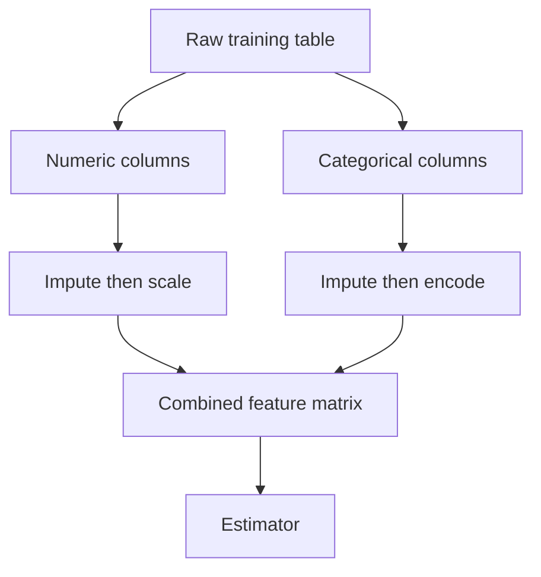

```python
from sklearn.compose import ColumnTransformer
from sklearn.impute import SimpleImputer
from sklearn.preprocessing import OneHotEncoder
numeric = Pipeline([("impute", SimpleImputer(strategy="median")),
                    ("scale", StandardScaler())])
categorical = Pipeline([("impute", SimpleImputer(strategy="most_frequent")),
                        ("encode", OneHotEncoder(handle_unknown="ignore"))])
pre = ColumnTransformer([
    ("num", numeric, ["age", "income"]),
    ("cat", categorical, ["city"]),
], remainder="drop")
```

This block defines the recipe; it does not yet fit it. `remainder="drop"` discards unlisted columns. Accidental exclusion of a useful column is possible, so inspect `get_feature_names_out()` after fitting. Conversely, `passthrough` can accidentally admit IDs or future-derived columns. The output may be sparse if one-hot encoding produces many zeros. Pick downstream estimators that accept the resulting representation.


### Trace one row through both branches

Suppose the training numerical median age is 30, training mean income is 50,000, and training income scale is 10,000. A new row has age missing, income 60,000, city Pune. The numeric branch fills age with 30 and applies its fitted scaling; income becomes $(60000-50000)/10000=1$. The categorical branch maps Pune using its previously learned category ordering.

The two resulting arrays are concatenated **by column**, not by row. If the numeric branch creates two columns and the category branch creates three, one raw row becomes one row with five numerical entries. The estimator's five coefficients correspond to those five transformed columns. Inspecting feature names is how you connect a coefficient back to its meaning.

During cross-validation, every fold has its own fitted median, means, scales, and vocabulary. The validation fold must use those fold-training objects, not a single preprocessing object fitted before the folds were created.

<a id="topic-29"></a>

## 29. Pipelines A–Z

A pipeline makes preprocessing and estimation one fitted object. Calling `fit` first fits/transforms each preprocessing step, then fits the final estimator. Calling `predict` only transforms using those fitted steps and calls the estimator.

```python
from sklearn.linear_model import LogisticRegression
# Uses pre defined in chapter 28.
X = pd.DataFrame({"age": [20, 30, 40, 23, 50, 36, 27, 44],
                  "income": [20, 40, np.nan, 25, 65, 48, 29, 55],
                  "city": ["Pune", "Mumbai", "Pune", "Surat"] * 2})
y = np.array([0, 0, 1, 0, 1, 1, 0, 1])
pipe = Pipeline([("prepare", pre), ("model", LogisticRegression(max_iter=1000))])
pipe.fit(X, y)
print(pipe.predict(X.iloc[:2]))  # Training predictions: demonstration only.
print(pipe.named_steps["prepare"].get_feature_names_out())
```

For evaluation, pass the whole pipeline to cross-validation. If you scale or impute the complete dataset first, each validation fold has influenced preprocessing. Pipelines prevent this common leakage when used correctly.

Nested hyperparameters use `step__parameter`, for example `model__C` or `prepare__num__impute__strategy`. Persist the entire fitted pipeline so production applies exactly the same category mapping and scaling. Pipelines do not automatically fix future-derived raw features, incorrect joins, or an inappropriate split; those errors occur upstream.

<a id="topic-30"></a>

## 30. FunctionTransformer and simple transformations

A transformation changes a feature's mathematical representation. A logarithm compresses ratios: 10→100 and 100→1000 are equal increases on a log10 scale. This can represent diminishing returns.

| Transform | Domain | Typical intuition |
|---|---|---|
| $\log x$ | $x>0$ | Multiplicative differences become additive |
| $\log(1+x)$ | $x>-1$ | Handles zero-valued nonnegative features |
| $\sqrt x$ | $x\ge0$ | Mild compression of large counts |
| $1/x$ | $x\ne0$ | Inverse relationships; unstable near zero |

```python
from sklearn.preprocessing import FunctionTransformer
log1p = FunctionTransformer(np.log1p, inverse_func=np.expm1,
                           feature_names_out="one-to-one", validate=True)
print(log1p.fit_transform([[0.], [9.], [99.]]))
```

Unlike a fitted scaler, `np.log1p` has no data-estimated parameters, but keeping it in a pipeline preserves deployment consistency. A log does not guarantee normality or better prediction. For targets, transforming $y$ changes the loss being optimized: exponentiating a predicted mean log-value does not generally recover the original-scale conditional mean. Evaluate in the units that matter, and consider retransformation bias.

<a id="topic-31"></a>

## 31. PowerTransformer: Box–Cox and Yeo–Johnson

Power transforms select a parameter $\lambda$ to change distributional shape. Box–Cox for strictly positive $x$ is

$$T_\lambda(x)=\begin{cases}(x^\lambda-1)/\lambda,&\lambda\ne0\\\log x,&\lambda=0.\end{cases}$$

This family includes approximate square-root behavior at $\lambda=1/2$ and logarithms at zero. Yeo–Johnson extends the idea to zero and negative values through a piecewise definition. It is useful when adding an arbitrary constant just to permit logarithms would be hard to justify.

```python
from sklearn.preprocessing import PowerTransformer
positive = np.array([[1.], [2.], [3.], [10.], [50.]])
pt = PowerTransformer(method="box-cox", standardize=True)
print(pt.fit_transform(positive).ravel())
print("learned lambda", pt.lambdas_)
print(PowerTransformer(method="yeo-johnson").fit_transform([[-3.], [0.], [2.], [20.]]))
```

The default also standardizes transformed features. Fit $\lambda$ on training data. A feature that appears more symmetric is not automatically more useful; tree models may gain little from monotone transformations. The algorithm is not a universal outlier treatment, and a degenerate constant column needs appropriate handling.

<a id="topic-32"></a>

## 32. Binning and binarization

Binning replaces a continuous value with an interval identity. Ages might become 0–17, 18–35, and 36+. Binarization asks whether a value exceeds one threshold.

| Binning strategy | How boundaries are chosen | Main limitation |
|---|---|---|
| Uniform width | Equal numeric interval widths | Sparse bins in skewed tails |
| Quantile | Roughly equal observation counts | Unequal widths; tied values matter |
| K-means | Centers fitted to the values | Depends on distribution and fit |
| Domain-defined | Business/scientific thresholds | Requires a defensible rationale |

```python
from sklearn.preprocessing import KBinsDiscretizer, Binarizer
A = np.array([[10.], [12.], [15.], [20.], [40.], [100.]])
bins = KBinsDiscretizer(n_bins=3, encode="ordinal", strategy="uniform")
print(bins.fit_transform(A).ravel())
print(Binarizer(threshold=18).transform(A).ravel())
```

Ages 19 and 34 can become identical after binning, while 17.9 and 18.1 can become sharply different. Binning trades resolution for a simpler piecewise representation. For linear models, one-hot bins allow different interval effects; ordinal bin numbers impose a linear trend across bin indices. Learn empirical bin boundaries within training folds.

<a id="topic-33"></a>

## 33. Mixed variables

A mixed variable uses one field for several kinds of information. A room column might contain `"12"`, `"7"`, `"unknown"`, and `"not_assigned"`. Converting every nonnumeric entry to zero confuses actual room zero with several distinct conditions.

```python
s = pd.Series(["12", "7", "unknown", "not_assigned", None], dtype="string")
features = pd.DataFrame({
    "room_number": pd.to_numeric(s, errors="coerce"),
    "room_status": s.where(pd.to_numeric(s, errors="coerce").isna(), "numeric"),
})
print(features)
```

Now numeric magnitude and exceptional status can be processed separately. But ask whether magnitude means anything: a hotel room identifier 512 is usually an ID, not five times room 102. Splitting floor and wing may be more meaningful than treating room number continuously.

Preserve the distinction between “not applicable,” “not measured,” and “unknown” when it can affect interpretation. Decide the representation using domain meaning, then fit numerical imputation and categorical encoding within the pipeline. Avoid a huge one-hot column for every unique identifier unless memorization is explicitly part of the intended task.

<a id="topic-34"></a>

## 34. Date and time variables

Dates contain trend, seasonality, duration, and ordering. Useful features include weekday, hour, time since previous event, and account age **as of prediction time**.

```python
s = pd.to_datetime(pd.Series(["2026-01-01T23:00:00Z", "2026-01-02T00:00:00Z"]), utc=True)
local = s.dt.tz_convert("Asia/Kolkata")
out = pd.DataFrame({"weekday": local.dt.dayofweek, "hour": local.dt.hour})
out["hour_sin"] = np.sin(2 * np.pi * out["hour"] / 24)
out["hour_cos"] = np.cos(2 * np.pi * out["hour"] / 24)
print(out)
```

Why sine and cosine? Hours 23 and 0 are close in daily time, although their integer values are far apart. Mapping hours to a circle preserves wraparound. Both coordinates are needed to distinguish all positions on the circle.

Use a consistent timezone, especially around daylight-saving changes outside India. A feature such as “days since signup” must use the historical prediction date, not today's date during retrospective training. Random splits often overestimate forecasting performance; use time-aware splits and ensure rolling statistics do not include the current target or future observations.

<a id="topic-35"></a>

## 35. Missing data and complete-case analysis

Missingness is a data-generation problem before it is an imputation problem.

| Mechanism | Informal meaning | Example |
|---|---|---|
| MCAR | Missingness unrelated to observed or unobserved values | A truly random sensor-upload failure |
| MAR | Missingness explained by observed information | Income response depends on recorded age |
| MNAR | Missingness still depends on the missing value | Highest incomes less likely to be reported |

Complete-case analysis deletes rows with missing required fields. Under strong conditions, such as MCAR with a suitable analysis, it can preserve validity, but it loses information. Under selection-related missingness, it can distort the population. The mechanism usually cannot be conclusively identified from observed values alone.

```python
df = pd.DataFrame({"age": [20, np.nan, 40], "income": [30., 45., np.nan]})
print(df.dropna())
print("fraction retained", len(df.dropna()) / len(df))
```

Even modest per-column missingness can eliminate many rows in a wide table. Examine retained versus removed groups before deciding. Do not fill an absent target with a feature-imputation method and pretend it became an observed label. Resolve missing targets through a task-specific strategy.

<a id="topic-36"></a>

## 36. Numerical imputation

Simple imputation fills missing numerical entries with a training-fitted statistic. Mean imputation minimizes squared deviations from a constant; median is more robust to extreme values.

```python
from sklearn.impute import SimpleImputer
A = np.array([[10.], [20.], [np.nan], [100.]])
mean_imp = SimpleImputer(strategy="mean").fit(A)
median_imp = SimpleImputer(strategy="median").fit(A)
print(mean_imp.transform(A).ravel())  # missing -> 43.333...
print(median_imp.transform(A).ravel())  # missing -> 20
```

A filled value is an estimate, not newly observed truth. Replacing every missing entry by the mean creates a pile-up at that mean, typically reduces variance, and can distort covariance. A downstream model can benefit from a missingness indicator when absence itself is informative.

Compare strategies using validation performance, stability, and domain plausibility. A constant such as zero may be meaningful for “no previous orders” but wrong for “income not provided.” Impute before scaling in ordinary pipelines, and do not refit imputation on the test batch. Features entirely missing during fitting require an explicit schema policy; inspect `keep_empty_features` behavior in your installed version.

<a id="topic-37"></a>

## 37. Missing categorical data

For categorical inputs, common approaches are filling with the most frequent training category or adding an explicit missing category.

```python
A = np.array([["Pune"], ["Mumbai"], [np.nan], ["Pune"]], dtype=object)
mode = SimpleImputer(strategy="most_frequent")
missing = SimpleImputer(strategy="constant", fill_value="__MISSING__")
print(mode.fit_transform(A).ravel())
print(missing.fit_transform(A).ravel())
```

Most-frequent filling strengthens the dominant category and erases the information that the value was absent. An explicit missing category preserves absence but can overfit a temporary collection artifact. If data capture changes after deployment, missingness effects may stop generalizing.

Normalize missing markers first: the strings `"?"`, `"NA"`, an empty string, and actual `np.nan` are different objects until cleaned. Choose a missing-category token that cannot collide with a genuine category. Then one-hot encode with an unknown-category policy for future data.

<a id="topic-38"></a>

## 38. Missing indicators and random-sample imputation

A missing indicator is 1 when a value was absent and 0 otherwise. It allows a model to distinguish “known median income” from “unknown income filled with the median.”

```python
A = np.array([[10.], [np.nan], [30.]])
imp = SimpleImputer(strategy="median", add_indicator=True)
print(imp.fit_transform(A))  # value column plus missing flag

s = pd.Series([10., 20., np.nan, 50., np.nan])
rng = np.random.default_rng(42)
filled = s.copy()
mask = s.isna()
filled.loc[mask] = rng.choice(s.dropna().to_numpy(), size=mask.sum(), replace=True)
print(filled)
```

Random-sample imputation draws observed training values. It can approximately preserve a marginal distribution, but it does not preserve the right conditional relationship with other features. Drawing an income for a student from the entire population may be implausible. Sampling also adds randomness: fix a seed for reproducibility and never draw donors from the test set.

Indicators generated by `SimpleImputer` normally correspond to features missing during fitting; a new kind of missingness at deployment needs a deliberate schema strategy. For statistical inference, one randomly filled dataset is not multiple imputation and does not quantify imputation uncertainty.

<a id="topic-39"></a>

## 39. KNN imputation

KNN imputation estimates a missing feature using rows similar on the features both rows have observed. If two people have similar age and spending, one person's known income may help estimate the other's.

For a pair of rows, scikit-learn's missing-aware Euclidean distance rescales the sum over common observed features by the ratio of total to common feature count, then takes the square root. Pairs without shared observations have undefined distance; fallback behavior handles insufficient neighbors.

```python
from sklearn.impute import KNNImputer
# Two comparable-scale measurements; third row's second measurement is absent.
A = np.array([[1., 2.], [2., 4.], [1.1, np.nan], [8., 16.]])
print(KNNImputer(n_neighbors=2, weights="distance").fit_transform(A))
```

The missing value will be influenced strongly by the nearby first row. Scale matters: if one feature is in thousands and another in fractions, distance can be dominated by units. Use a training-fitted NaN-tolerant scaling strategy where appropriate, and avoid confusing a mechanically reversible scaling with a meaningful distance metric.

KNN imputation is more expensive than filling a median and can struggle in high dimensions or when most useful comparison features are absent. It cannot invent a reliably observed relationship where the data provide none.

<a id="topic-40"></a>

## 40. MICE and IterativeImputer

Chained-equation imputation treats each incomplete feature as a prediction task using the others.

1. Initialize missing cells with simple estimates.
2. Choose one incomplete column, say income.
3. Train a regression on rows where income is observed, using other columns.
4. Predict income for rows where it is absent.
5. Repeat for other columns and cycle until a stopping condition.

```python
from sklearn.experimental import enable_iterative_imputer  # enables import below
from sklearn.impute import IterativeImputer
A = np.array([[20., 30., 2.], [30., 45., np.nan],
              [40., np.nan, 4.], [50., 75., 5.], [60., 90., 6.]])
imp = IterativeImputer(max_iter=20, random_state=42)
print(imp.fit_transform(A))
```

This can exploit multivariate relationships but depends on the imputation models and missingness assumptions. Numeric encodings of arbitrary categories do not turn them into appropriate continuous regression targets.

**Important distinction:** a default `IterativeImputer` run returns one completed dataset. Classical multiple imputation generates several plausible completed datasets and combines the resulting analyses to represent uncertainty. Repeating stochastic imputation with posterior sampling is part of such a workflow, but proper pooling and assumptions still matter. More complicated imputation is not automatically better; compare against a median-plus-indicator baseline.


### A tiny chained-equation example

Consider three columns: age, experience, and salary. One row has age 30, experience 8, salary missing. Another has age 40, experience missing, salary known. Initial median filling gives temporary values for both missing entries. A salary regression is fitted using rows with observed salary; it predicts a revised salary for the first row from age and current experience. Next, an experience regression uses observed experience rows and predicts the second row's experience using age and its salary.

On the next cycle, the revised experience values can alter salary predictions, and vice versa. Originally observed values stay observed; the procedure updates the cells that were missing, rather than repeatedly overwriting genuine measurements. This iterative use of provisional values is what “chained” describes.

The process may converge numerically while still being statistically inappropriate—for example, if missing salaries are systematically the highest salaries and the observed data cannot reveal that pattern. Convergence is about the algorithm's updates, not proof that missingness bias disappeared.

<a id="topic-41"></a>

## 41. What are outliers?

An outlier is unusual relative to a reference distribution or relationship. It may be a data-entry error, a rare legitimate event, or the exact event you are trying to detect.

A sale of ₹1,000,000 may be extreme among retail purchases but ordinary for wholesale. A temperature of 40°C may be normal for one sensor and abnormal for another. A row can be ordinary in every individual column yet unusual jointly—for example, very high expenditure with extremely low recorded activity.

Distinguish **outliers in features**, **large target residuals**, and **high-leverage points**. In regression, an extreme input can strongly influence the fitted slope, especially when it also has an unusual target.

The workflow is: flag → investigate provenance and context → decide whether to correct, keep, transform, clip, or use a robust model. Never remove a point solely because it lowers model accuracy. In fraud detection, deleting unusual transactions may delete the positives. Learn statistical thresholds on training data and preserve a documented deployment policy.

<a id="topic-42"></a>

## 42. Z-score outlier detection

A z-score measures distance from a mean in standard-deviation units:

$$z_i=(x_i-\mu)/\sigma.$$

For approximately Gaussian data, $|z|>3$ is a conventional flag because about 0.27% of an ideal Gaussian population lies outside three standard deviations. This is a heuristic threshold, not a universal anomaly probability.

```python
s = pd.Series([98., 99., 100., 101., 102., 150.])
mu, sigma = s.mean(), s.std(ddof=0)
z = (s - mu) / sigma
print(pd.DataFrame({"value": s, "z": z, "flag": z.abs() > 3}))
```

Notice that this tiny dataset may not flag 150: the extreme value itself raises the mean and standard deviation. This **masking** illustrates why a rule is not a substitute for context. For skewed data, three standard deviations has no Gaussian tail interpretation.

If filtering training rows, apply the same row mask to both `X` and `y`. Do not silently delete difficult test cases: that changes the evaluation population. Consider robust statistics or robust losses when unusual values are valid.

<a id="topic-43"></a>

## 43. IQR-based outlier detection

The interquartile range is $IQR=Q_3-Q_1$. A conventional boxplot rule flags values below $Q_1-1.5IQR$ or above $Q_3+1.5IQR$.

For training quartiles 20 and 40, IQR=20, so fences are −10 and 70. An observation 100 is flagged. The rule uses central quantiles, so a single extreme maximum usually changes it less than it changes the mean and standard deviation.

```python
s = pd.Series([10., 20., 25., 30., 35., 40., 100.])
q1, q3 = s.quantile([0.25, 0.75])
iqr = q3 - q1
lo, hi = q1 - 1.5 * iqr, q3 + 1.5 * iqr
print(s[(s < lo) | (s > hi)])
```

Quantile definitions can differ slightly between tools, especially in tiny datasets. A skewed population can legitimately produce many upper-fence flags. If IQR is zero, as with a highly concentrated count feature, the resulting rule can be unhelpful. Fences describe one variable's distribution; they do not detect every multivariate anomaly.

<a id="topic-44"></a>

## 44. Percentiles and winsorization

Percentile clipping caps extreme values at selected training quantiles. If the training 1st and 99th percentiles are 5 and 200, clipping maps −20 to 5 and 500 to 200. Rows remain, but their exact tail magnitude is lost.

```python
train = pd.Series([1., 2., 3., 4., 5., 6., 7., 8., 100.])
lo, hi = train.quantile([0.10, 0.90])
print(train.clip(lo, hi))
test = pd.Series([-10., 200.])
print(test.clip(lo, hi))  # uses training bounds
```

**Trimming** removes observations; **winsorization** replaces tail values. They answer different questions and affect the target population differently. Clipping may stabilize a model exposed to occasional sensor glitches, but it can erase severity information in a risk model.

A percentile rule always focuses on a fraction of the observed distribution, even when no data are erroneous. Choose bounds using domain meaning and training validation, record how many points are affected, and do not recompute bounds separately on each incoming test batch.

<a id="topic-45"></a>

## 45. Feature construction and splitting

Construction combines existing information into new features. Splitting extracts interpretable components from a composite field.

```python
df = pd.DataFrame({"family_adults": [2, 1], "children": [1, 0],
                   "cabin": ["B-42", "C-17"], "spend": [900., 200.]})
df["family_size"] = df["family_adults"] + df["children"]
df["spend_per_person"] = df["spend"] / df["family_size"].replace(0, np.nan)
parts = df["cabin"].str.split("-", n=1, expand=True)
df["deck"] = parts[0]
df["cabin_number"] = pd.to_numeric(parts[1], errors="coerce")
print(df)
```

A ratio can expose behavior independent of group size; an interaction can expose a dependence between features. But ratios are unstable when denominators approach zero. Differences and durations require consistent units and timezones.

A useful feature encodes a defensible relationship, not just a clever formula. Validate the contribution by comparing pipelines with and without it on the same splits. Aggregate constructions must use past/training-only information. Splitting a string must tolerate malformed and missing values rather than failing on the first unexpected record.

---

# Part IV — Dimensionality and PCA

<a id="topic-46"></a>

## 46. The curse of dimensionality

As dimensions increase, space expands and observations become sparse. Suppose each feature is divided into ten intervals. Covering all combinations takes $10^d$ cells: 100 cells for two features, one billion for nine. A fixed dataset touches a smaller fraction of possible combinations.

Another view: a region occupying 10% of each axis occupies $0.1^d$ of a uniform hypercube's volume. To capture 10% of the volume in ten dimensions, a centered box must span about $0.1^{1/10}\approx79.4\%$ of each axis. “Local” neighborhoods become broad.

Distance can become less informative when many irrelevant features contribute noise. This particularly affects KNN, K-means, and density estimation. It is not a theorem that every high-dimensional dataset is impossible: useful data can lie near a lower-dimensional manifold or have sparse predictive structure.

```python
rng = np.random.default_rng(42)
for d in [2, 20, 200]:
    A = rng.normal(size=(1000, d))
    dist = np.linalg.norm(A - A[0], axis=1)[1:]
    print(d, dist.std() / dist.mean())
```

The relative spread often shrinks in this synthetic setting. Remedies include collecting more data, removing irrelevant features, regularization, and dimensionality reduction. PCA preserves variance, not guaranteed predictive information.

<a id="topic-47"></a>

## 47. PCA: geometric intuition

Principal component analysis finds orthogonal directions along which centered data vary most. Imagine photographing a thin pencil: looking along its length makes it appear as a dot; looking perpendicular shows most of its shape. PCA chooses informative viewing axes for a point cloud.

If height and weight increase together, the two-dimensional cloud may stretch diagonally. PC1 follows that stretch; PC2 is perpendicular. Projecting onto PC1 keeps each point's coordinate along the main direction and discards its perpendicular deviation.

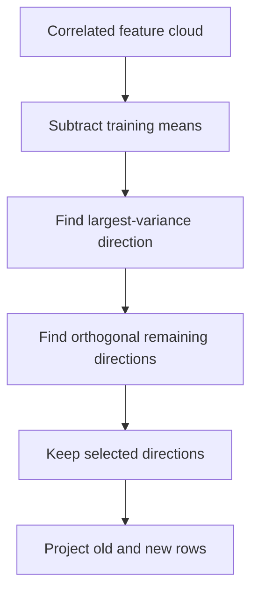

PCA rotates the representation; selecting fewer components also compresses it. A component is usually a combination of original features, not a selected original column. PC1 is not automatically “the most important predictor of y,” because PCA does not inspect `y`.

Scale is crucial. If income is measured in rupees and age in years, unscaled variance may be dominated by income. Standardize when equalizing feature scales makes scientific sense. Sometimes original variance units are meaningful; scaling is a modeling decision.

<a id="topic-48"></a>

## 48. PCA: formulation and a complete calculation

Given centered rows in $X_c$, choose a unit direction $v$ to maximize projected variance:

$$\max_{\|v\|=1}v^TSv,\qquad S=\frac{X_c^TX_c}{n-1}.$$

The length constraint prevents making variance arbitrarily large merely by multiplying $v$. A Lagrange multiplier gives $Sv=\lambda v$: eigenvectors are the candidate axes, eigenvalues are their variances. Choose the largest eigenvalue first. Later axes are constrained to be orthogonal to previous ones.

Take rows $(1,1),(2,2),(3,3)$. Their mean is $(2,2)$, so

$$X_c=\begin{bmatrix}-1&-1\\0&0\\1&1\end{bmatrix},\quad
S=\begin{bmatrix}1&1\\1&1\end{bmatrix}.$$

The unit vectors are $v_1=(1,1)/\sqrt2$ with eigenvalue 2 and $v_2=(1,-1)/\sqrt2$ with eigenvalue 0. The compressed coordinates are

$$z=X_cv_1=[-\sqrt2,0,\sqrt2]^T.$$

Reconstruction using one component is $\hat X=zv_1^T+\mu$. Here it is exact because all points lie on one line. In ordinary data the discarded eigenvalues represent lost variance and squared reconstruction error under this orthogonal projection.

The explained-variance ratio for component $j$ is $\lambda_j/\sum_k\lambda_k$. Keeping 95% variance does not mean keeping 95% accuracy. A low-variance direction can contain the label signal. Eigenvector signs are arbitrary: $v$ and $-v$ describe the same axis.

<a id="topic-49"></a>

## 49. PCA: code and visualization

```python
from sklearn.decomposition import PCA
rng = np.random.default_rng(42)
x = rng.normal(size=200)
A = np.column_stack([x, 2 * x + rng.normal(0, 0.25, 200)])
pca = PCA(n_components=1)
Z = pca.fit_transform(A)
Ahat = pca.inverse_transform(Z)
print("components", pca.components_)
print("variance retained", pca.explained_variance_ratio_)
plt.scatter(A[:, 0], A[:, 1], alpha=0.4, label="Original")
plt.scatter(Ahat[:, 0], Ahat[:, 1], s=10, label="1-PC reconstruction")
plt.axis("equal"); plt.legend(); plt.show()

# From scratch using SVD:
mu = A.mean(axis=0)
U, singular_values, Vt = np.linalg.svd(A - mu, full_matrices=False)
Z_manual = (A - mu) @ Vt[:1].T
variance = singular_values**2 / (len(A) - 1)
print(variance / variance.sum())
```

SVD is a numerically useful way to compute PCA without explicitly forming the covariance matrix. `PCA` centers inputs but does not automatically standardize them; add `StandardScaler` in a pipeline when appropriate. Component signs may differ between implementations while projections describe the same geometry. For prediction tasks, fit scaler and PCA only within training folds. See the [PCA reference](https://scikit-learn.org/stable/modules/generated/sklearn.decomposition.PCA.html).

---
# Part V — Regression, optimization, and regularization

<a id="topic-50"></a>

## 50. Simple linear regression: intuition and code

Simple linear regression predicts a numerical target from one feature:

$$\hat y_i=wx_i+b.$$

The slope $w$ is the predicted target change per one-unit input increase. The intercept $b$ is the prediction at zero input; it may have little practical meaning if zero is outside the meaningful range.

Imagine predicting monthly electricity cost from usage. The intercept can represent a fixed charge and the slope a cost per unit. Real tariffs can be nonlinear, so this is an approximation.

```python
from sklearn.linear_model import LinearRegression
X = np.array([[1.], [2.], [3.], [4.]])
y = np.array([2., 3., 5., 4.])
reg = LinearRegression().fit(X, y)
print(reg.coef_, reg.intercept_)  # [0.8], 1.5
print(reg.predict([[5.]]))  # [5.5]
plt.scatter(X[:, 0], y)
plt.plot(X[:, 0], reg.predict(X), color="red")
plt.xlabel("x"); plt.ylabel("y"); plt.show()
```

Ordinary least squares minimizes the sum of squared **vertical** residuals $y_i-\hat y_i$, not perpendicular point-to-line distances. Squaring prevents positive and negative residuals from canceling and gives large errors more influence. The best fit can still make errors on every row; “best” means best within the chosen model family and objective.

<a id="topic-51"></a>

## 51. Simple linear regression: mathematics and scratch implementation

Minimize $J(w,b)=\frac1n\sum_i(y_i-wx_i-b)^2$. At the minimum, derivatives vanish. The intercept equation gives $b=\bar y-w\bar x$. Substituting into the slope equation yields

$$w=\frac{\sum_i(x_i-\bar x)(y_i-\bar y)}{\sum_i(x_i-\bar x)^2},\qquad b=\bar y-w\bar x.$$

The numerator measures co-movement; the denominator measures how much input variation is available to estimate a slope. For $x=[1,2,3,4]$, $y=[2,3,5,4]$, means are 2.5 and 3.5. Numerator=4 and denominator=5, so $w=0.8$, $b=1.5$. Predictions are $[2.3,3.1,3.9,4.7]$.

```python
x = np.array([1., 2., 3., 4.])
y = np.array([2., 3., 5., 4.])
den = np.sum((x - x.mean())**2)
if den == 0:
    raise ValueError("Cannot identify slope when all x values are equal")
w = np.sum((x - x.mean()) * (y - y.mean())) / den
b = y.mean() - w * x.mean()
print(w, b, w * x + b)
```

No iteration is needed for this one-feature closed form. With constant $x$, many slope/intercept pairs yield the same predictions, so the slope is not identifiable. Library solvers handle general matrix problems more robustly than manually applying formulas to arbitrary data.

<a id="topic-52"></a>

## 52. Regression metrics

Let $e_i=y_i-\hat y_i$.

| Metric | Definition | Interpretation |
|---|---|---|
| MAE | $\frac1n\sum|e_i|$ | Average absolute error in target units |
| MSE | $\frac1n\sum e_i^2$ | Squared-unit error; emphasizes large misses |
| RMSE | $\sqrt{MSE}$ | Target-unit measure with squared-error emphasis |
| $R^2$ | $1-\frac{\sum e_i^2}{\sum(y_i-\bar y)^2}$ | Improvement over the evaluation-set mean benchmark |
| Adjusted $R^2$ | $1-(1-R^2)\frac{n-1}{n-d-1}$ | Classical complexity adjustment when $n>d+1$ |

For actual $[2,4,6]$ and predicted $[3,4,4]$, errors are $[-1,0,2]$. MAE=1, MSE=$5/3$, RMSE≈1.291, and $R^2=1-5/8=0.375$.

```python
from sklearn.metrics import mean_absolute_error, r2_score
actual = np.array([2., 4., 6.]); predicted = np.array([3., 4., 4.])
print(mean_absolute_error(actual, predicted))
print(mean_squared_error(actual, predicted)**0.5)
print(r2_score(actual, predicted))
```

$R^2$ can be negative, especially on unseen data; it is not “percentage accuracy.” Constant targets need special handling. Adjusted $R^2$ is not a replacement for validation, particularly for regularized or flexible models with ambiguous effective degrees of freedom. Use business-relevant units and inspect error slices.


### Why squared loss predicts a mean and absolute loss predicts a median

At a fixed feature value, imagine the possible targets are 10, 10, and 100. Choosing one constant under squared loss gives the mean 40: its squared errors sum to $30^2+30^2+60^2=5400$. Choosing 10 gives squared error 8100. Under absolute loss, choosing 10 gives total error 90, while choosing 40 gives 120. The median is therefore better for absolute loss.

This matters when interpreting model outputs. A squared-error regression estimates a conditional mean under suitable conditions; an absolute-error model targets a conditional median. A mean forecast can exceed most observed outcomes in a strongly right-skewed distribution without being an arithmetic mistake. Choose a loss consistent with the decision's costs rather than assuming all “regression predictions” summarize the same quantity.

<a id="topic-53"></a>

## 53. Multiple linear regression: geometry

With $d$ features,

$$\hat y=b+w_1x_1+\cdots+w_dx_d.$$

For two features this is a plane over the feature space; for more it is a hyperplane. Predicting price from area and age allows price to rise with area while falling with age.

```python
X = np.array([[500., 1.], [700., 5.], [900., 2.], [1100., 10.], [800., 7.]])
y = 100 + 0.2 * X[:, 0] - 3 * X[:, 1]
m = LinearRegression().fit(X, y)
print(m.coef_, m.intercept_)  # approximately [0.2, -3], 100
print(m.predict([[1000., 4.]]))  # 288
```

The coefficient 0.2 means “change area by one unit while holding the other modeled features fixed.” It is a conditional association, not automatically a causal effect. If area and age are correlated, interpreting coefficients independently requires care.

There is a second geometry: treat each feature column as a vector in $n$-dimensional observation space. Least squares projects the target vector onto the span of the design-matrix columns. The residual is orthogonal to that span at an unregularized optimum. This explains the normal equations next.

<a id="topic-54"></a>

## 54. Multiple regression: matrix derivation

Add an all-ones column to absorb the intercept:

$$\tilde X=[\mathbf1\;X],\quad\theta=[b,w_1,\ldots,w_d]^T,\quad\hat y=\tilde X\theta.$$

The objective is $J=\frac1{2n}\|\tilde X\theta-y\|^2$. Its gradient is

$$\nabla J=\frac1n\tilde X^T(\tilde X\theta-y).$$

Setting it to zero gives the normal equations

$$\tilde X^T\tilde X\theta=\tilde X^Ty.$$

If the columns are independent, the formal solution is $(\tilde X^T\tilde X)^{-1}\tilde X^Ty$. Do not use explicit inversion as the default numerical implementation: it is unnecessary and can worsen conditioning. Use a least-squares solver or pseudoinverse.

**Shape check:** $(d+1,n)(n,d+1)(d+1,1)=(d+1,1)$. Every feature contributes one equation through its relationship with the residuals. If two columns are exact copies, there is no unique way to distribute their combined effect between their coefficients, although predictions can still be identified.

<a id="topic-55"></a>

## 55. Multiple regression from scratch

```python
class OLSFromScratch:
    def fit(self, X, y):
        X = np.asarray(X, dtype=float)
        y = np.asarray(y, dtype=float)
        design = np.column_stack([np.ones(len(X)), X])
        self.theta_, _, self.rank_, self.singular_values_ = np.linalg.lstsq(
            design, y, rcond=None
        )
        return self

    def predict(self, X):
        X = np.asarray(X, dtype=float)
        return np.column_stack([np.ones(len(X)), X]) @ self.theta_

X = np.array([[1., 0.], [2., 1.], [0., 2.], [3., 1.], [2., 3.]])
y = 4 + 2 * X[:, 0] - X[:, 1]
scratch = OLSFromScratch().fit(X, y)
reference = LinearRegression().fit(X, y)
print(scratch.theta_)  # [4, 2, -1]
assert np.allclose(scratch.predict(X), reference.predict(X))
```

This is “from scratch” at the estimator level: NumPy still supplies a stable linear-algebra routine. Implementing a robust SVD solver is a different numerical-analysis project. Inspect rank and singular values to detect deficient or nearly redundant designs. A perfect fit here is intentional synthetic data, not a general expectation. For generalization, repeat with noise and held-out rows.

<a id="topic-56"></a>

## 56. Linear regression assumptions

Separate assumptions needed to fit an equation, obtain good predictions, and make classical statistical inference.

1. **Linear conditional mean:** $E[Y\mid X]=b+Xw$ under the specified features. Polynomial features can model curves while retaining parameter linearity.
2. **Exogeneity:** $E[\epsilon\mid X]=0$. Omitted confounders or measurement issues can violate this.
3. **No perfect multicollinearity:** unique individual OLS coefficients require independent design columns.
4. **Independent errors / suitable dependence treatment:** time-series or grouped data can violate classical independent-error formulas.
5. **Constant error variance:** homoscedasticity supports conventional standard-error calculations. Heteroscedasticity calls for appropriate inference or weighting.

Normal errors are useful for exact small-sample classical tests and intervals, but normal **features** are not an OLS requirement. OLS can be computed without normal errors. Residual normality is also not a guarantee of valid causal interpretation.

Inspect residuals versus fitted values for curves or changing spread; inspect dependence in time-ordered residuals; check influential observations. Diagnostics suggest problems rather than proving assumptions. Robust standard errors can adjust some uncertainty estimates but do not repair a misspecified conditional mean or leakage.

<a id="topic-57"></a>

## 57. Gradient descent from scratch

Gradient descent minimizes an objective by moving opposite its gradient. For a one-variable function, the derivative tells how the function changes for a small positive input movement. A positive derivative means moving left locally decreases the objective.

For $J(w)=(w-3)^2$, $J'(w)=2(w-3)$. With $w_0=0$ and $\eta=0.1$:

$$w_1=0-0.1(-6)=0.6,\quad w_2=0.6-0.1(-4.8)=1.08.$$

Updates approach 3. A very large step can overshoot repeatedly or diverge.

```python
w = 0.
history = []
for _ in range(50):
    history.append((w, (w - 3)**2))
    w -= 0.1 * 2 * (w - 3)
print(w)
plt.plot([h[1] for h in history]); plt.xlabel("Step"); plt.ylabel("Loss"); plt.show()
```

For regression with $J=\frac1{2n}\sum(\hat y-y)^2$,

$$\nabla_wJ=\frac1nX^T(\hat y-y),\qquad \partial J/\partial b=\operatorname{mean}(\hat y-y).$$

The gradient is a vector of slopes, one per parameter. Compute all gradients at the same current parameter values, then update. Unequal feature scales can make the loss surface elongated, causing zigzagging. Standardization can improve conditioning; it does not change the principle of descending the objective.


### Follow one batch update numerically

Use $x=[1,2]$, targets $y=[2,4]$, initial $w=0,b=0$, and $J=\operatorname{mean}((\hat y-y)^2)/2$. Initial predictions are $[0,0]$, errors $[-2,-4]$, and loss 5. The gradients are

$$g_w=[1(-2)+2(-4)]/2=-5,\qquad g_b=(-2-4)/2=-3.$$

With learning rate 0.1, update simultaneously to $w=0.5,b=0.3$. New predictions are $[0.8,1.3]$, residual errors $[-1.2,-2.7]$, and loss is $(1.44+7.29)/4=2.1825$. One step improved the objective, but the parameters are not yet optimal.

The residual sign has a clear meaning: negative prediction-minus-target errors indicate underprediction. Their weighted contribution produces a negative gradient here, so subtracting it increases the slope and intercept. With mixed signs or negative features, no universal “increase every weight” rule applies; the matrix expression keeps all cases consistent.

<a id="topic-58"></a>

## 58. Batch gradient descent

Batch gradient descent uses all $n$ training rows to calculate each update. The direction is the exact full-data gradient, but each step can be expensive.

```python
X = np.array([[0.], [1.], [2.], [3.]])
y = np.array([1., 3., 5., 7.])
w = np.zeros(X.shape[1]); b = 0.
losses = []
for epoch in range(2000):
    error = X @ w + b - y
    losses.append(np.mean(error**2) / 2)
    grad_w = X.T @ error / len(X)
    grad_b = error.mean()
    w -= 0.1 * grad_w
    b -= 0.1 * grad_b
print(w, b)  # near [2], 1
```

An **epoch** is one pass over the training set. Here each epoch has one update. Averaging by $n$ prevents the gradient's scale growing simply because we duplicated the dataset, although objective conventions differ between libraries.

Use loss trends and tolerances rather than assuming a fixed iteration count is enough. For convex squared-error linear regression, local minima are global minima, so poor behavior is usually conditioning, learning rate, stopping, or implementation—not a mysterious bad local minimum.

<a id="topic-59"></a>

## 59. Stochastic gradient descent

SGD uses one sampled row per update:

$$w\leftarrow w-\eta(\hat y_i-y_i)x_i,\qquad b\leftarrow b-\eta(\hat y_i-y_i).$$

A single row's direction is noisy relative to the full-data gradient. Averaged appropriately over random sampling it estimates that gradient. Many cheap updates can make early progress quickly.

```python
X = np.array([[0.], [1.], [2.], [3.]])
y = 1 + 2 * X[:, 0]
rng = np.random.default_rng(42)
w = np.zeros(1); b = 0.; step = 0
for epoch in range(200):
    for i in rng.permutation(len(X)):
        eta = 0.1 / (1 + 0.01 * step)
        error = X[i] @ w + b - y[i]
        w -= eta * error * X[i]
        b -= eta * error
        step += 1
print(w, b)
```

Shuffle rows for ordinary IID learning; preserve necessary temporal structure in streaming settings. With constant learning rate, SGD may fluctuate near an optimum. Decay schedules can reduce fluctuation.

Noise can help escape some shallow basins or saddle regions in nonconvex models, but **SGD is not guaranteed to escape all local minima or find a global optimum**. For convex linear/logistic objectives, non-global local minima are not the issue in the first place.

<a id="topic-60"></a>

## 60. Mini-batch gradient descent

Mini-batch descent averages gradients from a subset of $B$ rows. It balances the noisy cheap updates of SGD and the stable expensive update of full-batch descent.

```python
X = np.array([[0.], [1.], [2.], [3.], [4.]])
y = 1 + 2 * X[:, 0]
rng = np.random.default_rng(42)
w = np.zeros(1); b = 0.; batch_size = 2
for epoch in range(500):
    order = rng.permutation(len(X))
    for start in range(0, len(X), batch_size):
        idx = order[start:start + batch_size]
        error = X[idx] @ w + b - y[idx]
        w -= 0.05 * (X[idx].T @ error / len(idx))
        b -= 0.05 * error.mean()
print(w, b)
```

Divide by the actual batch length, including the shorter final batch. One epoch now contains $\lceil n/B\rceil$ updates. Comparing two methods by epochs alone can hide different numbers of parameter updates.

Larger batches exploit vectorized hardware and produce lower gradient variance, but they need more memory and are not universally more data-efficient. Learning rate and batch size interact. “Batch size 32” is a practical setting to evaluate, not a mathematical optimum for every dataset.

<a id="topic-61"></a>

## 61. Polynomial regression

A curve can be linear in its parameters:

$$\hat y=b+w_1x+w_2x^2.$$

The transformed features are $[x,x^2]$. The model is linear in $b,w_1,w_2$, even though its relationship with the original $x$ is curved. With two original features, degree-two expansion can include $x_1,x_2,x_1^2,x_1x_2,x_2^2$.

```python
from sklearn.preprocessing import PolynomialFeatures
X = np.linspace(-2, 2, 60).reshape(-1, 1)
y = 1 + 2 * X[:, 0] + 3 * X[:, 0]**2
poly = make_pipeline(PolynomialFeatures(degree=2, include_bias=False),
                     LinearRegression())
poly.fit(X, y)
print(poly.predict([[1.5]]))  # 10.75
```

**Intuition:** a straight-line tool is operating in a richer coordinate system. When projected back to the original axis, the fitted surface looks curved.

High degree adds flexibility but increases variance and numerical instability. Polynomial extrapolation can become extreme. For regularized polynomial regression, usually generate features then standardize them inside a pipeline before fitting. Choose degree and regularization by validation, not by maximizing training $R^2$.

<a id="topic-62"></a>

## 62. Bias–variance trade-off

Imagine repeatedly drawing different training datasets of the same size from the same population and fitting the same learning procedure. At a fixed query $x$, these fitted models produce different predictions.

- **Bias:** how far their average prediction is from the true conditional mean $f(x)=E[Y\mid X=x]$.
- **Variance:** how much those predictions change across training datasets.
- **Irreducible noise:** outcome variation remaining even if $f(x)$ were known.

Under a squared-error setup,

$$E[(Y-\hat f_D(x))^2]=\operatorname{Bias}^2+\operatorname{Var}_D(\hat f_D(x))+\sigma^2.$$

The averaging is over **different training samples**, not merely different regularization values. Changing $\lambda$ changes the learning procedure whose bias and variance you are assessing.

A rigid line fitted to a strongly curved relationship may have high bias. A high-degree polynomial that bends through every noisy sample may have high variance. Underfitting often corresponds to overly restrictive modeling; overfitting corresponds to learning sample-specific noise. These are useful patterns, not exact synonyms in every modern model regime.

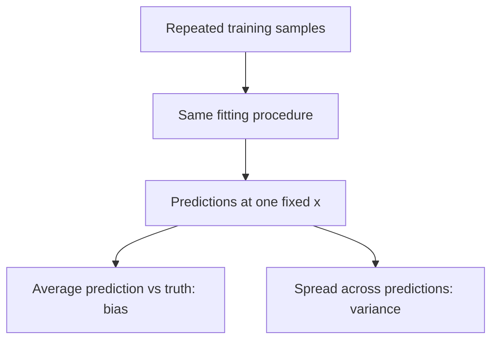

Regularization, more data, better features, and ensembles can alter the balance. Training and validation learning curves help diagnose it, but a single train/test gap does not directly measure mathematical bias and variance.


### Bias and variance as numerical predictions

Suppose the true conditional mean at one query is 50. A rigid learning procedure trained on five independently drawn datasets predicts $[39,40,41,40,40]$. Its average prediction is 40: bias is −10, squared bias is 100, and variance is small.

A very flexible procedure predicts $[30,70,35,65,50]$. Its mean is exactly 50, so this tiny illustrative collection has zero average bias, but the spread is large. A third procedure predicting $[47,52,49,51,51]$ has both smaller average error and smaller spread.

The point is not that a flexible model must always have low bias or a rigid model always low variance. The point is what each quantity averages over: train the same procedure repeatedly on different samples, then examine predictions at the **same query**. Predictions at different x values should naturally differ and are not what this definition calls model variance.

<a id="topic-63"></a>

## 63. Ridge regression: intuition

Ridge discourages large coefficients:

$$J=\frac1{2n}\|y-Xw-b\|^2+\frac\lambda2\|w\|_2^2.$$

The intercept is normally unpenalized. Increasing $\lambda$ shrinks slopes toward zero. This sacrifices some training fit in exchange for less sensitivity to noisy samples and correlated features.

```python
from sklearn.linear_model import Ridge
from sklearn.preprocessing import PolynomialFeatures
X = np.linspace(-1, 1, 30).reshape(-1, 1)
rng = np.random.default_rng(42)
y = X[:, 0]**2 + rng.normal(0, 0.2, len(X))
ridge = make_pipeline(PolynomialFeatures(8, include_bias=False),
                      StandardScaler(), Ridge(alpha=1.0))
ridge.fit(X, y)
```

Geometrically, minimizing loss inside an L2 ball limits the total coefficient length. Unlike Lasso's diamond, the L2 boundary is smooth and rarely touches an exact zero axis, so ridge usually shrinks rather than eliminates coefficients.

Scale features first when a comparable penalty across units is intended. A coefficient of 0.001 on rupees may encode the same relationship as 1 on thousands of rupees; an unscaled penalty treats them differently. Scikit-learn's `alpha` uses its own objective convention; chapter 64 makes the conversion explicit.

<a id="topic-64"></a>

## 64. Ridge: closed form and scratch code

For centered inputs and target, the intercept is handled separately. Differentiating our objective gives

$$X_c^T(X_cw-y_c)/n+\lambda w=0,$$

so

$$w=(X_c^TX_c+n\lambda I)^{-1}X_c^Ty_c,\qquad b=\bar y-\bar x^Tw.$$

Scikit-learn `Ridge` minimizes SSE + `alpha`$\|w\|^2$, so to match this book's objective use `alpha = n * lambda`.

```python
from sklearn.linear_model import Ridge
X = np.array([[1., 2.], [2., 4.], [3., 5.], [4., 8.]])
y = np.array([2., 3., 4., 6.])
lam = 0.5
xc = X - X.mean(axis=0); yc = y - y.mean()
w = np.linalg.solve(xc.T @ xc + len(X) * lam * np.eye(X.shape[1]), xc.T @ yc)
b = y.mean() - X.mean(axis=0) @ w
ref = Ridge(alpha=len(X) * lam).fit(X, y)
assert np.allclose(w, ref.coef_)
print(w, b)
```

Adding a positive diagonal stabilizes directions where data provide little information. Even if two columns are identical, positive ridge penalty yields a unique weight solution. This does not prove either coefficient is a causal effect or resolve flawed data collection.

<a id="topic-65"></a>

## 65. Ridge with gradient descent

The ridge gradient is the ordinary regression gradient plus a shrinkage term:

$$\nabla_wJ=X^T(\hat y-y)/n+\lambda w.$$

Therefore

$$w\leftarrow(1-\eta\lambda)w-\eta X^T(\hat y-y)/n.$$

The first term pulls weights toward zero; the second tries to improve fit. They act in the same update, not two independently fitted models.

```python
X = np.array([[0.], [1.], [2.], [3.]])
y = np.array([1., 3., 5., 7.])
w = np.zeros(1); b = 0.; lam = 0.1
for _ in range(3000):
    error = X @ w + b - y
    grad_w = X.T @ error / len(X) + lam * w
    grad_b = error.mean()
    w -= 0.05 * grad_w
    b -= 0.05 * grad_b
print(w, b)
```

Do not add a penalty to the intercept by accident when combining it with feature weights. Check whether your chosen loss is averaged or summed before comparing implementations: otherwise a supposedly equal $\lambda$ can differ by a factor of $n$ or two.

<a id="topic-66"></a>

## 66. Five key ridge points

1. **Zero penalty recovers OLS behavior**, subject to numerical solver details and non-uniqueness in deficient designs.
2. **Large penalty drives slopes toward zero.** With an unpenalized intercept, predictions approach the training target mean, not necessarily zero.
3. **Scaling matters** because coefficient size depends on units.
4. **Correlated predictors tend to share influence.** Ridge can stabilize predictions while individual coefficients remain hard to interpret.
5. **Choose strength on validation data.** A smaller training error does not imply better generalization.

```python
from sklearn.model_selection import GridSearchCV
from sklearn.linear_model import Ridge
search = GridSearchCV(make_pipeline(StandardScaler(), Ridge()),
                      {"ridge__alpha": [0.01, 0.1, 1., 10., 100.]},
                      cv=3, scoring="neg_mean_squared_error")
# Supply an adequately sized training dataset:
X = np.arange(30., dtype=float).reshape(-1, 1)
y = 2 * X[:, 0] + np.sin(X[:, 0])
search.fit(X, y)
print(search.best_params_)
```

The grid belongs inside training data. `best_score_` is a model-selection score, and repeatedly optimizing against it can overfit the validation procedure. Reserve independent evaluation or use nested CV when estimating the entire selection process.

<a id="topic-67"></a>

## 67. Lasso regression

Lasso replaces the squared L2 penalty with an L1 penalty:

$$J=\frac1{2n}\|y-Xw-b\|^2+\lambda\sum_j|w_j|.$$

It can set coefficients exactly to zero, creating a sparse model. A sparse model can be easier to inspect and may ignore irrelevant features, though selected variables can be unstable when predictors are strongly correlated.

```python
from sklearn.linear_model import Lasso
from sklearn.datasets import make_regression
X, y = make_regression(n_samples=180, n_features=10, n_informative=3,
                       noise=5, random_state=42)
lasso = make_pipeline(StandardScaler(), Lasso(alpha=1.0, max_iter=10000))
lasso.fit(X, y)
print(lasso[-1].coef_)
```

Unlike ridge, the L1 penalty has a corner at zero. Optimization therefore uses methods such as coordinate descent rather than simply pretending the absolute value has an ordinary derivative everywhere.

A selected feature is not necessarily causally important, and a discarded feature is not necessarily useless in every model. Correlated substitutes can share the same information. Fit scaling and feature selection inside each validation fold; selecting variables on the full dataset before CV leaks information.

<a id="topic-68"></a>

## 68. Why Lasso creates sparsity

Consider one standardized, centered feature with $\frac1n\sum x_i^2=1$. Define $c=\frac1n\sum x_iy_i$. Ignoring terms independent of $w$, the objective is

$$\frac12w^2-cw+\lambda|w|.$$

For $w>0$, derivative is $w-c+\lambda$, giving $w=c-\lambda$ if $c>\lambda$. For $w<0$, derivative is $w-c-\lambda$, giving $w=c+\lambda$ if $c<-\lambda$. When $|c|\le\lambda$, zero satisfies the subgradient condition.

Thus

$$w^*=\operatorname{sign}(c)\max(|c|-\lambda,0).$$

This is **soft thresholding**. If $c=0.3$ and $\lambda=0.5$, the fitted coefficient is exactly 0. If $c=2$, it becomes 1.5. Ridge's corresponding shrinkage is $c/(1+\lambda)$, generally nonzero for nonzero $c$ under this one-feature convention.

```python
def soft_threshold(c, lam):
    return np.sign(c) * np.maximum(np.abs(c) - lam, 0.)
print(soft_threshold(np.array([-2., -0.3, 0.3, 2.]), 0.5))
```

Geometrically, the L1 feasible region has axis-aligned corners, making zero-coordinate solutions common. It is not because “Lasso subtracts a constant forever and crosses zero”; correct optimization handles the corner through a threshold/subgradient condition.

<a id="topic-69"></a>

## 69. Elastic Net

Elastic Net combines L1 sparsity and L2 shrinkage:

$$J=\frac1{2n}\|y-Xw-b\|^2+\alpha\rho\|w\|_1+
\frac{\alpha(1-\rho)}2\|w\|_2^2.$$

Here $\rho$ is `l1_ratio`. At $\rho=1$ it becomes Lasso. As $\rho$ approaches zero it becomes ridge-like, though a dedicated Ridge solver is preferable for pure ridge.

```python
from sklearn.linear_model import ElasticNet
from sklearn.datasets import make_regression
X, y = make_regression(n_samples=150, n_features=12, n_informative=4,
                       noise=8, random_state=42)
enet = make_pipeline(StandardScaler(),
                     ElasticNet(alpha=0.5, l1_ratio=0.5, max_iter=10000))
enet.fit(X, y)
print(enet[-1].coef_)
```

Suppose several sensors measure nearly the same physical quantity. Lasso may choose one somewhat arbitrarily. The L2 component can encourage more stable sharing across related features while retaining some sparsity. Tune both total strength and mixture. They answer different questions: how strongly to regularize, and which penalty shape to use.

---
# Part VI — Logistic regression and classification evaluation

<a id="topic-70"></a>

## 70. The perceptron trick

A linear classifier calculates $z=w^Tx+b$ and places its decision boundary at $z=0$. The perceptron predicts $\hat y=1$ if $z\ge0$, otherwise 0. For a misclassified point it updates

$$w\leftarrow w+\eta(y_i-\hat y_i)x_i,\qquad
b\leftarrow b+\eta(y_i-\hat y_i).$$

For a positive point wrongly predicted negative, $y-\hat y=1$: add a fraction of its vector. For a negative point wrongly predicted positive, subtract a fraction. Correctly classified points cause no update.

Why does this help the mistaken point? Define $\delta=\eta(y_i-\hat y_i)$. After the update, its own score changes by

$$z_i^{new}-z_i^{old}=\delta(\|x_i\|^2+1).$$

The `+1` comes from the bias update. Since $\|x_i\|^2+1$ is positive, the score moves in the correct direction. The boundary can both rotate and shift; it does not always move “up” or “down.” Effects on another point $x_j$ depend on $x_i^Tx_j+1$.

This is an introduction to linear classification, **not logistic regression itself**. The perceptron uses a hard threshold; logistic regression uses probabilities and a different loss. The classical perceptron converges on linearly separable data under its assumptions; it need not converge on nonseparable data.

<a id="topic-71"></a>

## 71. Perceptron code from scratch

```python
X = np.array([[0., 0.], [0., 1.], [1., 0.], [1., 1.]])
y = np.array([0, 0, 0, 1])  # AND
w = np.zeros(2); b = 0.; eta = 0.1
rng = np.random.default_rng(42)
for epoch in range(100):
    mistakes = 0
    for i in rng.permutation(len(X)):
        pred = int(X[i] @ w + b >= 0)
        delta = eta * (y[i] - pred)
        w += delta * X[i]
        b += delta
        mistakes += (pred != y[i])
    if mistakes == 0:
        break
print((X @ w + b >= 0).astype(int))
```

Starting from zero means the chosen tie rule matters: all initial scores are zero. The code treats ties as positive, then corrects mistakes. Shuffling can change the fitted separator because many separators classify the same training data correctly.

The perceptron does not choose the widest margin and does not return calibrated probabilities. On XOR labels $[0,1,1,0]$, no straight line in the original two features can solve the problem. Add nonlinear features or use a nonlinear model rather than assuming more epochs will fix a representation limit.

<a id="topic-72"></a>

## 72. Sigmoid: turning a score into a probability

Logistic regression uses

$$z=w^Tx+b,\qquad p=\sigma(z)=\frac1{1+e^{-z}}.$$

At $z=0$, $p=0.5$; at $z=2$, $p\approx0.881$; at $z=-2$, $p\approx0.119$. The sigmoid compresses any real-valued score into $(0,1)$.

```python
from scipy.special import expit
X = np.array([[1., 0., 2.], [2., 1., 0.], [0., 2., 1.]])
w = np.array([0.4, -0.8, 0.2]); b = -0.1
z = X @ w + b  # (3,3) @ (3,) + scalar -> (3,)
p = expit(z)   # sigmoid applies separately to every score
print(z, p, (p >= 0.5).astype(int))
```

For 10 samples and three features, `X.shape==(10,3)`, `w.shape==(3,)`, and predictions have shape `(10,)`. Sigmoid does not combine the samples; the matrix multiplication first creates one score per row.

The model assumes **log-odds** are linear:

$$\log\frac{p}{1-p}=w^Tx+b.$$

A one-unit increase in feature $j$ multiplies the odds by $e^{w_j}$ holding other features fixed. That does not mean it adds a fixed probability; sigmoid's slope varies across the score range.

<a id="topic-73"></a>

## 73. Maximum likelihood and binary cross-entropy

For a Bernoulli label, the model assigns observed-label probability

$$P(y_i\mid x_i)=p_i^{y_i}(1-p_i)^{1-y_i}.$$

If $y=1$, this equals $p$; if $y=0$, it equals $1-p$. Under the conditional-independence assumption for examples, the dataset likelihood is the product of these quantities. Maximizing a product is equivalent to maximizing its log. Negating the average log-likelihood produces binary cross-entropy:

$$J=-\frac1n\sum_i[y_i\log p_i+(1-y_i)\log(1-p_i)].$$

For a positive example, predicting 0.9 gives loss $-\log0.9\approx0.105$; predicting 0.1 gives $2.303$. Confident mistakes cost much more. Negative examples also contribute: when $y=0$, the second term remains.

```python
y = np.array([1., 0.]); p = np.array([0.9, 0.2])
print(-np.mean(y * np.log(p) + (1-y) * np.log1p(-p)))
# Stable logit-space equivalent:
z = np.array([2., -1.])
print(np.mean(np.logaddexp(0, z) - y * z))
```

The logit-space expression avoids explicitly taking logs of probabilities rounded to zero or one. In linearly separable data, unregularized logistic coefficients can grow without a finite maximum-likelihood solution. Regularization controls this behavior.

<a id="topic-74"></a>

## 74. Derivative of sigmoid

Start with $\sigma(z)=(1+e^{-z})^{-1}$. Apply the chain rule:

$$\sigma'(z)=-(1+e^{-z})^{-2}(-e^{-z})
=\frac{e^{-z}}{(1+e^{-z})^2}.$$

Since $1-\sigma(z)=e^{-z}/(1+e^{-z})$,

$$\boxed{\sigma'(z)=\sigma(z)(1-\sigma(z))}.$$

The derivative is largest at $p=0.5$, where it equals 0.25, and small in the tails. This describes sensitivity of probability to the score.

For cross-entropy, a useful cancellation occurs:

$$\frac{\partial L}{\partial p}=\frac{p-y}{p(1-p)},\quad
\frac{\partial p}{\partial z}=p(1-p),\quad
\frac{\partial L}{\partial z}=p-y.$$

Thus the parameter gradient does not need an extra sigmoid-derivative factor beyond $p-y$. Multiplying by $p(1-p)$ again would give the wrong cross-entropy gradient.

```python
from scipy.special import expit
z = 0.7; eps = 1e-6
numerical = (expit(z + eps) - expit(z - eps)) / (2 * eps)
analytical = expit(z) * (1 - expit(z))
print(numerical, analytical)
```

Finite differences are a useful check on derivations, though tiny step sizes eventually suffer floating-point cancellation.

<a id="topic-75"></a>

## 75. Logistic gradient descent from scratch

Combining the previous chapter with $z_i=w^Tx_i+b$:

$$\nabla_wJ=X^T(p-y)/n,\quad \partial J/\partial b=\operatorname{mean}(p-y).$$

For one row, the update is $w\leftarrow w+\eta(y_i-p_i)x_i$. This resembles the perceptron, but replaces a hard predicted label by a probability.

```python
from scipy.special import expit
X = np.array([[-2., 0.], [-1., 1.], [1., 0.], [2., 1.]])
y = np.array([0., 0., 1., 1.])
w = np.zeros(2); b = 0.; lam = 0.01
for _ in range(3000):
    p = expit(X @ w + b)
    grad_w = X.T @ (p - y) / len(X) + lam * w
    grad_b = (p - y).mean()
    w -= 0.1 * grad_w
    b -= 0.1 * grad_b
print(expit(X @ w + b))
```

**Correctly classified positive:** if $y=1,p=0.9$, the coefficient is $+0.1\eta$. Training still increases its score because 0.9 is not certainty and cross-entropy still decreases as $p$ approaches 1. A correctly classified negative with $p=0.1$ gets a negative update. Classification correctness is a threshold decision; loss evaluates confidence as well.

The own-point score change is $\eta(y-p)(\|x\|^2+1)$ for the unregularized single-row update. Other points may improve or worsen depending on alignment. Dataset gradients balance all these pressures, while regularization resists unlimited coefficient growth.


### One row, every arithmetic operation

Take $x=[2,1]$, true label $y=1$, initial $w=[0.2,-0.4]$, and $b=0$. The score is $z=2(0.2)+1(-0.4)=0$, so $p=0.5$. For cross-entropy, the weight gradient is

$$(p-y)x=(-0.5)[2,1]=[-1,-0.5],\qquad g_b=-0.5.$$

With learning rate 0.1, new weights are $[0.3,-0.35]$ and new intercept is 0.05. The same point's score becomes $2(0.3)-0.35+0.05=0.3$, and its probability increases to about 0.5744. Its loss decreases from $-\log0.5\approx0.6931$ to $-\log0.5744\approx0.5544$.

For another point $x'=[-2,-1]$, the score change due to this update is $0.1(0.5)(x^Tx'+1)=0.05(-5+1)=-0.2$. The update can improve the positive point while decreasing the other point's score. This is precisely why vector alignment matters and why saying “the whole line moves upward” is unreliable.

The calculation is unregularized and uses one row. In a batch update, add the contributions from all training rows and average; conflicting contributions can cancel or dominate one another.

<a id="topic-76"></a>

## 76. Accuracy, confusion matrix, Type I and Type II errors

For a chosen positive class and threshold:

| | Predicted positive | Predicted negative |
|---|---:|---:|
| Actually positive | TP | FN |
| Actually negative | FP | TN |

Accuracy is $(TP+TN)/n$. If only 1% of transactions are fraudulent, predicting “not fraud” for everything achieves 99% accuracy and detects no fraud.

A false positive is a false alarm; a false negative is a missed positive. In the usual testing analogy where the null corresponds to negative, Type I means rejecting a true null (FP), and Type II means failing to reject a false null (FN). State the null/positive definition because the terms are otherwise easy to reverse.

```python
from sklearn.metrics import confusion_matrix, accuracy_score
y = [1, 1, 1, 0, 0, 0]
pred = [1, 1, 0, 1, 0, 0]
print(confusion_matrix(y, pred, labels=[0, 1]))  # [[TN, FP], [FN, TP]]
print(accuracy_score(y, pred))
```

Scikit-learn's default binary matrix order differs from the display table above: with labels `[0,1]`, negative is first. Always label axes. Threshold choice changes the confusion matrix even when model probabilities remain identical.

<a id="topic-77"></a>

## 77. Precision, recall, and F1

$$\operatorname{Precision}=\frac{TP}{TP+FP},\quad
\operatorname{Recall}=\frac{TP}{TP+FN},\quad
F_1=\frac{2PR}{P+R}.$$

Precision asks “among predicted positives, how many were correct?” Recall asks “among actual positives, how many did we find?”

If TP=30, FP=10, FN=20, precision=0.75, recall=0.60, and F1≈0.667. A fraud review team with limited capacity may prioritize precision; a search system trying to retrieve nearly all relevant documents may prioritize recall. The actual business trade-off also depends on prevalence and costs.

```python
from sklearn.metrics import precision_score, recall_score, f1_score
actual = [1, 1, 1, 0, 0, 0]
predicted = [1, 1, 0, 1, 0, 0]
print(precision_score(actual, predicted, zero_division=0))
print(recall_score(actual, predicted, zero_division=0))
print(f1_score(actual, predicted, zero_division=0))
```

F1 ignores true negatives and is not always the right objective. For multiclass tasks, macro averaging treats classes equally, weighted averaging uses support, and micro aggregates counts. Report the averaging convention. Choose thresholds on validation data, not the final test set, and handle undefined denominators explicitly.

<a id="topic-78"></a>

## 78. ROC curve and ROC-AUC

A score becomes a class only after applying a threshold. Sweeping the threshold yields different true-positive and false-positive rates:

$$TPR=\frac{TP}{TP+FN},\qquad FPR=\frac{FP}{FP+TN}.$$

ROC plots TPR against FPR. AUC summarizes ranking: under the usual tie convention, it is the probability a random positive receives a higher score than a random negative, with half credit for ties. AUC=0.5 represents random ranking, not necessarily 50% classification accuracy.

```python
from sklearn.metrics import roc_curve, roc_auc_score, precision_recall_curve
actual = np.array([0, 0, 1, 1, 0, 1])
score = np.array([0.1, 0.4, 0.35, 0.8, 0.2, 0.7])
fpr, tpr, thresholds = roc_curve(actual, score)
plt.plot(fpr, tpr, marker="o")
plt.plot([0, 1], [0, 1], "--")
plt.xlabel("False positive rate"); plt.ylabel("True positive rate"); plt.show()
print(roc_auc_score(actual, score))
```

Use probabilities or decision scores, not just hard labels. AUC does not measure calibration: a model can rank perfectly while its probabilities are systematically wrong. Under extreme imbalance, a modest FPR can still create many false alarms, so inspect precision–recall curves and costs. A good global AUC can hide poor performance in the operational threshold region.

<a id="topic-79"></a>

## 79. Softmax / multinomial logistic regression

For $K$ classes and $d$ features, each class gets its own score:

$$z_k=w_k^Tx+b_k,\qquad p_k=\frac{e^{z_k}}{\sum_{j=1}^Ke^{z_j}}.$$

Three classes and three features give a convenient weight matrix $W$ of shape $(3,3)$: nine coefficients, plus three intercepts. Three shared coefficients would produce one scalar score, not three independently varying class scores. The full parameterization is redundant under common shifts; a reference-class formulation can represent the same probabilities with fewer free parameters.

For one row $x=[2,1,0]$ and

$$W=\begin{bmatrix}1&0&0\\0&1&0\\0&0&1\end{bmatrix},\quad b=0,$$

scores are $[2,1,0]$, giving probabilities approximately $[0.665,0.245,0.090]$.

```python
from scipy.special import softmax
X = np.array([[2., 1., 0.], [0., 1., 3.]])
W = np.eye(3); b = np.zeros(3)
Z = X @ W.T + b  # (n,d) @ (d,K) -> (n,K)
P = softmax(Z, axis=1)
print(P, P.argmax(axis=1))
```

Loss for a row is $-\log p_{true}$. With one-hot target matrix $Y$, the score gradient is $P-Y$, and the weight gradient is $(P-Y)^TX/n$. **Every row contributes to every class score.** For a row of class 1, class 2 has target zero but predicted probability $p_2>0$, so its gradient pushes that score down. Training does not select only class-2 rows to learn class 2.


### Watch all nine coefficients learn from one row

Use the previous $x=[2,1,0]$, identity $W$, zero intercepts, and suppose the true class is the **second** class, index 1. Then $p\approx[0.6652,0.2447,0.0900]$ and one-hot target $y=[0,1,0]$. The score errors are

$$p-y\approx[0.6652,-0.7553,0.0900].$$

The single-row gradient is the outer product $(p-y)x^T$:

$$\nabla_WL\approx
\begin{bmatrix}
1.3305&0.6652&0\\
-1.5105&-0.7553&0\\
0.1801&0.0900&0
\end{bmatrix}.$$

Subtracting this gradient reduces class 0's score, increases class 1's score, and reduces class 2's score. Thus a class-1 example changes **all class rows of W**, even though only one target entry is one. The third feature's coefficient gradients are zero for this observation because its third feature is zero, not because those parameters are excluded from training.

```python
from scipy.special import softmax
x = np.array([2., 1., 0.]); W = np.eye(3); b = np.zeros(3)
p_before = softmax(W @ x + b)
error = p_before - np.array([0., 1., 0.])
grad_W = np.outer(error, x)
W -= 0.1 * grad_W
b -= 0.1 * error
p_after = softmax(W @ x + b)
print(p_before, p_after)
assert p_after[1] > p_before[1]
```

Adding the same feature-weight vector to every class row and the same constant to every intercept leaves softmax probabilities unchanged because all scores receive a common shift. This explains the parameter redundancy mentioned above. Regularization and reference-class choices determine how coefficients are represented without requiring a different set of predictions.

<a id="topic-80"></a>

## 80. Polynomial logistic regression

Logistic regression is linear in the supplied features. Supplying nonlinear features creates nonlinear boundaries in the original coordinates.

$$z=b+w_1x_1+w_2x_2+w_3x_1^2+w_4x_1x_2+w_5x_2^2.$$

The boundary $z=0$ can be curved. For $z=x_1^2+x_2^2-r^2$, it is a circle. Sigmoid controls probability along this score; the polynomial features create the nonlinear boundary.

```python
from sklearn.datasets import make_circles
from sklearn.preprocessing import PolynomialFeatures
from sklearn.linear_model import LogisticRegression
X, y = make_circles(n_samples=300, factor=0.35, noise=0.08, random_state=42)
Xtr, Xte, ytr, yte = train_test_split(X, y, stratify=y, random_state=42)
model = make_pipeline(PolynomialFeatures(2, include_bias=False),
                      StandardScaler(), LogisticRegression(max_iter=1000))
model.fit(Xtr, ytr)
print(accuracy_score(yte, model.predict(Xte)))
```

Polynomial degree grows the feature count quickly, increasing variance and computational cost. Use regularization and validation. The current import is `from sklearn.datasets import make_circles`; the old `sklearn.datasets.samples_generator` path is obsolete.

<a id="topic-81"></a>

## 81. Logistic regression hyperparameters

Key choices include regularization strength `C`, solver, iteration limit, class weights, and—outside the estimator—the probability threshold. Smaller `C` means stronger regularization in scikit-learn's convention.

```python
from sklearn.datasets import load_breast_cancer
from sklearn.linear_model import LogisticRegression
from sklearn.model_selection import GridSearchCV
X, y = load_breast_cancer(return_X_y=True)
pipe = make_pipeline(StandardScaler(), LogisticRegression(max_iter=2000))
search = GridSearchCV(pipe, {"logisticregression__C": [0.01, 0.1, 1., 10.]},
                      scoring="roc_auc", cv=3)
# For final performance, reserve an external test split before this search.
search.fit(X, y)
print(search.best_params_)
```

`max_iter` is a cap, not a guarantee of convergence or a prescribed training duration. Solvers stop according to their convergence criteria; a warning calls for inspecting scaling, tolerances, data, and iteration budget.

Solver/penalty support and parameter deprecations vary by release; consult the [installed-version reference](https://scikit-learn.org/stable/modules/generated/sklearn.linear_model.LogisticRegression.html). The guide's baseline uses the standard default L2 setup rather than deprecated multiclass or penalty arguments. `class_weight="balanced"` changes the fitted objective; it does not automatically calibrate probabilities to deployment prevalence or choose a cost-optimal threshold.

---

# Part VII — Probability and Naive Bayes

<a id="topic-82"></a>

## 82. Conditional probability

Conditional probability restricts the reference population:

$$P(A\mid B)=\frac{P(A\cap B)}{P(B)},\qquad P(B)>0.$$

Suppose 100 students include 40 who study at night. Of these 40, 30 pass. Then $P(pass\mid night)=30/40=0.75$. The denominator is night-study students because that is the group we have conditioned on.

If 70 students pass overall, $P(night\mid pass)=30/70\approx0.429$. Reversing the conditioning changes the denominator. The shared numerator does not make the probabilities equal.

```python
students = pd.DataFrame({"night": [1, 1, 1, 1, 0, 0],
                         "pass":  [1, 1, 1, 0, 1, 0]})
print(students.loc[students["night"] == 1, "pass"].mean())
```

Conditioning is a change of information, not necessarily a causal intervention. “Pass rate among night students” does not prove night study caused passing; prior preparation or workload may differ. Naive Bayes uses conditioning to compare how plausible each class is after observing features.

<a id="topic-83"></a>

## 83. Independent events

Events $A$ and $B$ are independent when

$$P(A\cap B)=P(A)P(B).$$

When $P(B)>0$, this is equivalent to $P(A\mid B)=P(A)$. Learning whether B occurred does not change A's probability.

For a fair die, let A=even and B=greater than 4. Then $P(A)=1/2$, $P(B)=1/3$, and their intersection is {6}, probability 1/6. They are independent and **do intersect**.

Independence does not mean events cannot happen together. It means their occurrence does not alter the relevant probability. Mutually exclusive events are a different idea.

Conditional independence is also different from marginal independence. Two symptoms can correlate overall because both are associated with an illness, yet be closer to independent within each illness category. Naive Bayes assumes features are independent **conditional on the class**, not independent across the entire dataset.

Pairwise zero correlation is weaker than full independence in general. Nor do pairwise independence checks prove joint independence of an entire feature set.

<a id="topic-84"></a>

## 84. Mutually exclusive events

Mutually exclusive events cannot occur together: $A\cap B=\varnothing$ and $P(A\cap B)=0$. On one die roll, A={1} and B={2} are exclusive.

If both have positive probabilities, they cannot also be independent, because independence would require $P(A\cap B)=P(A)P(B)>0$. The zero-probability edge cases are special exceptions.

For exclusive events, $P(A\cup B)=P(A)+P(B)$. For overlapping events, subtract the intersection:

$$P(A\cup B)=P(A)+P(B)-P(A\cap B).$$

Classification labels can be mutually exclusive while features are not. An email may be either spam or not spam in a binary task, yet contain both “offer” and “meeting.” Confusing label exclusivity with feature independence leads to incorrect Naive Bayes reasoning.

<a id="topic-85"></a>

## 85. Bayes' theorem: counting intuition

$$P(A\mid B)=\frac{P(B\mid A)P(A)}{P(B)}.$$

Both $P(A\mid B)P(B)$ and $P(B\mid A)P(A)$ describe the same intersection. Rearranging gives Bayes' theorem. The denominator normalizes the restricted group so posterior probabilities sum to one.

Consider a **hypothetical** screening population of 1,000 people. Prevalence is 10%, sensitivity 90%, and false-positive rate 10%.

| Group | Population | Positive results |
|---|---:|---:|
| Condition present | 100 | 90 |
| Condition absent | 900 | 90 |
| Total | 1,000 | 180 |

Among positive results, only 90 of 180 are from the condition-present group. Therefore $P(condition\mid positive)=0.5$, even though sensitivity is 0.9.

The overall positive probability is

$$P(+)=P(+\mid A)P(A)+P(+\mid A^c)P(A^c)
=0.9(0.1)+0.1(0.9)=0.18.$$

That 0.18 is not an assumed input: it comes from adding true positives and false positives across the entire population. This is an arithmetic example, not guidance about any actual diagnostic test.

<a id="topic-86"></a>

## 86. Another worked Bayes problem

Two factories supply bulbs. Factory A makes 70%, factory B makes 30%. Defect rates are 2% and 8% respectively. You observe a defective bulb. Which source is more likely?

Out of 10,000 bulbs, A contributes 7,000 and about 140 defects; B contributes 3,000 and about 240 defects. Total defects=380. Thus

$$P(B\mid defect)=\frac{0.08(0.30)}{0.02(0.70)+0.08(0.30)}
=\frac{240}{380}\approx0.632.$$

Although B supplies fewer bulbs, its higher defect rate makes it the more likely source among defective bulbs.

```python
prior = np.array([0.70, 0.30])
likelihood = np.array([0.02, 0.08])
unnormalized = prior * likelihood
posterior = unnormalized / unnormalized.sum()
print(posterior)  # [0.3684..., 0.6316...]
```

The pattern will reappear in classification: calculate an unnormalized score for each class, then divide by the sum. Always check that the conditioning event has positive total probability.

<a id="topic-87"></a>

## 87. Naive Bayes intuition

Naive Bayes asks: “Which class makes these observed features most plausible, after accounting for how common the class is?”

For an email with words “free” and “offer,” compare

$$P(spam)P(free\mid spam)P(offer\mid spam)$$

with the corresponding not-spam score. Multiplication is justified by the model's conditional-independence assumption. Actual words are not independent, but the approximation can still produce useful rankings or classifications.

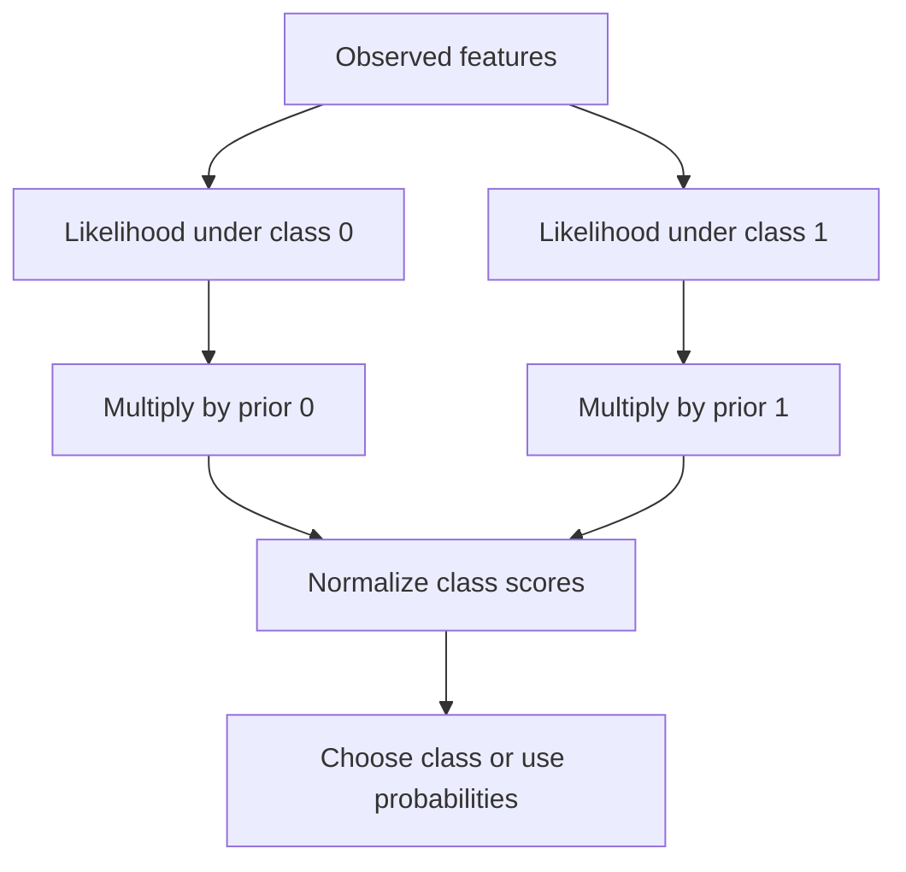

This is a **generative** modeling approach: it models the feature distribution within each class and the class prior. Logistic regression instead directly models the conditional class probability. Naive Bayes probabilities can be overconfident when correlated features double-count evidence; useful classification accuracy does not guarantee calibration.

<a id="topic-88"></a>

## 88. Naive Bayes mathematics and smoothing

For class $c$ and feature vector $x$,

$$P(c\mid x)\propto P(c)\prod_{j=1}^dP(x_j\mid c).$$

In a multinomial word-count model, let $N_{cj}$ be the count of word $j$ in class $c$, $N_c=\sum_jN_{cj}$, and $V$ the vocabulary size. Additive smoothing estimates

$$\theta_{cj}=\frac{N_{cj}+\alpha}{N_c+\alpha V}.$$

For document counts $x_j$, its class score is proportional to $P(c)\prod_j\theta_{cj}^{x_j}$. The multinomial combinatorial factor is identical across classes for a fixed document and cancels in classification.

If class spam has counts free=4 and meeting=1, with $\alpha=1,V=2$, probabilities become $5/7$ and $2/7$. The denominator includes the added count for **every vocabulary item**, not just the observed word. Smoothing prevents an unseen training word from making the entire likelihood zero.

Compute in log space:

$$s_c=\log P(c)+\sum_jx_j\log\theta_{cj}.$$

Adding log-probabilities avoids numerical underflow from multiplying many tiny numbers. Use log-sum-exp to normalize scores if probabilities are needed. Bernoulli NB models feature presence/absence; multinomial NB models nonnegative counts or analogous weighted inputs. They are not interchangeable assumptions.


### Fully numerical classification with two binary features

Use Bernoulli features `free_present` and `meeting_present`, not multinomial counts for this example. Suppose $P(spam)=0.4$ and $P(ham)=0.6$. Fitted conditional probabilities are:

| Feature probability | Spam | Ham |
|---|---:|---:|
| free present | 0.8 | 0.1 |
| meeting present | 0.1 | 0.7 |

For an email with free present and meeting absent, the naive scores are $0.4(0.8)(1-0.1)=0.288$ for spam and $0.6(0.1)(1-0.7)=0.018$ for ham. Normalize by $0.306$ to get spam posterior about 0.9412.

Absence contributes in a Bernoulli model: `meeting absent` supplies $1-P(meeting\mid class)$. A multinomial count model instead describes word-count draws; a zero count contributes exponent zero and hence multiplicative factor one for that vocabulary entry. Mixing these two likelihoods is a frequent source of incorrect hand calculations.

<a id="topic-89"></a>

## 89. Naive Bayes code example

```python
from sklearn.feature_extraction.text import CountVectorizer
from sklearn.naive_bayes import MultinomialNB
texts = ["free offer win", "win free prize", "meeting project tomorrow",
         "project meeting notes", "prize offer", "tomorrow project review"]
y = np.array([1, 1, 0, 0, 1, 0])
spam = make_pipeline(CountVectorizer(), MultinomialNB(alpha=1.0))
spam.fit(texts, y)
print(spam.predict(["free prize", "project notes"]))
print(spam.predict_proba(["free prize"]))
```

The vectorizer learns a vocabulary from training text and converts each message into counts. The classifier learns class priors and per-class word probabilities. New words outside this learned vocabulary are ignored by this simple vectorizer.

This six-message example illustrates mechanics only. A realistic evaluation needs enough independent messages, appropriate splitting by time or sender when necessary, and metrics matching spam costs. Put the vectorizer inside CV so vocabulary and feature extraction are not learned from validation text.

<a id="topic-90"></a>

## 90. Numerical features: Gaussian Naive Bayes

For continuous features, Gaussian NB models a separate normal density for each feature within each class:

$$p(x_j\mid c)=\frac1{\sqrt{2\pi\sigma_{cj}^2}}
\exp\left[-\frac{(x_j-\mu_{cj})^2}{2\sigma_{cj}^2}\right].$$

Estimate $\mu_{cj}$ and variance from class-$c$ training rows, multiply densities across features, and multiply by the class prior. A density is not the probability of exactly one real number; for continuous variables that point probability is zero. Comparing class densities is still meaningful in Bayes' rule.

```python
from sklearn.naive_bayes import GaussianNB
X = np.array([[1., 2.], [1.5, 1.8], [2., 2.5],
              [6., 7.], [7., 6.], [8., 8.]])
y = np.array([0, 0, 0, 1, 1, 1])
nb = GaussianNB().fit(X, y)
print(nb.theta_)  # class-by-feature means
print(nb.predict_proba([[2., 3.]]))
```

Variance smoothing stabilizes near-constant features. Check class-conditional shape rather than assuming all numerical data are Gaussian. Strongly correlated features violate the naive conditional-independence assumption and can distort confidence.

---

# Part VIII — Neighbors and support vector machines

<a id="topic-91"></a>

## 91. K nearest neighbors

KNN stores training examples. For a new row, calculate distances, select the $k$ nearest rows, and combine their labels. Classification commonly uses a majority vote; regression uses an average or distance-weighted average.

For one-dimensional training points $1,2,3$ labeled A and $7,8,9$ labeled B, query 4 has nearest three points 3,2,1, so predicts A. Query 6 has nearest points 7,8,3, so predicts B.

```python
from sklearn.neighbors import KNeighborsClassifier
X = np.array([[1.], [2.], [3.], [7.], [8.], [9.]])
y = np.array([0, 0, 0, 1, 1, 1])
knn = make_pipeline(StandardScaler(), KNeighborsClassifier(n_neighbors=3))
knn.fit(X, y)
print(knn.predict([[4.], [6.]]))
```

Small $k$ is flexible but noise-sensitive; large $k$ smooths more and can miss small patterns. Distance weighting gives closer examples more influence. Standardization matters in multiple dimensions, and irrelevant features can overwhelm the useful ones. Ties need a defined rule; odd $k$ does not eliminate every multiclass tie.

Prediction and storage can be costly for large data. Approximate nearest-neighbor indexing is an engineering alternative, but its approximation trade-offs must be evaluated. Tune neighborhood and distance choices with validation.

<a id="topic-92"></a>

## 92. SVM geometric intuition

For binary labels $y_i\in\{-1,+1\}$, a linear SVM uses $f(x)=w^Tx+b$ and predicts by its sign. The boundary is $f=0$. Among separating boundaries, a hard-margin SVM chooses one with maximum margin.

The signed geometric distance of point $x_i$ is

$$\frac{y_i(w^Tx_i+b)}{\|w\|}.$$

After choosing the conventional scaling where the closest training scores satisfy $y_if(x_i)=1$, the margin boundaries are $f=+1$ and $f=-1$. Their separation is $2/\|w\|$. Maximizing width therefore means minimizing $\|w\|$, subject to correct margin constraints.

The nearest influential observations are **support vectors**. Points far outside the margin typically do not affect the solution in the same way. Scaling $w,b$ by a positive constant does not change the decision boundary, which is why we need a score normalization to discuss margin width.

**Intuition:** the classifier tries to place a road between two groups while making the road as wide as the constraints allow. Hard-margin separation can be destroyed by a single contradictory or extreme point, motivating soft margins.

<a id="topic-93"></a>

## 93. Hard-margin SVM and the route to alpha

The primal optimization is

$$\min_{w,b}\frac12\|w\|^2\quad\text{subject to}\quad y_i(w^Tx_i+b)\ge1.$$

To handle constraints, introduce one nonnegative Lagrange multiplier $\alpha_i$ per row:

$$\mathcal L(w,b,\alpha)=\frac12\|w\|^2+
\sum_i\alpha_i[1-y_i(w^Tx_i+b)].$$

At the optimum, stationarity with respect to $w$ and $b$ gives

$$w=\sum_i\alpha_i y_ix_i,\qquad \sum_i\alpha_i y_i=0.$$

This is where the alpha equation comes from: it is the derivative condition of the constrained objective, not a separate heuristic. Substitute these equalities into the Lagrangian to eliminate $w,b$:

$$\max_\alpha\sum_i\alpha_i-rac12\sum_{i,j}\alpha_i\alpha_jy_iy_jx_i^Tx_j,$$

subject to $\alpha_i\ge0$ and $\sum_i\alpha_iy_i=0$.

The $\alpha_i$ values are learned **sample coefficients**, one per training row, rather than one per original feature. The optimizer finds them jointly. Complementary slackness gives

$$\alpha_i[y_if(x_i)-1]=0.$$

Thus a point strictly beyond the margin has $\alpha_i=0$. A point on the margin can have nonzero alpha and support the solution. This dual formulation is the doorway to kernels, because inputs appear only through pairwise inner products.


### Solve alpha values without a numerical optimizer

Take two one-dimensional observations: $x_1=-1,y_1=-1$ and $x_2=1,y_2=1$. The equality constraint $\sum\alpha_iy_i=0$ requires $\alpha_1=\alpha_2=a$. The ordinary Gram matrix and label-adjusted matrix are

$$G=\begin{bmatrix}1&-1\\-1&1\end{bmatrix},\qquad
Q=\begin{bmatrix}1&1\\1&1\end{bmatrix}.$$

The dual becomes $D(a)=2a-2a^2$, with $a\ge0$. Its derivative is $2-4a$, so the maximum is at $a=0.5$. Recover

$$w=0.5(-1)(-1)+0.5(1)(1)=1,\qquad b=0.$$

Both training points satisfy $y_i(wx_i+b)=1$, so both are support vectors. The margin width is $2/|w|=2$. Predict a new $x=0.4$ using the dual form:

$$f(0.4)=0.5(-1)K(-1,0.4)+0.5(1)K(1,0.4)
=0.5(-1)(-0.4)+0.5(0.4)=0.4.$$

For the linear kernel $K(a,b)=ab$, the result matches $wx+b$. The positive sign predicts +1. A nonlinear kernel changes the pairwise similarities but preserves this sample-weighted prediction structure.

<a id="topic-94"></a>

## 94. Soft-margin SVM, slack, and hinge loss

Allow violations using slack variables $\xi_i\ge0$:

$$\min_{w,b,\xi}\frac12\|w\|^2+C\sum_i\xi_i,$$

subject to $y_if(x_i)\ge1-\xi_i$. At optimum, the smallest feasible slack is

$$\xi_i=\max(0,1-y_if(x_i)).$$

Substituting produces the familiar objective

$$\frac12\|w\|^2+C\sum_i\max(0,1-y_if(x_i)).$$

The second part is **hinge loss**, not simply the number of wrong predictions. A correctly classified point with signed score 0.4 still has loss 0.6 because it is inside the desired margin. A point with signed score 2 has zero hinge loss. A misclassified point with signed score −0.5 has loss 1.5.

In the dual, the key new constraint is $0\le\alpha_i\le C$. Introducing slack and differentiating its Lagrangian yields this upper bound. The rest still involves pairwise inner products. Typical KKT interpretation:

| Alpha status | Typical interpretation |
|---|---|
| $\alpha_i=0$ | Outside or possibly exactly on margin |
| $0<\alpha_i<C$ | On margin; useful for estimating $b$ |
| $\alpha_i=C$ | On or inside margin, possibly misclassified |

Larger `C` penalizes violations more strongly and means weaker effective regularization; smaller `C` accepts more violations. It does not guarantee every point is correctly classified or that geometric width changes monotonically on every dataset.

<a id="topic-95"></a>

## 95. Kernel trick: complete training-to-prediction connection

### Why two points and an inner product?

The previous derivation produced $x_i^Tx_j$ because substituting $w=\sum_i\alpha_iy_ix_i$ into $\|w\|^2$ multiplies sums:

$$\left(\sum_i\alpha_iy_ix_i\right)^T
\left(\sum_j\alpha_jy_jx_j\right)
=\sum_{i,j}\alpha_i\alpha_jy_iy_jx_i^Tx_j.$$

We do not randomly pick two points. The optimization needs relationships for **all relevant pairs**. Their dot product measures alignment and magnitude. For three features it is simply $x_{i1}x_{j1}+x_{i2}x_{j2}+x_{i3}x_{j3}$.

### Introduce a richer feature space

Replace $x$ with $\phi(x)$. The primal becomes a linear classifier in transformed space, with the same margin/hinge objective. Its dual replaces $x_i^Tx_j$ by $\phi(x_i)^T\phi(x_j)$.

A kernel computes that value directly:

$$K(x_i,x_j)=\phi(x_i)^T\phi(x_j).$$

For $K(x,z)=(x^Tz)^2$ in two dimensions, one explicit map is

$$\phi(x)=[x_1^2,\sqrt2x_1x_2,x_2^2].$$

Expanding $\phi(x)^T\phi(z)$ gives exactly $(x^Tz)^2$. The kernel avoids constructing those mapped coordinates explicitly. Not every arbitrary similarity is a valid positive-semidefinite kernel.

### The kernel / Gram matrix

For $n$ training rows, define $G_{ij}=K(x_i,x_j)$. This is an $n\times n$ matrix. The dual objective is

$$\max_\alpha\ \mathbf1^T\alpha-rac12\alpha^TQ\alpha,
\quad Q_{ij}=y_iy_jG_{ij},$$

subject to $0\le\alpha_i\le C$ and $y^T\alpha=0$.

The optimizer uses entries of this matrix to decide alpha values. Implementations may compute/cache blocks rather than materialize the entire matrix, but the conceptual pairwise relationships are the same. Labels enter through $Q$; the Gram matrix alone does not know the classes.

### Final prediction

After training,

$$w=\sum_i\alpha_iy_i\phi(x_i),\qquad
f(x)=\sum_{i\in SV}\alpha_iy_iK(x_i,x)+b.$$

The first equation describes an implicit feature-space weight vector. Prediction substitutes it into $w^T\phi(x)+b$. Only nonzero-alpha support vectors contribute. For a margin support vector with $0<\alpha_i<C$, obtain $b=y_i-\sum_j\alpha_jy_jK(x_j,x_i)$, often averaged over suitable support vectors.

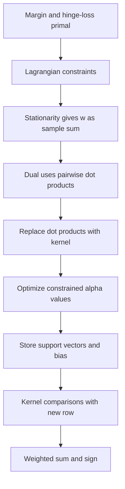

**RBF intuition:** $K(x,z)=\exp(-\gamma\|x-z\|^2)$. Nearby points have similarity near one; distant points near zero. Prediction combines signed, learned influences around support vectors. The corresponding feature space can be infinite-dimensional, yet evaluating the kernel is finite computation. Large gamma makes influences highly local and can overfit; small gamma makes them broad.

The kernel is therefore not merely pasted into the original loss while keeping the same original-feature weights. It arises naturally by optimizing the dual representation of a linear classifier in a richer feature space.


### Why a squared feature separates concentric groups

Suppose inner points have radius approximately 1 and outer points radius approximately 3. In raw $(x_1,x_2)$ coordinates, no line can isolate the entire inner circle from the entire outer ring. Add a feature $r^2=x_1^2+x_2^2$. Inner points now have $r^2\approx1$ and outer points $r^2\approx9$. The threshold $r^2=5$ separates them in this representation.

This example constructs a useful feature explicitly. A polynomial or RBF kernel can represent richer relationships implicitly, without requiring the programmer to write that exact radius feature. The kernel is not automatically “finding a new dimension that separates everything”; the chosen kernel family and its hyperparameters control the allowable geometry.

For an RBF kernel with $\gamma=0.5$, points one unit apart have similarity $e^{-0.5}\approx0.6065$, while points three units apart have similarity $e^{-4.5}\approx0.0111$. Standardization changes these distances, and therefore the Gram matrix and the entire fitted classifier.

<a id="topic-96"></a>

## 96. Kernel SVM code, Gram matrix, and manual prediction

```python
from sklearn.datasets import make_circles
from sklearn.svm import SVC
from sklearn.metrics.pairwise import rbf_kernel
from sklearn.model_selection import train_test_split
from sklearn.preprocessing import StandardScaler

X, y = make_circles(n_samples=240, factor=0.3, noise=0.08, random_state=42)
Xtr, Xte, ytr, yte = train_test_split(X, y, stratify=y, random_state=42)
sc = StandardScaler().fit(Xtr)
A = sc.transform(Xtr); B = sc.transform(Xte)
svm = SVC(kernel="rbf", C=2., gamma=0.5).fit(A, ytr)
print("test accuracy", svm.score(B, yte))
G = rbf_kernel(A, A, gamma=0.5)
print("training Gram shape", G.shape)

# Binary SVC stores signed coefficients alpha_i * y_i in dual_coef_.
new_kernel = rbf_kernel(B[:3], svm.support_vectors_, gamma=0.5)
manual_score = new_kernel @ svm.dual_coef_[0] + svm.intercept_[0]
assert np.allclose(manual_score, svm.decision_function(B[:3]))
print(manual_score)

# Equivalent explicit-precomputed interface:
precomputed = SVC(kernel="precomputed", C=2.).fit(G, ytr)
Gtest = rbf_kernel(B, A, gamma=0.5)  # test rows × ALL training rows
assert np.array_equal(precomputed.predict(Gtest), svm.predict(B))
```

For binary `SVC`, a positive decision score corresponds to `classes_[1]`. `dual_coef_` stores signed coefficients; multiplying by labels again would double-apply their signs. Precomputed test matrices compare each test row to the training rows in original training order—not to other test rows.

```python
xx, yy = np.meshgrid(np.linspace(-2.5, 2.5, 150), np.linspace(-2.5, 2.5, 150))
grid = np.column_stack([xx.ravel(), yy.ravel()])
zz = svm.decision_function(grid).reshape(xx.shape)
plt.contourf(xx, yy, zz, levels=20, cmap="coolwarm", alpha=0.5)
plt.contour(xx, yy, zz, levels=[-1, 0, 1], colors="black")
plt.scatter(A[:, 0], A[:, 1], c=ytr, cmap="coolwarm", s=15)
plt.xlabel("Scaled feature 1"); plt.ylabel("Scaled feature 2"); plt.show()
```

These grid coordinates are already in scaled space. For production, prefer `make_pipeline(StandardScaler(), SVC(...))` to package the steps. Kernel SVM training can become costly as sample count grows. See the [SVM user guide](https://scikit-learn.org/stable/modules/svm.html).

---
# Part IX — Trees and ensembles

<a id="topic-97"></a>

## 97. Decision trees: geometry, entropy, Gini, and information gain

A decision tree asks a sequence of feature questions. A split such as `area <= 800` partitions feature space into two regions; later splits subdivide them. Standard CART-style trees create axis-aligned boundaries. A leaf predicts a class based on the training labels reaching it.

For class proportions $p_k$ at a node:

$$Gini=1-\sum_kp_k^2,\qquad H=-\sum_kp_k\log_2p_k.$$

Both are zero for a pure node. For a binary 50/50 node, Gini=0.5 and entropy=1 bit. Entropy measures uncertainty; Gini can be interpreted as the chance of label disagreement between two independent draws from the node's class distribution.

A candidate split is scored by weighted impurity reduction:

$$\Delta=I(parent)-\frac{n_L}{n}I(left)-\frac{n_R}{n}I(right).$$

Suppose six rows have three positive and three negative labels. Split into a left node with three negatives and a right node with three positives. Parent Gini=0.5; both children have zero impurity; reduction=0.5. A split yielding left $(2+,1-)$ and right $(1+,2-)$ has child Gini=$4/9$, so reduction=$1/18\approx0.0556$.

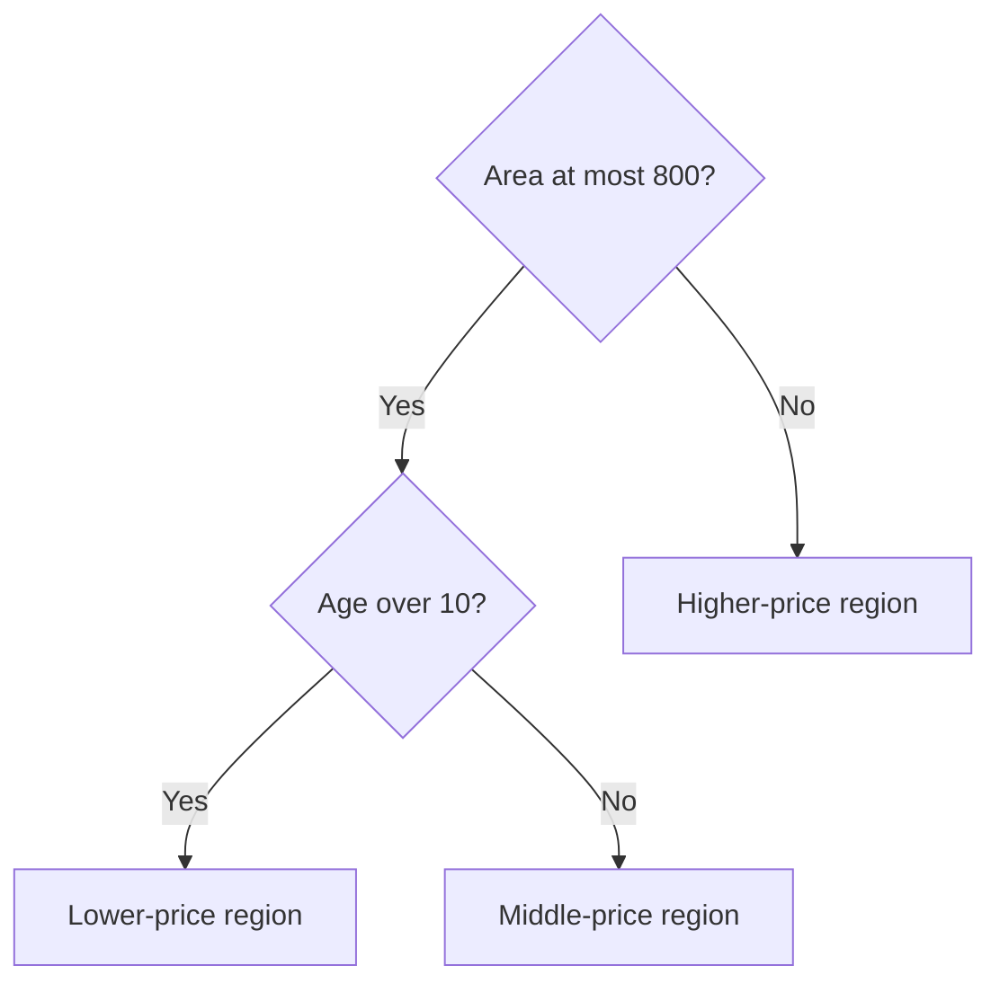

```python
from sklearn.tree import DecisionTreeClassifier
X = np.array([[1.], [2.], [3.], [7.], [8.], [9.]])
y = [0, 0, 0, 1, 1, 1]
tree = DecisionTreeClassifier(max_depth=2, random_state=42).fit(X, y)
print(tree.predict([[2.5], [8.5]]))
```

Trees search greedily for a locally useful split; they do not generally find the globally best tree. Shannon information gain is specifically entropy reduction; implementations also use Gini reduction. Scaling usually does not change threshold ordering, but categorical encoding can strongly affect which splits are expressible.

<a id="topic-98"></a>

## 98. Tree hyperparameters and overfitting

A deep tree can isolate individual training rows, including noisy labels. Its piecewise-constant predictions then change sharply when the training sample changes.

| Parameter | Effect |
|---|---|
| `max_depth` | Caps levels of splitting |
| `min_samples_split` | Minimum rows needed to attempt a split |
| `min_samples_leaf` | Minimum rows per resulting leaf |
| `max_leaf_nodes` | Caps number of terminal regions |
| `max_features` | Limits candidate features per split |
| `ccp_alpha` | Cost-complexity pruning strength |

```python
from sklearn.datasets import make_moons
from sklearn.tree import DecisionTreeClassifier
X, y = make_moons(n_samples=300, noise=0.25, random_state=42)
Xtr, Xte, ytr, yte = train_test_split(X, y, stratify=y, random_state=42)
for depth in [1, 3, None]:
    model = DecisionTreeClassifier(max_depth=depth, min_samples_leaf=3, random_state=42)
    model.fit(Xtr, ytr)
    print(depth, model.score(Xtr, ytr), model.score(Xte, yte))
```

A stump (`max_depth=1`) may underfit a curved pattern. An unrestricted tree may overfit it. Depth is not the only control: larger leaves average over more examples and can stabilize predictions. Pruning removes branches whose improvement is insufficient relative to complexity. Choose settings using training validation rather than trying many choices against one repeatedly viewed test split.

<a id="topic-99"></a>

## 99. Regression trees

A regression tree predicts a constant numerical value in each leaf. Under squared error, the optimal constant is the mean target among training rows reaching that leaf. Splits are chosen to reduce weighted within-node squared error.

For targets $[10,12,30,32]$, a single unsplit mean is 21, with SSE=404. Splitting into $[10,12]$ and $[30,32]$ gives leaf means 11 and 31, combined SSE=4. That split is valuable.

```python
from sklearn.tree import DecisionTreeRegressor
X = np.array([[1.], [2.], [3.], [4.]])
y = np.array([10., 12., 30., 32.])
regtree = DecisionTreeRegressor(max_depth=1, random_state=42).fit(X, y)
print(regtree.predict([[1.5], [3.5], [100.]]))  # [11, 31, 31]
```

The prediction at 100 remains the rightmost leaf mean. Standard regression trees do not extrapolate a linear trend beyond the training range. This matters in demand forecasting with rapidly increasing growth. Other loss criteria can imply different leaf estimates, such as medians under absolute error. Ensembles average or add these stepwise functions to produce more flexible predictions.

<a id="topic-100"></a>

## 100. Tree visualization and dtreeviz

A tree diagram helps inspect thresholds, sample counts, impurity, and predicted class distributions. Begin with built-in plotting, which avoids optional rendering dependencies.

```python
from sklearn.datasets import load_iris
from sklearn.tree import DecisionTreeClassifier, plot_tree
iris = load_iris()
model = DecisionTreeClassifier(max_depth=3, random_state=42).fit(iris.data, iris.target)
plt.figure(figsize=(11, 6))
plot_tree(model, feature_names=iris.feature_names, class_names=list(iris.target_names),
          filled=True, rounded=True)
plt.tight_layout(); plt.show()
```

**Optional dtreeviz integration:** install `dtreeviz` and the Graphviz system executable appropriate to your OS, then use the package's current API rather than older video import patterns.

```python
# Optional:
import dtreeviz
viz = dtreeviz.model(model, X_train=iris.data, y_train=iris.target,
                    feature_names=iris.feature_names,
                    target_name="species", class_names=list(iris.target_names))
view = viz.view()
view.save("iris_tree.svg")
```

A visual path explains how the fitted tree reaches one result; it does not establish that the rule is causal or reliable outside its training population. If a displayed tree is too large to read, inspect a pruned version or one prediction path. Optional rendering can fail if Graphviz is missing even though model training works.

<a id="topic-101"></a>

## 101. Introduction to ensemble learning

An ensemble combines multiple predictors. The benefit depends on their accuracy and how their errors relate. Ten models making the same mistake are not ten independent sources of evidence.

If $M$ base prediction errors each have variance $\sigma^2$ and common pairwise correlation $\rho$, the variance of their average is

$$\sigma^2\left(\rho+\frac{1-\rho}{M}\right).$$

When $\rho=0$, variance falls as $1/M$. When $\rho=1$, averaging provides no variance reduction. This simplified equal-variance formula explains why diversity matters.

| Family | Main idea |
|---|---|
| Voting | Combine several fitted models' outputs |
| Bagging | Fit on resampled datasets and average |
| Random forest | Bagged trees plus random feature subsets |
| Boosting | Add models sequentially to improve an objective |
| Stacking | Learn a second-level combination from out-of-fold predictions |

An ensemble adds compute, storage, and interpretability costs. Always compare it against a simple baseline on the same evaluation scheme. More estimators can reduce some randomness but cannot fix biased labels or invalid test splits.

<a id="topic-102"></a>

## 102. Voting: the core idea

Voting combines independently specified model families, such as logistic regression, KNN, and a tree. These models can make different errors because they represent different assumptions about the boundary.

For one observation, hard class votes `[A,A,B]` give A. Soft probability predictions for A `[0.51,0.51,0.01]` average to approximately 0.343 and therefore favor B in a binary task. This disagreement illustrates that hard and soft voting use different information.

Weighted voting assigns larger influence to selected members. Weight selection itself is model tuning and belongs on validation data. A highly confident poorly calibrated model can dominate soft voting in the wrong direction.

The ensemble is helpful only if the combination generalizes. Adding a weak, redundant, or systematically biased member can reduce performance. Evaluate probability calibration and error diversity rather than assuming every model deserves equal influence.

<a id="topic-103"></a>

## 103. VotingClassifier: hard vs soft

```python
from sklearn.datasets import load_iris
from sklearn.ensemble import VotingClassifier, RandomForestClassifier
from sklearn.linear_model import LogisticRegression
from sklearn.neighbors import KNeighborsClassifier
X, y = load_iris(return_X_y=True)
Xtr, Xte, ytr, yte = train_test_split(X, y, stratify=y, random_state=42)
members = [
    ("lr", make_pipeline(StandardScaler(), LogisticRegression(max_iter=1000))),
    ("knn", make_pipeline(StandardScaler(), KNeighborsClassifier(n_neighbors=5))),
    ("rf", RandomForestClassifier(n_estimators=100, random_state=42)),
]
for mode in ["hard", "soft"]:
    vote = VotingClassifier(estimators=members, voting=mode).fit(Xtr, ytr)
    print(mode, vote.score(Xte, yte))
```

Hard voting combines predicted classes. Soft voting averages class probabilities, so every member must support `predict_proba`. Each member keeps its own preprocessing pipeline; tree features need not be standardized merely because the linear model's features are.

`VotingClassifier` clones and fits the supplied estimators; pre-fitting the original objects is unnecessary. On this small dataset, small score differences are noisy. Use cross-validation and a suitably sized test set for conclusions.

<a id="topic-104"></a>

## 104. VotingRegressor

For regression, average numerical predictions. Predictions 100, 110, and 120 give 110 under equal weights. With weights 2,1,1, the result is 107.5.

```python
from sklearn.ensemble import VotingRegressor, RandomForestRegressor
from sklearn.linear_model import Ridge
from sklearn.datasets import make_regression
X, y = make_regression(n_samples=200, n_features=5, noise=12, random_state=42)
Xtr, Xte, ytr, yte = train_test_split(X, y, random_state=42)
ensemble = VotingRegressor([
    ("ridge", make_pipeline(StandardScaler(), Ridge(alpha=1.))),
    ("forest", RandomForestRegressor(n_estimators=100, random_state=42)),
]).fit(Xtr, ytr)
print(mean_squared_error(yte, ensemble.predict(Xte))**0.5)
```

Averaging can reduce prediction variance if errors differ, but it can also introduce bias from an unsuitable member. On a truly linear extrapolation problem, a forest's bounded leaf predictions can pull a linear model's predictions in an unhelpful direction. Choose weights with validation, and compare against each member rather than reporting only the ensemble.

<a id="topic-105"></a>

## 105. Bagging intuition

Bagging means **bootstrap aggregating**. Draw a training sample of size $n$ with replacement, fit a model, repeat, and aggregate. Some original rows appear multiple times in a bootstrap sample, while others are absent.

A particular row is absent with probability $(1-1/n)^n\approx e^{-1}\approx0.368$. Thus each sample contains about 63.2% unique original rows for large $n$, despite having $n$ draws.

**Intuition:** ask several analysts trained on slightly different resampled case files, then average their predictions. Unstable learners such as deep decision trees react strongly to each file; averaging stabilizes them. A stable, already strongly biased learner may benefit much less.

Bagging is mainly associated with variance reduction, but its exact effects depend on the learner and data. It does not guarantee unbiased estimates or independent models, since bootstrap samples overlap.

<a id="topic-106"></a>

## 106. Bagging classifiers

```python
from sklearn.datasets import make_moons
from sklearn.ensemble import BaggingClassifier
from sklearn.tree import DecisionTreeClassifier
X, y = make_moons(n_samples=300, noise=0.25, random_state=42)
Xtr, Xte, ytr, yte = train_test_split(X, y, stratify=y, random_state=42)
bag = BaggingClassifier(estimator=DecisionTreeClassifier(), n_estimators=100,
                        bootstrap=True, max_samples=1.0,
                        random_state=42, n_jobs=-1).fit(Xtr, ytr)
print(bag.score(Xte, yte))
```

Current APIs use `estimator`, whereas older tutorials may use `base_estimator`. Every base model receives a bootstrap sample. `max_samples` controls sample size and `max_features` can also subsample features at the base-estimator level.

Classifier aggregation can average member probabilities when available, otherwise use votes. Increasing estimator count usually stabilizes the ensemble but eventually yields diminishing returns. It does not automatically prevent overfitting from extreme model flexibility, label noise, or repeated validation tuning.

<a id="topic-107"></a>

## 107. Bagging regressors

```python
from sklearn.ensemble import BaggingRegressor
from sklearn.tree import DecisionTreeRegressor
rng = np.random.default_rng(42)
X = rng.uniform(-3, 3, (250, 1)); y = np.sin(X[:, 0]) + rng.normal(0, 0.25, 250)
Xtr, Xte, ytr, yte = train_test_split(X, y, random_state=42)
bag = BaggingRegressor(estimator=DecisionTreeRegressor(), n_estimators=100,
                       random_state=42, n_jobs=-1).fit(Xtr, ytr)
print(mean_squared_error(yte, bag.predict(Xte))**0.5)
```

The average of many jagged tree functions can look smoother than any individual member. Predictions are averages of leaf outputs rather than a single globally fitted curve. Ordinary tree bagging still has limited extrapolation behavior.

If the data contain repeated customers or time dependence, ordinary row bootstrapping may not represent the uncertainty structure. Use a validation design appropriate to the task and do not interpret random-row resampling as a guarantee for future-period performance.

<a id="topic-108"></a>

## 108. Random forest intuition

A random forest adds a second source of diversity to bagged trees: at **each split**, consider only a random subset of candidate features. If one powerful feature dominates, ordinary bagged trees may all split on it near the root and remain highly correlated. Random feature subsets force different trees to explore alternatives.

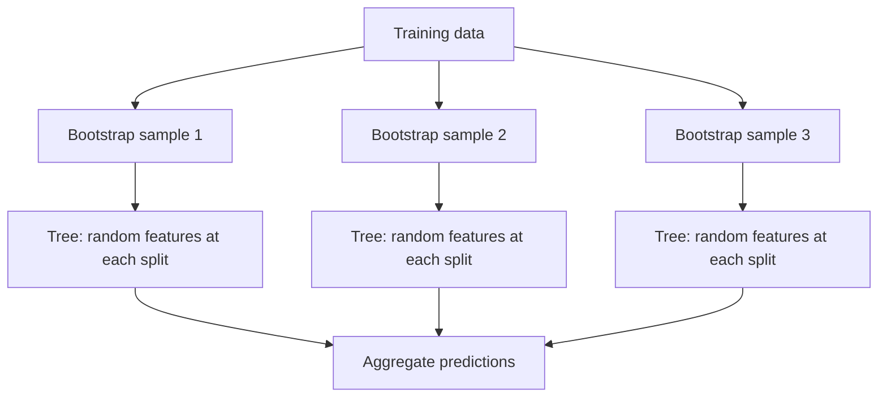

```python
from sklearn.ensemble import RandomForestClassifier
from sklearn.datasets import load_breast_cancer
X, y = load_breast_cancer(return_X_y=True)
Xtr, Xte, ytr, yte = train_test_split(X, y, stratify=y, random_state=42)
rf = RandomForestClassifier(n_estimators=200, max_features="sqrt",
                            min_samples_leaf=2, random_state=42, n_jobs=-1)
rf.fit(Xtr, ytr)
print(rf.score(Xte, yte))
```

Forests capture nonlinearities and interactions without manually constructing every interaction. They are not immune to misleading features or leakage. Standard sklearn forests require numerical representations for input categories; arbitrary numeric codes can limit the kinds of category partitions a threshold can represent.

<a id="topic-109"></a>

## 109. Why random forests often work well

Deep trees tend to have low training bias and high sample-to-sample variance. Bagging averages their variability. Random feature subsets lower correlation between trees, improving the averaging benefit described in chapter 101.

There is a balance: using too few candidate features can make each tree weak; using every feature can make trees too similar. Large leaves can add bias while reducing variance. The best setting depends on signal, noise, sample size, and feature redundancy.

Adding trees generally reduces Monte Carlo variation of the forest average. It does not necessarily eliminate the asymptotic bias or correlated-error floor. “More trees never overfit” is too absolute: in ordinary use more trees often stabilizes performance, but tuning and evaluation still matter.

Forests are strong tabular baselines because they handle nonlinear thresholds and interactions with modest preprocessing. They may struggle with smooth extrapolation, very sparse text compared with specialized linear models, or data with feature structure better represented by convolutional or sequential models.

<a id="topic-110"></a>

## 110. Bagging vs random forest

| Aspect | Generic tree bagging | Random forest |
|---|---|---|
| Row sampling | Usually bootstrap | Usually bootstrap by default |
| Feature randomness | Optional estimator-level feature subsampling | Random candidate subset at each split |
| Base estimator | Configurable | Decision trees |
| Main intention | Stabilize resampled learners | Stabilize and decorrelate trees |

A `BaggingClassifier(max_features=...)` can give a tree a fixed feature subset for its whole fit. A forest typically resamples the candidate subset separately at each split. These are not the same mechanism.

A bagging ensemble of trees can be configured to resemble a forest closely, so the distinction is about algorithmic settings rather than a mystical difference in averaging. For regression, current sklearn forest defaults may consider all features (`max_features=1.0`); random feature restriction is a configurable mechanism, not something to assume from the class name alone.

<a id="topic-111"></a>

## 111. Random forest hyperparameters

Tune a few important controls first:

- `n_estimators`: number of trees; more increases compute and stabilizes averaging.
- `max_features`: diversity versus strength of each split.
- `max_depth`, `min_samples_leaf`, `min_samples_split`: tree complexity.
- `max_samples`: bootstrap sample size when bootstrapping.
- `class_weight`: weighted class objective for classification.
- `bootstrap` and `oob_score`: resampling and internal held-out evaluation.

Start with enough trees for stability and investigate leaf size and feature subset choices. A very deep forest can memorize noisy rows; large minimum leaves can make predictions more stable but miss rare local patterns. Class weighting is not a substitute for evaluating rare-class precision and recall.

Keep reproducibility and deployment limits in view. A thousand deep trees may be unnecessary if a smaller model meets quality and latency needs. Limiting threads with `n_jobs` helps when outer cross-validation is also parallel to avoid excessive nested resource use.

<a id="topic-112"></a>

## 112. GridSearchCV and RandomizedSearchCV

Grid search evaluates every combination in a specified grid. Randomized search samples a fixed number of combinations from lists or distributions.

```python
from sklearn.datasets import load_iris
from sklearn.ensemble import RandomForestClassifier
from sklearn.model_selection import GridSearchCV, RandomizedSearchCV, StratifiedKFold
from scipy.stats import randint
X, y = load_iris(return_X_y=True)
Xtr, Xte, ytr, yte = train_test_split(X, y, stratify=y, random_state=42)
cv = StratifiedKFold(n_splits=3, shuffle=True, random_state=42)
rf = RandomForestClassifier(n_estimators=100, random_state=42, n_jobs=1)
grid = GridSearchCV(rf, {"max_depth": [3, None], "min_samples_leaf": [1, 3]},
                    cv=cv, scoring="accuracy", n_jobs=-1)
random_search = RandomizedSearchCV(
    rf, {"max_depth": randint(2, 12), "min_samples_leaf": randint(1, 8),
         "max_features": ["sqrt", 0.7, 1.0]},
    n_iter=8, cv=cv, scoring="accuracy", random_state=42, n_jobs=-1)
random_search.fit(Xtr, ytr)
print(random_search.best_params_)
print(random_search.score(Xte, yte))
# grid.fit(Xtr, ytr) runs the alternative search.
```

A grid with 5×5×5 settings and five folds requires 625 fits plus refitting. Random search can explore more values of influential parameters for a fixed budget. Use the same folds when comparing settings. Preprocessing and resampling, if any, belong inside the searched pipeline. Nested CV estimates performance of the tuning procedure when no external test is available.

<a id="topic-113"></a>

## 113. OOB score

Out-of-bag evaluation predicts each training row using only trees whose bootstrap samples omitted it. A row is therefore evaluated by a subset of trees that did not train on it.

```python
from sklearn.datasets import load_iris
from sklearn.ensemble import RandomForestClassifier
X, y = load_iris(return_X_y=True)
rf = RandomForestClassifier(n_estimators=300, bootstrap=True,
                            oob_score=True, random_state=42).fit(X, y)
print(rf.oob_score_)
print(rf.oob_decision_function_[:3])
```

With too few trees, some rows may have few or no OOB predictions. More trees improve coverage. OOB saves a dedicated random holdout for certain IID settings, but it is not a time-aware or group-aware evaluation. If preprocessing was fitted on every row before forest training, OOB rows influenced that preprocessing even though individual trees omitted them.

Repeatedly tuning to OOB scores can overfit that internal evaluation. For final claims, use an independent evaluation appropriate to deployment. The default classification OOB score is accuracy, which may be unsuitable for an imbalanced task.

<a id="topic-114"></a>

## 114. Tree and forest feature importance

Impurity-based importance adds the weighted impurity reduction attributable to each feature across nodes, then normalizes. Forest importance averages such quantities across trees.

A feature used often in large, useful splits receives high importance. But high-cardinality continuous features have many candidate split points and can receive inflated importance even without strong true signal. Correlated features may share or substitute for one another, making rankings unstable.

```python
from sklearn.datasets import load_iris
from sklearn.ensemble import RandomForestClassifier
from sklearn.inspection import permutation_importance
X, y = load_iris(return_X_y=True)
Xtr, Xte, ytr, yte = train_test_split(X, y, stratify=y, random_state=42)
rf = RandomForestClassifier(n_estimators=150, random_state=42).fit(Xtr, ytr)
print("impurity", rf.feature_importances_)
perm = permutation_importance(rf, Xte, yte, n_repeats=10, random_state=42)
print("permutation", perm.importances_mean)
```

Permutation importance measures performance loss when a feature is shuffled in held-out data. It reflects reliance of this fitted model under this perturbation, not causal effect. Correlated substitutes can make individual permutation importance look small. If importance results guide further model selection, use validation data for that development and retain a separate final test.

<a id="topic-115"></a>

## 115. AdaBoost geometric intuition

AdaBoost builds a sequence of weak classifiers, often decision stumps. After each round it increases the relative weight of misclassified training examples. The next learner therefore pays more attention to difficult cases. Final prediction is a weighted vote of the learners.

Imagine the first stump separates most examples using age but misses several low-age positives. Those points receive more weight, so the next stump may use spending to isolate them. Combining the stumps creates a richer boundary than either alone.

The algorithm changes the **importance of observations**; it does not necessarily move their coordinates or duplicate them physically. A weak learner must use sample weights correctly. Noisy or mislabeled observations can repeatedly attract attention, making boosting sensitive to them.

The classic binary derivation next uses labels −1/+1 and exponential loss. Current sklearn `AdaBoostClassifier` uses multiclass SAMME; its implementation is not line-for-line identical to the binary normalization used in the scratch example. See the [API reference](https://scikit-learn.org/stable/modules/generated/sklearn.ensemble.AdaBoostClassifier.html).

<a id="topic-116"></a>

## 116. AdaBoost step by step

Begin with $D_i=1/n$. At round $t$, fit $h_t(x)\in\{-1,+1\}$ using weights $D_i$. Its weighted error is

$$\epsilon_t=\sum_iD_i\mathbf1[h_t(x_i)\ne y_i].$$

The classic binary learner weight is

$$\alpha_t=\frac12\log\frac{1-\epsilon_t}{\epsilon_t}.$$

Update and normalize observation weights:

$$D_i\leftarrow\frac{D_i\exp[-\alpha_ty_ih_t(x_i)]}{Z_t}.$$

If correctly classified, $y_ih_t=+1$, so weight multiplies by $e^{-\alpha_t}$. If wrong, it multiplies by $e^{\alpha_t}$. Final prediction is $\operatorname{sign}\sum_t\alpha_th_t(x)$.

With four initially equal-weight rows and one error, $\epsilon=0.25$ and $\alpha=0.5\log3\approx0.5493$. Before normalization, the incorrect row weighs $0.25\sqrt3\approx0.4330$, and each correct row $0.25/\sqrt3\approx0.1443$. After normalization, the wrong row weighs 0.5 and each correct row 1/6.

Thus the next learner spends half its weighted attention on the single missed observation. If error is 0.5, the learner has no useful binary vote; if zero, the ideal coefficient diverges, so implementations stop or handle the case numerically.

<a id="topic-117"></a>

## 117. AdaBoost from scratch

```python
from sklearn.tree import DecisionTreeClassifier
class BinaryAdaBoost:
    def __init__(self, n_estimators=30, learning_rate=1.):
        self.n_estimators = n_estimators
        self.learning_rate = learning_rate

    def fit(self, X, y):
        X = np.asarray(X, float); y = np.asarray(y)
        if set(np.unique(y)) != {-1, 1}:
            raise ValueError("This educational implementation requires -1/+1 labels")
        D = np.ones(len(y)) / len(y)
        self.models_, self.weights_ = [], []
        for t in range(self.n_estimators):
            stump = DecisionTreeClassifier(max_depth=1, random_state=t)
            stump.fit(X, y, sample_weight=D)
            pred = stump.predict(X)
            err = float(D[pred != y].sum())
            if err >= 0.5:
                break
            alpha = self.learning_rate * 0.5 * np.log((1 - max(err, 1e-12)) / max(err, 1e-12))
            self.models_.append(stump); self.weights_.append(alpha)
            if err <= 1e-12:
                break
            D *= np.exp(-alpha * y * pred)
            D /= D.sum()
        if not self.models_:
            raise ValueError("No weak learner achieved error below 0.5")
        return self

    def decision_function(self, X):
        return sum(a * m.predict(X) for a, m in zip(self.weights_, self.models_))

    def predict(self, X):
        return np.where(self.decision_function(X) >= 0, 1, -1)

X = np.array([[0.], [1.], [2.], [3.], [4.], [5.]])
y = np.array([-1, -1, 1, -1, 1, 1])
boost = BinaryAdaBoost().fit(X, y)
print(boost.predict(X))
```

This implements the binary weight-update mechanism using sklearn stumps. It is not a complete production estimator or the current multiclass SAMME implementation. It deliberately rejects a non-informative first learner instead of returning a misleading empty-model prediction. Long runs would benefit from log-space observation weights for numerical stability.

<a id="topic-118"></a>

## 118. AdaBoost hyperparameters and search

The main controls are number of rounds, learning rate, and weak-learner complexity. Deeper trees fit interactions but may cease to be weak and can concentrate on noise.

```python
from sklearn.ensemble import AdaBoostClassifier
from sklearn.tree import DecisionTreeClassifier
from sklearn.model_selection import GridSearchCV
from sklearn.datasets import load_iris
X, y = load_iris(return_X_y=True)
Xtr, Xte, ytr, yte = train_test_split(X, y, stratify=y, random_state=42)
ada = AdaBoostClassifier(estimator=DecisionTreeClassifier(max_depth=1), random_state=42)
search = GridSearchCV(ada, {"n_estimators": [50, 100],
                           "learning_rate": [0.1, 0.5, 1.0],
                           "estimator__max_depth": [1, 2]}, cv=3)
search.fit(Xtr, ytr)
print(search.best_params_, search.score(Xte, yte))
```

Do not copy older `algorithm="SAMME.R"` examples into newer releases: support changed and the current API omits that parameter. Smaller learning rate often needs more rounds, but the optimal combination is empirical. A higher training score after more rounds does not establish better generalization, especially with label noise.

<a id="topic-119"></a>

## 119. Bagging vs boosting

| Aspect | Bagging | Boosting |
|---|---|---|
| Training relationship | Members can fit independently | Sequentially depends on current ensemble |
| Data emphasis | Random resampling | Reweight errors or fit loss gradients |
| Aggregation | Usually averaging/voting | Weighted additive updates |
| Common base learners | Deep trees | Often shallow trees |
| Main intuition | Stabilize variable predictors | Improve current fitted function |
| Noise sensitivity | Depends on base models | Some variants strongly chase hard/noisy cases |

It is useful to associate bagging with variance reduction and boosting with bias reduction, but “bagging only reduces variance” and “boosting only reduces bias” are oversimplifications. Regularization, depth, shrinkage, and data determine the actual bias–variance changes.

AdaBoost reweights examples. Gradient boosting fits negative loss gradients. Both are boosting, but their mechanics differ. Random forests combine bootstrap samples and split-level feature randomness; ordinary gradient boosting does not require bootstrapping at all.

<a id="topic-120"></a>

## 120. Gradient boosting intuition

Gradient boosting constructs an additive model

$$F_M(x)=F_0(x)+\eta\sum_{m=1}^Mh_m(x).$$

Each new weak learner points in a direction that reduces the current loss. For squared error, this direction is the residual: actual target minus current prediction.

Imagine a forecast that is 5 units too low in one region and 3 too high in another. A small tree learns a correction of approximately +5 and −3 for those regions. The ensemble adds a fraction of that correction, then repeats on the new remaining errors.

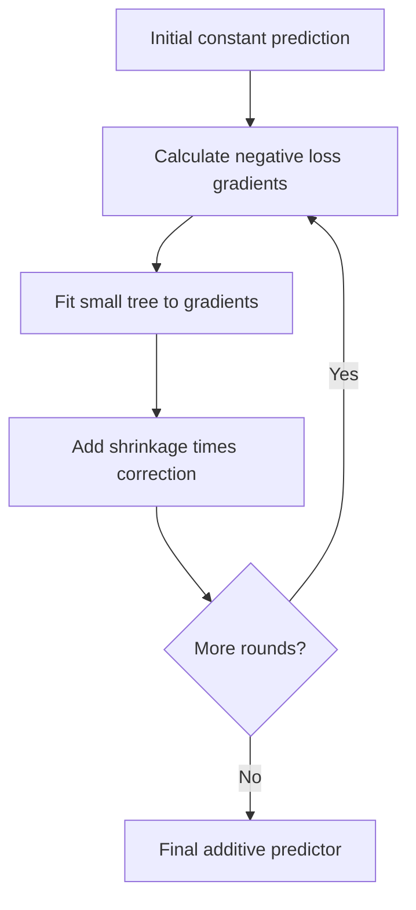

The trees generally predict **corrections**, not independent full target predictions. Averaging all gradient-boosting trees as though they were random forest members would be wrong. Learning rate, tree depth, and stopping together control flexibility. For larger tabular data, histogram-based implementations can be much faster than evaluating every possible split exactly.

<a id="topic-121"></a>

## 121. Gradient boosting regression mathematics

With $L(y,F)=\frac12(y-F)^2$, the optimal initial constant is $F_0=\bar y$. The negative gradient is

$$r_i=-\frac{\partial L}{\partial F_i}=y_i-F_i.$$

Fit a tree to $r_i$. For a leaf region $R$, the optimal squared-error correction is the mean residual in that region. Update $F\leftarrow F+\eta h$.

For targets $[10,12,20,22]$, initial prediction is 16, residuals are $[-6,-4,4,6]$. A stump splitting the first pair from the last predicts corrections −5 and +5. With $\eta=0.1$, new predictions are $[15.5,15.5,16.5,16.5]$. Shrinkage deliberately takes a partial step.

```python
from sklearn.tree import DecisionTreeRegressor
X = np.arange(4.).reshape(-1, 1); y = np.array([10., 12., 20., 22.])
initial = y.mean(); pred = np.full(len(y), initial)
trees = []
for t in range(20):
    tree = DecisionTreeRegressor(max_depth=1, random_state=t).fit(X, y - pred)
    pred += 0.1 * tree.predict(X)
    trees.append(tree)
new = np.array([[1.5], [3.]])
new_pred = initial + 0.1 * sum(t.predict(new) for t in trees)
print(pred, new_pred)
```

This is a complete minimal squared-error boosting loop. For other losses, the pseudo-residual is a gradient and the leaf's optimal update may require a different calculation.

<a id="topic-122"></a>

## 122. Gradient boosting classification

For binary classification, boost an additive **logit score** $F$, with $p=\sigma(F)$. Binary cross-entropy has gradient $p-y$, so the negative gradient is $y-p$.

Initialize $F_0=\log(\bar y/(1-\bar y))$ when both classes are present. Fit a regression tree to $y-p$, calculate suitable leaf updates, add a shrunken correction to $F$, then recompute probabilities. The trees are regression trees even though the final task is classification.

A common Newton-style leaf update is

$$\gamma_R=\frac{\sum_{i\in R}(y_i-p_i)}{\sum_{i\in R}p_i(1-p_i)}.$$

This is an approximate logit-space step, not an instruction to add residuals directly to probabilities. Exact factors can differ under alternative score parameterizations.

```python
from sklearn.ensemble import GradientBoostingClassifier
from sklearn.datasets import make_moons
X, y = make_moons(n_samples=300, noise=0.25, random_state=42)
Xtr, Xte, ytr, yte = train_test_split(X, y, stratify=y, random_state=42)
gbc = GradientBoostingClassifier(n_estimators=100, learning_rate=0.05,
                                 max_depth=2, random_state=42).fit(Xtr, ytr)
print(gbc.score(Xte, yte))
```

Probabilities can still be poorly calibrated. Validate both ranking/decision metrics and calibration if the output will be interpreted as risk.

<a id="topic-123"></a>

## 123. Introduction to XGBoost

XGBoost is a gradient-boosted tree system with regularized objectives, second-order optimization, efficient split search, sparsity handling, and systems optimizations. It belongs to the boosting family; it is not a random forest with a different name.

Key ideas include first and second loss derivatives, regularized leaf weights, a penalty for additional leaves, and row/column sampling. These allow flexible trees while controlling complexity and compute.

**Optional installation:** `python -m pip install xgboost`.

```python
# Optional integration:
from xgboost import XGBRegressor
model = XGBRegressor(n_estimators=200, max_depth=3, learning_rate=0.05,
                      tree_method="hist", objective="reg:squarederror",
                      random_state=42, n_jobs=2)
```

Trees generally do not require standardization. Category and missing-value handling must still match the chosen interface and dtype configuration. Powerful software does not remove the need for leakage-free features, careful validation, and a baseline. See the [official tutorials](https://xgboost.readthedocs.io/en/stable/tutorials/index.html).

<a id="topic-124"></a>

## 124. XGBoost for regression

For squared loss $\frac12(\hat y-y)^2$, gradients are $g_i=\hat y_i-y_i$ and Hessians $h_i=1$. In a leaf, define $G=\sum g_i$ and $H=\sum h_i$. With L2 leaf penalty $\lambda$, its optimal incremental weight is

$$w^*=-\frac{G}{H+\lambda}.$$

If current prediction is 16 and leaf targets are 10 and 12, gradients are 6 and 4. Thus $G=10,H=2$. With $\lambda=1$, correction is −10/3 rather than the unregularized residual mean −5. Shrinkage applies another factor $\eta$ when adding the tree.

```python
# Optional; requires xgboost.
from xgboost import XGBRegressor
from sklearn.datasets import make_regression
X, y = make_regression(n_samples=300, n_features=6, noise=10, random_state=42)
Xtr, Xte, ytr, yte = train_test_split(X, y, random_state=42)
xgb = XGBRegressor(n_estimators=250, max_depth=3, learning_rate=0.05,
                   reg_lambda=1., subsample=0.8, colsample_bytree=0.8,
                   tree_method="hist", random_state=42, n_jobs=2)
xgb.fit(Xtr, ytr)
print(mean_squared_error(yte, xgb.predict(Xte))**0.5)
```

If using early stopping, create a validation set from training data; do not use the final test as `eval_set`. Keep the test untouched until model and stopping choices are fixed.

<a id="topic-125"></a>

## 125. XGBoost for classification

For binary logistic loss, the ensemble score is a logit and $p=\sigma(F)$. Its derivatives are

$$g_i=p_i-y_i,\qquad h_i=p_i(1-p_i).$$

The same regularized leaf formula $-G/(H+\lambda)$ now uses these classification derivatives. If a leaf contains positives whose current probabilities are too small, its total gradient tends negative and its update becomes positive, increasing their logits.

```python
# Optional; requires xgboost.
from xgboost import XGBClassifier
from sklearn.datasets import load_breast_cancer
from sklearn.metrics import roc_auc_score
X, y = load_breast_cancer(return_X_y=True)
Xtr, Xte, ytr, yte = train_test_split(X, y, stratify=y, random_state=42)
clf = XGBClassifier(n_estimators=150, max_depth=3, learning_rate=0.05,
                     objective="binary:logistic", eval_metric="logloss",
                     tree_method="hist", random_state=42, n_jobs=2)
clf.fit(Xtr, ytr)
print(roc_auc_score(yte, clf.predict_proba(Xte)[:, 1]))
```

For multiclass problems use a compatible multiclass objective and correctly encoded classes. Class weighting changes training emphasis and may affect calibration. The Hessian is loss curvature, not the uncertainty of a final prediction; do not interpret a leaf's Hessian sum as a confidence interval.

<a id="topic-126"></a>

## 126. The mathematics behind XGBoost

At boosting round $t$, add tree $f_t$. The objective is loss plus tree regularization:

$$\sum_iL(y_i,F_{t-1}(x_i)+f_t(x_i))+\Omega(f_t),\qquad
\Omega(f)=\gamma T+\frac\lambda2\sum_{j=1}^Tw_j^2.$$

Here $T$ is leaf count and $w_j$ is leaf output. A second-order Taylor approximation around current predictions gives, ignoring constants,

$$\sum_i[g_if_t(x_i)+\tfrac12h_if_t(x_i)^2]+\Omega(f_t).$$

For a fixed tree structure, group observations by leaf:

$$\sum_{j=1}^T[G_jw_j+\tfrac12(H_j+\lambda)w_j^2]+\gamma T.$$

Differentiating gives $w_j^*=-G_j/(H_j+\lambda)$. Substitution yields the minimized structure score

$$-\frac12\sum_j\frac{G_j^2}{H_j+\lambda}+\gamma T.$$

The gain from splitting one parent into left and right children is

$$\frac12\left[\frac{G_L^2}{H_L+\lambda}+\frac{G_R^2}{H_R+\lambda}
-\frac{(G_L+G_R)^2}{H_L+H_R+\lambda}\right]-\gamma.$$

For $G_L=-4,H_L=2,G_R=4,H_R=2,\lambda=1,\gamma=0$, gain is $\frac12(16/3+16/3)=16/3$. Opposing gradient groups benefit from different corrections. If $\gamma=6$, this split would no longer have positive gain.

`min_child_weight` constrains a child's Hessian sum; it is not always a row-count minimum. `reg_lambda`, `reg_alpha`, `gamma`, depth, and shrinkage act through different mechanisms. See [parameters](https://xgboost.readthedocs.io/en/stable/parameter.html) and the [model tutorial](https://xgboost.readthedocs.io/en/stable/tutorials/model.html) for implementation conventions, including optional L1 penalties.

<a id="topic-127"></a>

## 127. Stacking and blending

Stacking trains a meta-model on predictions from base models. The critical detail is **out-of-fold predictions**. If the meta-model receives predictions that base models made on their own training rows, it can learn from unrealistically optimistic inputs.

Procedure: split training data into folds; fit each base model on the other folds; predict the held-out fold; concatenate these predictions to form meta-features. Fit the meta-model on this new table. Then refit base models on all training rows for eventual inference.

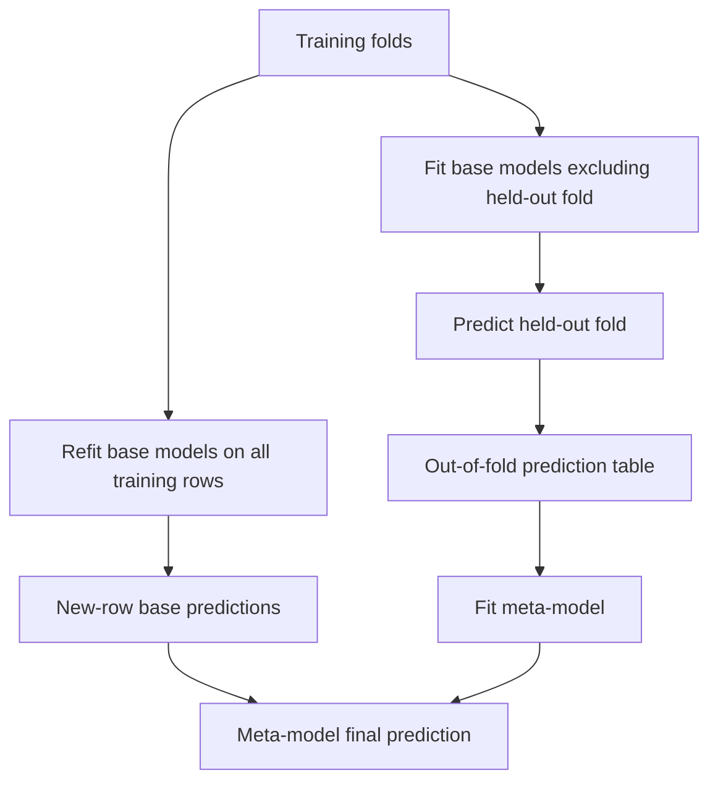

```python
from sklearn.ensemble import StackingClassifier, RandomForestClassifier
from sklearn.linear_model import LogisticRegression
from sklearn.neighbors import KNeighborsClassifier
from sklearn.datasets import load_iris
X, y = load_iris(return_X_y=True)
Xtr, Xte, ytr, yte = train_test_split(X, y, stratify=y, random_state=42)
stack = StackingClassifier(
    estimators=[("lr", make_pipeline(StandardScaler(), LogisticRegression(max_iter=1000))),
                ("rf", RandomForestClassifier(n_estimators=100, random_state=42))],
    final_estimator=LogisticRegression(max_iter=1000), cv=3)
stack.fit(Xtr, ytr)
print(stack.score(Xte, yte))
```

Blending commonly uses one dedicated holdout set for meta-training instead of cross-validated predictions. It is simpler but uses less data to train base models. Terminology varies. With temporal or grouped data, the meta-feature generation must respect the same prediction boundaries; default random/stratified folds may be inappropriate.

---
# Part X — Clustering, imbalance, and optimization

<a id="topic-128"></a>

## 128. K-means clustering: geometric intuition

K-means partitions observations into $K$ groups by minimizing within-cluster squared Euclidean distance:

$$J=\sum_{i=1}^n\|x_i-\mu_{c_i}\|^2.$$

Here $c_i$ is row $i$'s assigned cluster and $\mu_k$ is cluster $k$'s centroid. Alternate two steps:

1. Assign every row to its nearest current centroid.
2. Replace each centroid by the mean of its assigned rows.

For points $[1,2,8,9]$ and initial centroids 1 and 8, assignment gives groups $[1,2]$ and $[8,9]$. Updated centroids are 1.5 and 8.5. Reassignment is unchanged, so this run has converged. The arithmetic mean minimizes squared distance within a fixed group, explaining the update.

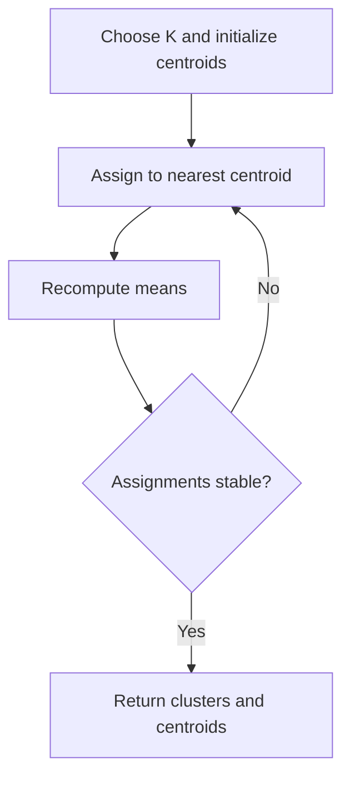

The objective does not increase under exact alternating updates, but convergence can be to a local optimum. Initialization matters. K-means++ spreads initial centers probabilistically; multiple starts improve reliability.

K-means favors compact roughly spherical clusters in the chosen metric. It is sensitive to scale and extreme points, and poorly represents rings or clusters with very different densities. Cluster numbers are arbitrary labels: cluster 0 is not intrinsically “better” than cluster 1. Choosing $K$ is a modeling and usefulness decision, not something inertia alone can solve.

<a id="topic-129"></a>

## 129. K-means practical student example

Suppose each student has study hours and attendance. The goal is describing patterns, not ranking worth or inferring intelligence. Scale the inputs before Euclidean clustering so percentage units do not dominate hours.

```python
from sklearn.cluster import KMeans
from sklearn.metrics import silhouette_score
students = pd.DataFrame({
    "hours": [1, 1.5, 2, 4, 4.5, 5, 7, 7.5, 8],
    "attendance": [45, 50, 48, 70, 75, 72, 92, 95, 90],
})
sc = StandardScaler().fit(students)
A = sc.transform(students)
km = KMeans(n_clusters=3, n_init=10, random_state=42).fit(A)
students["cluster"] = km.labels_
print(students.groupby("cluster").mean())
print("original-unit centers", sc.inverse_transform(km.cluster_centers_))
print("silhouette", silhouette_score(A, km.labels_))
plt.scatter(students["hours"], students["attendance"], c=km.labels_, cmap="viridis")
plt.xlabel("Hours"); plt.ylabel("Attendance (%)"); plt.show()
```

Inertia decreases as $K$ increases, eventually reaching zero if every distinct point has its own cluster. An elbow is a heuristic, not proof. Silhouette compares within-cluster distance with the nearest alternative cluster; it requires at least two clusters and fewer clusters than observations. It too favors certain shapes. Examine stability, interpretability, and whether the groups support a useful action. Nine invented students are only a demonstration.

<a id="topic-130"></a>

## 130. K-means from scratch

```python
def kmeans_scratch(X, k, max_iter=100, seed=42):
    X = np.asarray(X, dtype=float)
    if not 1 <= k <= len(X):
        raise ValueError("Require 1 <= k <= number of rows")
    rng = np.random.default_rng(seed)
    centers = X[rng.choice(len(X), size=k, replace=False)].copy()
    for _ in range(max_iter):
        d2 = ((X[:, None, :] - centers[None, :, :])**2).sum(axis=2)
        labels = d2.argmin(axis=1)
        new_centers = centers.copy()
        for j in range(k):
            members = X[labels == j]
            if len(members):
                new_centers[j] = members.mean(axis=0)
            # Empty cluster: retain its previous center in this simple version.
        if np.allclose(new_centers, centers):
            centers = new_centers
            break
        centers = new_centers
    # Recompute labels so they correspond to the returned centers.
    d2 = ((X[:, None, :] - centers[None, :, :])**2).sum(axis=2)
    labels = d2.argmin(axis=1)
    inertia = d2[np.arange(len(X)), labels].sum()
    return labels, centers, inertia

X = np.array([[1.], [2.], [8.], [9.]])
labels, centers, inertia = kmeans_scratch(X, 2)
print(labels, centers, inertia)
```

Broadcasting creates a `(n,k,d)` array of point-minus-center differences; summing over features gives an `(n,k)` squared-distance matrix. This direct implementation can consume substantial memory on large inputs. Production implementations use optimized routines, better initialization, multiple starts, and more deliberate empty-cluster handling. Retaining an empty center can yield fewer occupied clusters; do not pretend that guarantees $K$ nonempty groups.

<a id="topic-131"></a>

## 131. Agglomerative hierarchical clustering

Agglomerative clustering starts with each row as its own cluster and repeatedly merges clusters. A **linkage** rule defines inter-cluster distance:

| Linkage | Distance/criterion | Typical behavior |
|---|---|---|
| Single | Closest pair between clusters | Can connect through chains |
| Complete | Farthest pair | Encourages compact groups |
| Average | Average pairwise distance | Intermediate behavior |
| Ward | Increase in within-cluster SSE | Variance-focused; Euclidean geometry |

The merge sequence forms a dendrogram. Cutting it at a height or selecting a number of clusters gives a partition. Dendrogram branch order on the page is not a ranking; merge heights contain the meaningful dissimilarity information.

```python
from sklearn.cluster import AgglomerativeClustering
from scipy.cluster.hierarchy import linkage, dendrogram
X = np.array([[1., 1.], [1.2, 1.1], [5., 5.], [5.2, 4.9], [9., 1.]])
A = StandardScaler().fit_transform(X)
labels = AgglomerativeClustering(n_clusters=3, linkage="ward").fit_predict(A)
print(labels)
Z = linkage(A, method="ward")
dendrogram(Z); plt.ylabel("Merge distance"); plt.show()
```

Unlike ordinary K-means, no initial centroid is needed, but linkage and scaling strongly influence results. Many hierarchical methods have substantial quadratic memory/time costs. Sklearn's agglomerative estimator does not provide a general `predict` method for arbitrary new observations; assigning future rows requires an additional policy or refitting rather than assuming K-means-like inference.

<a id="topic-132"></a>

## 132. DBSCAN

DBSCAN groups dense connected regions and marks sparse points as noise. It uses radius `eps` and minimum neighborhood count `min_samples`.

- A **core point** has at least `min_samples` observations in its `eps` neighborhood, including itself in sklearn's convention.
- A **border point** is within reach of a core point but is not itself core.
- A **noise point** is not assigned to any density-connected cluster.

Core-to-core chains expand clusters. A border point can attach to a cluster but does not extend the chain as a core point does. Border assignments can be ambiguous when a point touches multiple clusters.

```python
from sklearn.datasets import make_moons
from sklearn.cluster import DBSCAN
X, _ = make_moons(n_samples=300, noise=0.05, random_state=42)
A = StandardScaler().fit_transform(X)
db = DBSCAN(eps=0.22, min_samples=5).fit(A)
print("noise rows", np.sum(db.labels_ == -1))
plt.scatter(A[:, 0], A[:, 1], c=db.labels_, cmap="tab10", s=12)
plt.xlabel("Scaled x1"); plt.ylabel("Scaled x2"); plt.show()
```

DBSCAN can find curved clusters and does not require $K$. But one global density scale may fail when clusters have different densities. Too-small eps makes many points noise; too-large eps merges groups. Scale affects neighborhoods and high dimensions weaken distance meaning. A k-distance plot can suggest candidate eps values, but it is a heuristic.

Noise label −1 does not prove a data error. Sklearn DBSCAN has no ordinary new-row `predict` interface, and comparing clusters requires careful handling of noise. Report cluster count, noise fraction, stability, and usefulness together.


### Hand-trace a density cluster

On a one-dimensional line take points $[0,0.1,0.2,0.3,2.0]$, `eps=0.11`, and `min_samples=3`, counting each point itself. Point 0.1 sees 0, 0.1, and 0.2, so it is core. Point 0.2 sees 0.1, 0.2, and 0.3, so it is also core. Their core neighborhoods connect. Point 0 sees only itself and 0.1, so it is border rather than core; similarly 0.3 is border. Point 2.0 has no core neighbor and becomes noise.

The cluster therefore includes all four nearby points even though the endpoint distance 0.3 exceeds eps. Eps limits **local neighborhood connections**, not a cluster's total diameter. This is how DBSCAN follows a curved or elongated dense shape that a single centroid-based spherical cluster would describe poorly.

<a id="topic-133"></a>

## 133. Imbalanced data: undersampling, oversampling, and SMOTE

Imbalance means class frequencies differ strongly. It becomes a problem when ordinary optimization or metrics under-serve the important rare class. An all-negative fraud detector can be accurate and useless.

First define the operational goal, choose stratified or time-appropriate splits, and inspect precision–recall trade-offs. Options include class weights, threshold tuning, collecting more rare examples, or resampling **training folds only**.

| Method | Mechanism | Risk |
|---|---|---|
| Random undersampling | Remove majority rows | Discards useful information |
| Random oversampling | Repeat minority rows | Can overfit repeated examples |
| SMOTE | Interpolate between minority neighbors | Can create implausible/boundary-crossing points |
| Class weighting | Change loss contribution | May affect probability calibration |

SMOTE constructs

$$x_{new}=x_i+u(x_{neighbor}-x_i),\qquad u\sim Uniform(0,1).$$

Between minority points $(2,4)$ and $(4,8)$ with $u=0.25$, the new point is $(2.5,5)$. This adds no genuinely independent new observation. For nominal features, naive interpolation can create nonsense; consider suitable categorical variants such as SMOTENC.

**Optional:** `python -m pip install imbalanced-learn`.

```python
# Optional integration. Use imblearn Pipeline, not sklearn Pipeline, for samplers.
from imblearn.pipeline import Pipeline as ImbPipeline
from imblearn.over_sampling import SMOTE
from sklearn.datasets import make_classification
from sklearn.linear_model import LogisticRegression
from sklearn.model_selection import StratifiedKFold, cross_val_score
from sklearn.metrics import average_precision_score
X, y = make_classification(n_samples=700, n_features=8, weights=[0.95, 0.05],
                           n_redundant=2, random_state=42)
Xtr, Xte, ytr, yte = train_test_split(X, y, stratify=y, random_state=42)
pipe = ImbPipeline([("scale", StandardScaler()),
                    ("smote", SMOTE(random_state=42, k_neighbors=3)),
                    ("model", LogisticRegression(max_iter=1000))])
cv = StratifiedKFold(n_splits=3, shuffle=True, random_state=42)
print(cross_val_score(pipe, Xtr, ytr, scoring="average_precision", cv=cv).mean())
pipe.fit(Xtr, ytr)
print(average_precision_score(yte, pipe.predict_proba(Xte)[:, 1]))
```

Never resample before splitting: synthetic examples can be derived from eventual validation rows, causing leakage. Leave validation/test class prevalence realistic for the intended deployment. SMOTE requires enough minority neighbors in every training fold; lower `k_neighbors` or choose another method when data are scarce. Average precision summarizes a precision–recall ranking and is not ordinary accuracy.

<a id="topic-134"></a>

## 134. Optuna and Bayesian optimization

Hyperparameter optimization searches for settings that give good validation performance. Grid search enumerates; random search samples without adapting; sequential model-based optimization uses earlier trials to suggest promising settings.

Optuna separates the **objective** you evaluate from the **sampler** that proposes values. TPE, explicitly selected below, models densities of configurations associated with good and worse outcomes and uses that information to propose candidates. It is not the same algorithm as Gaussian-process Bayesian optimization, although both are commonly grouped under model-based/Bayesian hyperparameter optimization.

**Optional:** `python -m pip install optuna`.

```python
import optuna
from sklearn.datasets import load_breast_cancer
from sklearn.ensemble import RandomForestClassifier
from sklearn.model_selection import StratifiedKFold, cross_val_score, train_test_split
from sklearn.metrics import roc_auc_score
X, y = load_breast_cancer(return_X_y=True)
Xtr, Xte, ytr, yte = train_test_split(X, y, stratify=y, random_state=42)
cv = StratifiedKFold(n_splits=3, shuffle=True, random_state=42)

def objective(trial):
    model = RandomForestClassifier(
        n_estimators=trial.suggest_int("n_estimators", 100, 300, step=50),
        max_depth=trial.suggest_int("max_depth", 2, 12),
        min_samples_leaf=trial.suggest_int("min_samples_leaf", 1, 10),
        max_features=trial.suggest_float("max_features", 0.3, 1.0),
        random_state=42, n_jobs=1,
    )
    return cross_val_score(model, Xtr, ytr, cv=cv, scoring="roc_auc", n_jobs=1).mean()

study = optuna.create_study(direction="maximize",
                            sampler=optuna.samplers.TPESampler(seed=42))
study.optimize(objective, n_trials=20)
best = RandomForestClassifier(**study.best_params, random_state=42, n_jobs=1)
best.fit(Xtr, ytr)
print(study.best_params)
print("final test AUC", roc_auc_score(yte, best.predict_proba(Xte)[:, 1]))
```

The test set is absent from the objective. Each trial is scored using the same fixed folds for fairer comparisons. For parameters spanning orders of magnitude, use logarithmic sampling, such as `trial.suggest_float("alpha", 1e-5, 10, log=True)`.

Pruning can stop unpromising trials only when the objective reports useful intermediate results and checks pruning; it is not automatically activated by this simple RF objective. Seeds improve reproducibility but do not remove sampling uncertainty. Twenty trials are an illustrative budget, not a guarantee of finding the global optimum. See [Optuna's sampler guide](https://optuna.readthedocs.io/en/stable/tutorial/10_key_features/003_efficient_optimization_algorithms.html).

---


### Separate three different kinds of optimization

1. **Parameter fitting:** gradient descent or a tree-building procedure chooses weights, thresholds, or leaf values from one training fold.
2. **Hyperparameter search:** Optuna or another search procedure chooses settings such as depth or regularization by repeatedly fitting models and examining validation scores.
3. **Business decision optimization:** a threshold or allocation policy converts model scores into actions under costs and capacity constraints.

These layers can all overfit if evaluated on the wrong data. A weight optimizer should not read validation labels as training labels. A hyperparameter search should not use final test outcomes. A threshold-selection procedure should be evaluated on data that did not determine that threshold. More sophisticated optimization at one layer cannot compensate for leakage at another.

# Appendix A — A small dataset you can reason about

The following fictional table supports manual feature-engineering practice. `renewed` is observed after the prediction date; every other column must be restricted to information known beforehand.

| customer_id | age | city | monthly_spend | visits_30d | plan | renewed |
|---|---:|---|---:|---:|---|---:|
| C01 | 22 | Pune | 500 | 8 | basic | 1 |
| C02 | 35 | Mumbai | 1500 | 2 | premium | 0 |
| C03 | missing | Pune | 700 | 7 | basic | 1 |
| C04 | 41 | Surat | missing | 1 | premium | 0 |
| C05 | 29 | missing | 900 | 6 | basic | 1 |
| C06 | 52 | Mumbai | 10000 | 0 | premium | 0 |

```python
practice = pd.DataFrame({
    "customer_id": ["C01", "C02", "C03", "C04", "C05", "C06"],
    "age": [22, 35, np.nan, 41, 29, 52],
    "city": ["Pune", "Mumbai", "Pune", "Surat", np.nan, "Mumbai"],
    "monthly_spend": [500., 1500., 700., np.nan, 900., 10000.],
    "visits_30d": [8, 2, 7, 1, 6, 0],
    "plan": ["basic", "premium", "basic", "premium", "basic", "premium"],
    "renewed": [1, 0, 1, 0, 1, 0],
})
```

Exercise: identify nominal features, numerical features, IDs, target, missingness indicators, and a possible outlier. Is plan truly ordinal? A higher price does not necessarily imply one linear numerical effect. Is ₹10,000 invalid? Not without context. Should the customer ID be used? Usually omit an arbitrary identifier unless the task deliberately models identity/history.

Six rows are too few for meaningful model comparison. Use them for tracing transformations, not estimating production accuracy.

# Appendix B — Model and preprocessing decision tables

## Choosing a baseline

| Situation | Sensible first comparison | Why |
|---|---|---|
| Numerical tabular target | Dummy mean/median, linear or ridge model | Establish basic predictive value |
| Binary tabular classification | Dummy classifier, scaled logistic regression | Simple probability-based baseline |
| Nonlinear tabular structure | Random forest or gradient boosting | Captures interactions and thresholds |
| Sparse word-count classification | Multinomial NB and regularized linear model | Suits sparse high-dimensional representations |
| Small nonlinear classification data | Scaled RBF SVM | Flexible kernel boundary |
| Exploratory compact clusters | Scaled K-means | Interpretable centroid baseline |
| Curved dense clusters with noise | Scaled DBSCAN | Density connectivity rather than spherical centers |

These are starting points, not universal winners. Dataset size, missingness, latency, interpretability, and intended use change the choice.

## What is learned during preprocessing?

| Operation | Training-fitted information | Leakage risk if done before splitting? |
|---|---|---|
| StandardScaler | Means and standard deviations | Yes |
| Median imputer | Per-column medians | Yes |
| OneHotEncoder | Vocabulary/categories unless explicitly supplied | Yes |
| PCA | Mean and component directions | Yes |
| PowerTransformer | Power parameters and optional scaling | Yes |
| Fixed `log1p` | No data-estimated parameter | No parameter leakage by itself; feature/domain choice can still be tuned improperly |
| SMOTE | Neighbor relationships and generated training rows | Yes, especially severe |
| Target encoding | Feature-to-target relationships | Yes; usually needs cross-fitting |

## Learning method, objective, and inference

| Algorithm | What training learns/stores | New-row prediction |
|---|---|---|
| OLS / ridge / lasso | Coefficients and intercept | Weighted feature sum |
| Logistic regression | Class-score coefficients | Sigmoid/softmax of scores |
| Naive Bayes | Priors and feature likelihood parameters | Posterior class comparison |
| KNN | Training examples and neighbor configuration | Neighbor vote/average |
| Kernel SVM | Support vectors, signed coefficients, bias | Kernel-weighted support-vector sum |
| Decision tree | Features, thresholds, leaf outputs | Follow branches to leaf |
| Random forest | Many randomized trees | Average tree outputs |
| Gradient boosting | Initial score and correction trees | Add weighted corrections |
| K-means | Centroids | Nearest centroid |
| Agglomerative / sklearn DBSCAN | Fitted clustering/structure | No standard estimator `predict`; define an additional policy |

# Appendix C — Reproducible capstone: raw table to held-out prediction

This single script creates a moderately sized synthetic customer table with numerical and categorical features, controlled missingness, a train/test split, preprocessing, cross-validated tuning, and final evaluation. Its data-generating rule is deliberately artificial. It is suitable for practicing the workflow without downloading a dataset.

## C1. Complete classification project

```python
import numpy as np
import pandas as pd
from scipy.special import expit
from sklearn.compose import ColumnTransformer
from sklearn.impute import SimpleImputer
from sklearn.preprocessing import StandardScaler, OneHotEncoder
from sklearn.pipeline import Pipeline
from sklearn.linear_model import LogisticRegression
from sklearn.dummy import DummyClassifier
from sklearn.model_selection import train_test_split, StratifiedKFold, GridSearchCV
from sklearn.metrics import (roc_auc_score, average_precision_score,
                             confusion_matrix, classification_report,
                             brier_score_loss)

rng = np.random.default_rng(42)
n = 1200
age = rng.integers(18, 66, n).astype(float)
visits = rng.poisson(4, n).astype(float)
spend = rng.lognormal(mean=6.3, sigma=0.7, size=n)
city = rng.choice(["Pune", "Mumbai", "Surat"], n).astype(object)
plan = rng.choice(["basic", "premium"], n, p=[0.7, 0.3]).astype(object)
logit = (-1.4 + 0.50 * visits - 0.012 * (age - 35)
         + 0.4 * (plan == "premium") - 0.0005 * spend)
y = rng.binomial(1, expit(logit))
X = pd.DataFrame({"age": age, "visits": visits, "spend": spend,
                  "city": city, "plan": plan})
for col in ["age", "spend", "city"]:
    X.loc[rng.random(n) < 0.08, col] = np.nan

Xtr, Xte, ytr, yte = train_test_split(X, y, test_size=0.2,
                                      stratify=y, random_state=42)
num_cols = ["age", "visits", "spend"]
cat_cols = ["city", "plan"]
num_pipe = Pipeline([
    ("imputer", SimpleImputer(strategy="median", add_indicator=True)),
    ("scale", StandardScaler()),
])
cat_pipe = Pipeline([
    ("imputer", SimpleImputer(strategy="constant", fill_value="__MISSING__")),
    ("onehot", OneHotEncoder(handle_unknown="ignore")),
])
prepare = ColumnTransformer([("numeric", num_pipe, num_cols),
                              ("categorical", cat_pipe, cat_cols)])
pipe = Pipeline([("prepare", prepare),
                 ("model", LogisticRegression(max_iter=2000))])
cv = StratifiedKFold(n_splits=5, shuffle=True, random_state=42)
search = GridSearchCV(pipe, {"model__C": [0.01, 0.1, 1., 10.]},
                       cv=cv, scoring="roc_auc", n_jobs=1)
search.fit(Xtr, ytr)

baseline = DummyClassifier(strategy="prior").fit(Xtr, ytr)
p = search.predict_proba(Xte)[:, 1]
p0 = baseline.predict_proba(Xte)[:, 1]
pred = (p >= 0.5).astype(int)
print("Selected parameters:", search.best_params_)
print("Baseline AUC:", roc_auc_score(yte, p0))
print("Model AUC:", roc_auc_score(yte, p))
print("Average precision:", average_precision_score(yte, p))
print("Brier score:", brier_score_loss(yte, p))
print("Confusion matrix [negative, positive]:\n", confusion_matrix(yte, pred))
print(classification_report(yte, pred, zero_division=0))

new_customer = pd.DataFrame({"age": [28.], "visits": [6.], "spend": [700.],
                             "city": ["Pune"], "plan": ["basic"]})
print("Renewal probability:", search.predict_proba(new_customer)[0, 1])
print(search.best_estimator_.named_steps["prepare"].get_feature_names_out())
```

The learning procedure never sees held-out targets during fitting or tuning. Imputer medians, scale statistics, and category mappings are refitted inside each training fold. The final chosen pipeline is refitted on all `Xtr` by `GridSearchCV` before test evaluation.

The Brier score is mean squared probability error, so smaller is better. It complements ranking metrics but does not alone diagnose every calibration issue. The 0.5 threshold is a demonstration; for contact-budget decisions, select a threshold on separate validation or out-of-fold training predictions. Once the test has been inspected, do not keep modifying the model and presenting the same test as an untouched final evaluation.

## C2. Meaningful extensions

1. Replace logistic regression with a forest; compare using the same folds and target metric.
2. Remove spend and observe whether results change consistently across folds.
3. Increase missingness and compare median-plus-indicator with KNN imputation.
4. Add nonlinear effects to the generating rule and compare polynomial features with trees.
5. Introduce chronological data and replace random splitting with temporal validation.
6. Plot calibration and precision–recall curves on validation predictions before choosing actions.

When comparing many alternatives, reserve another final test or use nested CV to estimate the whole selection procedure. The dataset is synthetic, so real-world fairness, measurement, and operational issues remain additional work.

# Appendix D — Check your understanding, with answers

### D1. What exactly does the model learn?

For linear regression it learns coefficients and intercept, not the future target values. For KNN it mainly stores training examples; prediction compares a query to them. A pipeline also learns preprocessing statistics and category vocabularies.

### D2. Why split before scaling if scaling ignores y?

Validation rows still reveal information about the input distribution. A clean estimate imitates a future query whose distribution was unavailable during fitting. Fit the entire pipeline within each training fold, even for unsupervised transforms such as PCA.

### D3. Does standardization make data Gaussian?

No. Subtracting a mean and dividing by a positive scale preserves skewness shape. It changes center and units. A power transform changes shape, but still does not guarantee normality or improved predictions.

### D4. Is a polynomial model nonlinear or linear?

It is nonlinear in the original inputs but linear in fitted coefficients. $b+w_1x+w_2x^2$ is linear regression on features $x$ and $x^2$.

### D5. Why do correctly classified logistic points still update weights?

Cross-entropy rewards better probability for the observed label, not merely the correct side of a threshold. A positive point at probability 0.9 still has gradient coefficient $p-y=-0.1$. The remaining dataset and regularization balance its pressure for higher confidence.

### D6. For three classes, do only class-2 rows train class-2 weights?

No. For class 2, each row contributes $(p_2-\mathbf1[y=2])x$. A row from another class pushes its class-2 probability down. The softmax denominator couples all classes.

### D7. Can independent events overlap?

Yes. The die example “even” and “greater than four” overlaps at 6 and satisfies independence. Exclusivity means no overlap, which is generally incompatible with independence for positive-probability events.

### D8. Where does Bayes' denominator come from?

It is the total probability of the observed evidence, summing over all possible classes: $P(x)=\sum_cP(x\mid c)P(c)$. It normalizes prior-times-likelihood scores to sum to one.

### D9. What are SVM alpha values?

One constrained learned coefficient per training sample in the dual problem. They express feature-space weights as $w=\sum_i\alpha_iy_i\phi(x_i)$. They are not one coefficient per original input feature and are not selected randomly.

### D10. Where is the kernel matrix used?

The dual training objective uses $Q_{ij}=y_iy_jK(x_i,x_j)$ to optimize all alpha coefficients. During inference, compare a query with support vectors, weight by signed alpha, add the bias, and take the sign.

### D11. Why can Lasso produce exact zeros while ridge usually cannot?

The L1 objective has a corner at zero. Its subgradient permits an entire interval of data-gradient values to balance at zero, producing soft thresholding. Ridge's smooth quadratic penalty produces continuous shrinkage instead.

### D12. Why does a random forest need feature randomness?

It can lower correlation among trees that otherwise repeatedly choose the same dominant split. Averaging gains less when member errors are strongly correlated.

### D13. Are gradient boosting trees averaged like forest trees?

No. They are added as sequential corrections to an initial predictor, usually with shrinkage. Forest trees are parallel fitted predictors whose outputs are averaged.

### D14. Does SMOTE create new independent evidence?

No. It constructs synthetic points from existing minority examples and their local geometry. It may help a learning algorithm but does not replace collecting genuine observations or repair label bias.

### D15. Does PCA preserve the best predictive directions?

Not necessarily. It maximizes input variance without using targets. A low-variance feature can be highly predictive, and a high-variance direction can be irrelevant noise.

### D16. Does high ROC-AUC imply calibrated probabilities?

No. Monotonic transformations can preserve score ranking and AUC while changing probability calibration substantially. Examine calibration when probabilities drive risk/cost calculations.

# Appendix E — Practical code and evaluation pitfalls

| Pitfall | Consequence | Better practice |
|---|---|---|
| Reusing variable names without checking shapes | Silent broadcasting or wrong dataset | Inspect `.shape` and isolate notebook sections |
| Fitting scaler on test data | Evaluation information enters training | Use training-fitted pipeline |
| Choosing threshold on final test | Optimistic reported result | Use validation/out-of-fold predictions |
| Random split for future forecasting | Future information may enter training | Chronological backtest |
| Putting repeated entities in both sets when testing new entities | Identity/history leakage | Group-aware split |
| Reporting only accuracy on rare positives | Missed minority failures | Precision, recall, PR measures, costs |
| Dropping all “outliers” | Changes target population | Investigate and document treatment |
| Using integer city codes with Euclidean distance | Invents numerical distances | One-hot or justified representation |
| Taking explicit matrix inverses indiscriminately | Numerical instability | `lstsq`, `solve`, stable library solvers |
| Resampling all data before CV | Synthetic/duplicate leakage | Sampler inside training-fold pipeline |
| Training stacker on in-sample predictions | Meta-level overfitting | Out-of-fold predictions |
| Comparing loss formulas with different normalization | Apparent implementation disagreement | Track factors of $n$, 2, and penalty conventions |
| Treating training fit as model validation | Memorization mistaken for performance | Held-out evaluation |

A useful debugging order is **meaning → split → shape → objective → numerics → hyperparameters**. Verify that the problem definition and data are correct before increasing model complexity.

# Appendix F — References and further study

The explanations and worked examples in this guide are original instructional material. The following primary documentation supports API usage and offers more exhaustive implementation details. Examples using optional integrations are not required for the core mathematical chapters.

1. [Scikit-learn: common pitfalls and recommended practices](https://scikit-learn.org/stable/common_pitfalls.html) — leakage and preprocessing consistency.
2. [Scikit-learn: preprocessing](https://scikit-learn.org/stable/modules/preprocessing.html) — scalers and encoders.
3. [Scikit-learn: OneHotEncoder](https://scikit-learn.org/stable/modules/generated/sklearn.preprocessing.OneHotEncoder.html) — sparse output and unknown categories.
4. [Scikit-learn: imputation](https://scikit-learn.org/stable/modules/impute.html) — simple, neighbor, and iterative imputation.
5. [Scikit-learn: PCA](https://scikit-learn.org/stable/modules/generated/sklearn.decomposition.PCA.html) — projection and solver interface.
6. [Scikit-learn: linear models](https://scikit-learn.org/stable/modules/linear_model.html) — OLS, penalties, and logistic regression.
7. [Scikit-learn: LogisticRegression](https://scikit-learn.org/stable/modules/generated/sklearn.linear_model.LogisticRegression.html) — current solver and parameter compatibility.
8. [Scikit-learn: support vector machines](https://scikit-learn.org/stable/modules/svm.html) — kernels, coefficients, and scaling.
9. [Scikit-learn: ensemble methods](https://scikit-learn.org/stable/modules/ensemble.html) — forests, voting, bagging, and boosting.
10. [Scikit-learn: AdaBoostClassifier](https://scikit-learn.org/stable/modules/generated/sklearn.ensemble.AdaBoostClassifier.html) — current SAMME API.
11. [Scikit-learn: clustering](https://scikit-learn.org/stable/modules/clustering.html) — K-means, hierarchical clustering, and DBSCAN.
12. [YData Profiling](https://docs.profiling.ydata.ai/) — automated profiling and modern import name.
13. [XGBoost: introduction to boosted trees](https://xgboost.readthedocs.io/en/stable/tutorials/model.html) — additive objectives and regularized tree scoring.
14. [XGBoost: parameters](https://xgboost.readthedocs.io/en/stable/parameter.html) — objective, regularization, and tree controls.
15. [Optuna: efficient optimization algorithms](https://optuna.readthedocs.io/en/stable/tutorial/10_key_features/003_efficient_optimization_algorithms.html) — samplers and pruning.
16. [Imbalanced-learn: avoiding data leakage](https://imbalanced-learn.org/stable/common_pitfalls.html) — resampling and evaluation.
17. [dtreeviz project documentation](https://github.com/parrt/dtreeviz) — optional tree rendering and Graphviz setup.

## Suggested practice sequence

Read a chapter, reproduce one tiny calculation by hand, run its example, change one assumption, and explain the resulting change in ordinary language. For every algorithm ask:

- What representation does it use?
- What objective or grouping rule does it follow?
- Which quantities are learned during fitting?
- What happens to one unseen observation?
- Which assumptions or data issues can make the result misleading?

Being able to answer those questions is more useful than memorizing estimator names.
